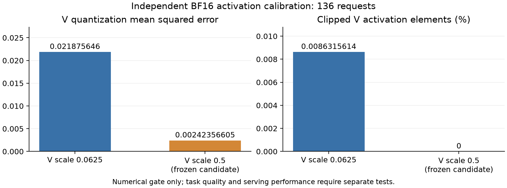

# 2026-11-06 数值校准与实现审查

本轮仍在执行。固定官方261274e5、实际A721afdabc，复用旧A/FP8/NVFP4正式结果；尚未取得MXFP4或优化FP8的新质量、服务成绩。5060Ti/SM120复现已按用户指令取消，没有启动本地GPU实验。

## 数值证据

独立BF16观察源260b5fab，编译C基础da7c6446，H800单卡、原模型/权重/服务机制。136个独立请求为128 ShareGPT、4 GovReport、4 QMSum，输入和数值候选在正式质量答案外冻结。136个HTTP/Tokenizer契约均通过；104个镜像成员SHA及原请求、worker结果、释放证据通过根审计和Sol Max独立24项复核。

| V 配方 | 有效元素观察数 | 裁剪数 / 比例 | MSE | 非零值舍入为零 |
|---|---:|---:|---:|---:|
| 当前 Scale=0.0625 | 8,681,488,384 | 749,348 / 0.008631561396557874% | 0.021875646033588377 | 581,418 |
| 冻结候选 Scale=0.5 | 8,681,488,384 | 0 / 0% | 0.0024235660469954477 | 4,657,459 |

实际V最大149。候选消除了本队列中的裁剪，MSE下降88.92116811876436%，但小值舍入为零增加，质量并未因此自动通过。K最大23、Q最大19.75，当前K=.125和Q=1没有裁剪。计数为排除无效slot后的激活元素观察次数，不代表独立样本数或驻留KV容量。

原始数值证据：`raw/fp8-numeric-0003/SHA_MANIFEST.json`（本地完整证据，不公开输入/原生成）；acceptance SHA `03918e14de502f91a80a94e6a2658d525d1a422e7257240f3de43a89ba2063b8`，result SHA `d225f63eb7240411abf24eb591bbaf120eb2a904c942e225fb8c1558bc6f809a`。可公开重绘数据为 [DATA.json](numeric-figures-a1/DATA.json)，[PNG](numeric-figures-a1/fp8-numerical-gate.png) / [SVG](numeric-figures-a1/fp8-numerical-gate.svg)。

## Strengths

- MXFP4使用真实E2M1、block32、E8M0，不是NVFP4改名。`mxfp4_reference.py`保留RNE/有符号零/E8M0最小Scale语义；`mxfp4_writer.py`的实际GPU位级检查覆盖BF16次正规数、舍入边界、非有限值与无效slot。
- 物理D256每head/token为128字节payload+8字节Scale，即0.53125B/元素；源码没有整缓存BF16 Shadow或逐步全历史解压。私有FlashInfer适配只在片上将block32 Scale映射到原tile加载布局。
- 新MX C++构建ba5eaec0已成功，CPU测试通过，新binary SHA `f5ee7ebf79c377779e145c838fe0880483fe953c60728201d50dca9b2413f734`；这是构建证据，不能替代Attention、模型或服务验收。

## Issues

**Critical — FP8 XQA首次工作区初始化缺失。** `flashinfer_native_kv.py`父类分配的`torch.empty`工作区直接交给XQA；固定FlashInfer `decode.py`明确要求首次清零，其前8MiB是原子CTA完成计数。独立直接算子oracle也曾使用未清零的工作区。修复d9f17a66只在量化XQA构造时清零一次，不增加驻留内存或逐token清零；oracle同步遵守契约。原r0混合对照失败仍保留：12,204/215,040元素不符，最大绝对误差0.451171875，原.001/.001阈值不变。新版本资格待GPU结果，暂不把缺陷修复称为已验证根因。

**Important — Strided Query收益与实际模型路径的差别。** r0六个Query算子结果均逐字节一致；256/8192 token非连续输入的延迟比为0.5889198060/0.4974924982，连续输入比为1.0016393312/1.0009527776。Qwen3.8沿用`qwen3_5/common.py:PartialRotaryEmbedding.forward`末尾`torch.cat`，再reshape进入Attention，源码表明该路径输出连续Query；不能用非连续fixture的收益推断同模型服务提升。该变更可作为通用转换实现整理，最终服务归因重点仍是混合分派和Scale。

**Important — MX冷启动编译不等于运行期低效。** 原H800私有JIT的build.ninja实际包含sm80/sm89/sm90a/sm100a/sm120a，首轮编译较慢。后续独立run拟只读复用已资格通过、源/镜像/SHA一致的.so到各自独立cache，避免重复编译；它不能算作测量窗口内的Attention加速。

**Important — 支持范围仍需如实限制。** MX当前面向SM90、BF16 Q24/KV4、D256、page128、默认分配器。H800执行融合解包后的BF16 Tensor Core计算，没有Blackwell原生FP4算力声明。VMM不支持时明确拒绝；不静默关闭生产特性。正式Prefix/GDN恢复、Graph和容量槽位须等待真实模型资格。

## Recommendations

继续使用原来的有限门槛：先修复版直接FI/混合算子，再源匹配模型与完整冻结质量/三组服务。V=.5只因独立数值门槛通过而进入候选，不根据质量答案调参。质量非劣效标准和所有失败均保留；共享Scheduler/Graph没有借本次补丁修改。

## Assessment

**Ready to merge? No，尚不具备整体生产合入证据。** MX已取得标准格式、Writer与构建证据；FP8已定位一个明确API契约缺陷和数值风险。需要将实际GPU Attention/Graph/模型、冻结质量和服务结果接齐，才能分别给出格式支持级别与合入建议。
