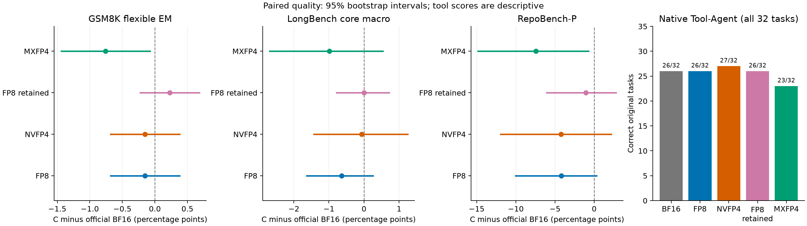
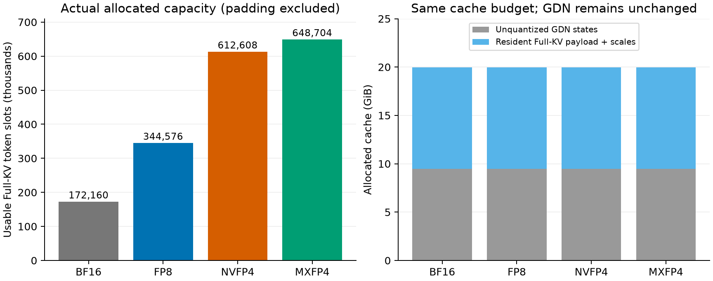
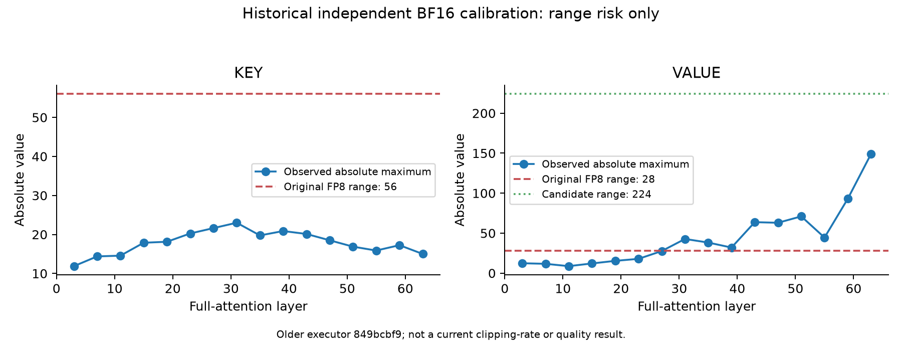
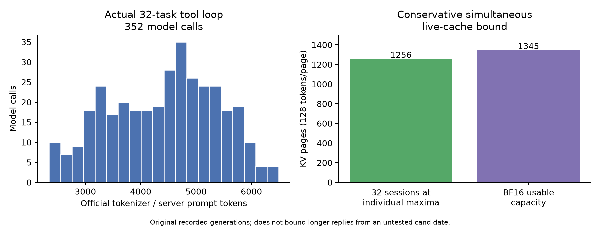

# 历史阶段记录：固定本轮已完成

最终结果、图表与合入建议以 [REPORT.md](REPORT.md) 为准。以下保留每个当时检查点，不代表当前GPU资源或待派发任务。

# 2026-11-06 两套完整质量与工具评分完成（服务对照进行中）

新增两套各 1,720 条核心生成及 32 项真实原生 Tool-Agent 均已完整归档、独立评分；保留全部空 EOS、触顶生成和工具预算耗尽项。没有根据正式答案调整源码或 Scale。

| 固定实现 | GSM8K flexible EM (%) | LongBench Macro | RepoBench-P | Native Tool-Agent |
|---|---:|---:|---:|---:|
| 官方 BF16 A | 96.73995451099317 | 53.898444013479164 | 43.92 | 26/32 |
| 原 FP8 | 96.58832448824867 | 53.264214441734495 | 39.74 | 26/32 |
| 原 NVFP4 | 96.58832448824867 | 53.829656388243365 | 39.68 | 27/32 |
| FP8 retained，V=.5 | 96.96739954510993 | 53.90334247013884 | 42.84 | 26/32 |
| MXFP4 | 95.98180439727066 | 52.91470227877436 | 36.48 | 23/32 |

FP8 保留组合通过预先固定的工程点值门槛，工具逐任务成败与原 FP8 相同。RepoBench-P 相对 A 的配对区间仍为 −6.0605…2.801，不能据点值宣称总体统计非劣效。该组合同时含首次 workspace 初始化修复和 V Scale 配方，正式质量变化不单独归因于某一行改动。MXFP4 未通过 GSM8K、RepoBench-P 和工具门槛，保持研究级。

两套质量归档（220 成员）及工具归档（798 成员）已由主 Agent 逐成员重读核 SHA，gpt-6.1-sol/max 独立复核全部通过。精确八项、额外长文、Strict/Flexible 分数及来源在 `quality-exact-a1/`，完整门槛判断在 `reports/operations/fast-idle-20261106g/FINAL_QUALITY_GATES-a1.json`。

MXFP4 三组正式服务已按原票据完成，正在完整原始数据归档/复算；最后一套 FP8 服务在原 GPU0 串行接续中。其他六张空闲卡没有新增独立待测质量/算子任务；正式 A/原 FP8 对照固定 GPU0，CPU 归档、审计和分析并行推进。

Astra Max 的最终效率复核确认：MX 有每模型步一次的小型 Graph metadata 重复 staging、两次 K/V writer 启动和同步 Scale 展开的适配成本；eager metadata、strided V 接入也可能省去其他复制。pure decode 的 split-KV/mask 保护路径与 NVFP4 不同，不能为追性能关闭正确性保护。未发现整历史拷贝或新增显式全设备同步。未测得各项的因果性能份额，不宣称当前 MX 路径已最优；不重开调优矩阵。

## 较早检查点：MXFP4 完整质量

MXFP4 原 1,720 条全部完成、释放、SETTLED；96 个文件共 53,551,699 字节完整归档并独立复核原始 HTTP/API、Token、输入和官方评分源码。8 条空 EOS 计零，81 条触顶生成保留。

| 固定版本/配方 | GSM8K flexible EM (%) | LongBench 八项 Macro | RepoBench-P |
|---|---:|---:|---:|
| 官方 BF16 A，复用 | 96.73995451099317 | 53.898444013479164 | 43.92 |
| 原 FP8，复用 | 96.58832448824867 | 53.264214441734495 | 39.74 |
| 原 NVFP4，复用 | 96.58832448824867 | 53.829656388243365 | 39.68 |
| MXFP4 ba5，本轮 | 95.98180439727066 | 52.91470227877436 | 36.48 |

相对 A，MX 的 GSM8K −0.7581501137225171 pp（配对 95% CI −1.4404852160727823…−0.0758150113722517），RepoBench-P −7.44 pp（CI −14.821…−0.72）；两者未达到冻结的工程点门槛。Macro −0.9837417347048074 pp，CI −2.691893746908593…0.5402208186266941，不能据点估计宣称统计非劣效。RepoBench-P 是代码相似度，不能称为代码执行成功率。

当前建议仍为**研究级，不生产合入**。不再用正式答案调整配方；按用户要求继续完整 32 工具及三组服务，记录容量和性能代价。FP8 retained `d163d5de`、V=.5 的同一套 1,720 条正在原 `g` 票据/GPU0 上生成。MX 工具包已追加 `g/NEXT_STAGES-0001.json`，固定历史 GPU1，等待当前质量释放后串行执行。

精确数据：`MXFP4-quality-a1/summary.json`、`quality-pair-A-MXFP4-a1.json`、`quality-pair-oldFP8-MXFP4-a1.json`、`quality-pair-NVFP4-MXFP4-a1.json`；原始数据 `raw/mxfp4-core-quality-0001/SHA_MANIFEST.json`。136 条校准与 1,720 质量请求的完整输入哈希交集为零，校准没有使用正式标签。

## 较早检查点：模型资格

MXFP4 `ba5eaec0` 和保留版 FP8 `d163d5de` 均已通过真实 Qwen3.8-27B 模型资格：各 16/16 已知答案，跨请求 Prefix 从 0 到 8,192 Token、插入独立请求后答案一致，GDN 恢复通过；各捕获到 6 次实际服务 CUDA Graph API 成功调用。该窗口不代表正式请求的完整 Graph 覆盖，也不代表完整质量通过。MX 使用新 C++ 二进制 `f5ee7ebf…`；FP8 复用原 C 二进制 `74668d5e…`，Python 源码另按 `d163d5de` 固定。

- MX 模型 124 文件、FP8 模型 121 文件已完整 SHA/生命周期审计，均 COMPLETE、GPU 已释放、原账本 SETTLED。原始数据分别在 `raw/mxfp4-qualified-model-0001/` 与 `raw/fp8-retained-model-0001/`。
- 实际 MX 分配器报告 5,069 个物理页、page128、Full-KV 驻留 11,294,867,456 字节、66 个 GDN State 槽；压缩不覆盖 GDN。BF16 影子与全历史 BF16 workspace 均未启用。
- MX 模型首次加载实证复用完整 JIT 缓存：真实 Ninja `no work to do`，随后官方 `build_and_load` 前后 `.so` SHA 均为 `38f2608976830075d64de1819d4966009f2087718c20e429970013bcafa06580`。这避免重编译，不计作服务吞吐收益。
- 原票据 `upstream-fast-20261106f-mxfp4-quality-0001` 正在 GPU0 生成冻结 1,720 条；10:20:05Z 为 1,354 条 durable、0 contract failures，尚未评分。FP8 的同源 V=.5 完整质量包已冻结，等待 MX 释放后串行运行。为明确保持模型资格及历史 A 的同一物理 GPU，新 `g` 队列固定 GPU0；旧 `f/003` 未消费且保留，旧本地协调进程退出未停止 MX 原作业。新队列遇任何活动/UNKNOWN 账本均禁止新派发。
- 不追加 Attention Kernel、Scale 或 Shape 搜索。旧 mixed 拆分超过预先固定性能门槛，继续拒绝；正式服务测量后才判断是否值得独立改公共 Scheduler/Graph，并为公共改动安排最小 BF16 回归。
- 5 秒资源观察、1 秒冲突守护及一次性派发保持有效，Controller 全部模块 SHA 冻结。主 Agent 持续接管；gpt-6.1-sol/max 只读监督至 15:00Z。5060Ti/SM120 取消仍有效。
- Astra Max 最终独立审查确认真 OCP 编码、E8M0 标度不经过 FP16、片上反量化与同步无当前支持范围内阻断缺陷；算子与模型 217 文件独立核验。Writer 极值通过不等于完整 Attention 极值资格；支持限于固定 SM90/BF16/Q24/KV4/D256/page128/paged 路径。

实际可用 Full-KV 槽位：BF16 172,160、FP8 344,576、NVFP4 612,608、MXFP4 648,704。各格式使用相近的固定缓存显存预算，GDN 预留均为 10,160,308,224 字节。这不是单请求上下文上限、实际同时驻留量或吞吐倍数。

精确模型、原始结果和源码身份见 `reports/operations/fast-idle-20261106f/MODEL_QUALIFICATIONS_CHECKPOINT-a1.json`。A/原 FP8/NVFP4 复用；新 1,720/32/三服务及配对图表仍未完成，不能提前提升生产支持级别。

## 较早检查点：2026-11-06 09:15 UTC

- 核心代码/算法取舍已交给用户指定的 gpt-6-astra / max；GPU监督仍为gpt-6.1-sol / max。5060Ti/SM120实验取消，无本地GPU作业。
- 独立136请求校准与104文件/24项独立审计通过；V=.5 MSE下降88.9211681%，舍零增加，未据此宣称质量通过。[图表与精确数据](NUMERIC_AND_CODE_REVIEW_20261106.md)。
- 修复后FP8 d9直接FlashInfer对照最大误差0；query6通过。Mixed性能三case比值1.2223488814140813/.3866250406271028/.7877233187379983，geomean .7193710450860855；小case超过冻结1.15上限，整个mixed方向被剔除，不挑正数或改阈值。
- Astra隔离最终候选d163d5de移除mixed分拆，恢复原整批FA3，puredecode保持XQA，保留一次workspace初始化和已登记Query实现。四项host测试/18子场景通过；源码已推用户独立分支。新的受影响算子资格尚待实机；不重新跑未变的query六fixture，按source SHA复用其成功组件。
- MX默认多架构首次JIT在原2400秒限额超时，Writer通过但未进入Attention；原FAILED/释放/SETTLED及日志保留。同源同镜像GPU不可见CPU构建e已成功编译并load SM90a模块：7,335,592B / SHA5cb6d72680f71f2912718f0c1c138d510e59e5ab05f3c8c00f951c99382cb2e8。只编译/加载，未当GPU资格。
- 当前d队列每5秒只读观察并按原Controller准入：先复用CPU模块做MXGPU资格，再做FP8隔离候选资格。所有新GPU作业仍launch_guarded_once、1秒冲突监护、UNKNOWN先对账；主Agent持续接管，20分钟常规复核，变化即时处理。
- 本轮1720质量、32工具、三服务正式成绩尚未完成。A/旧FP8/NVFP4继续复用，不rebase，不反序复验，不扩展kernel/scale/shape搜索。代码和CPU证据不替代真实模型/Graph/质量/服务。

以下保留较早阶段记录，不能作为当前资源状态或重新派发依据。

# MXFP4 与 FP8 优化：阶段记录

截至：2026-11-06 06:30 UTC。**本阶段受共享资源阻塞，任务尚未完成；下表不能作为生产验收结果。**

沿用官方 `261274e5`、实际 BF16 A `721afdabc` 和历史量化实测 `da7c6446`，未升级运行依赖，未重跑既有 A。完整历史结果见[上一轮报告](../upstream-production-kv-20261102/REPORT.md)。

| 工作 | 已有证据 | 尚缺证据 |
|---|---|---|
| OCP MXFP4 | E2M1/block32/E8M0 CPU reference；5 项位级测试；早期 SM90 Writer 与 CPU 字节一致；私有 Attention 模块 SM90a 离线编译成功 | 新 Writer 边界值实机检查；Paged Prefill/Decode/Graph；新 C++ 构建；模型与服务资格；完整质量/性能 |
| FP8 Query | 合并非连续 Query 的读取和 FP8 转换，取消前置 BF16 连续副本 | 与原算子逐字节一致性、实际延迟、服务结果 |
| FP8 混合批次 | Decode 行拆给 XQA，Prefill 行保留 FA3；3 项 CPU 元数据测试 | GPU 算子门槛、临时内存、端到端收益；混合批次仍不宣称模型 Decode Graph 覆盖 |
| FP8 数值范围 | 独立 BF16 诊断实现与 CPU 检查；固定原 136 条独立校准输入及 K=.125/V=.5/Q=1 候选 | 当前执行路径真实截断率、误差；正式质量非劣效性 |
| 资源 | 第一次 MXFP4 作业遇他人占用后停止我方容器；第二次等待超时、未分配 GPU | 全 8 张 H800 目前被其他作业占用；新 C++ 构建所需 CPU 空闲门槛也未满足 |

## 格式与路径

MXFP4 使用[OCP MX v1.0](https://www.opencompute.org/documents/ocp-microscaling-formats-mx-v1-0-spec-final-pdf)的 E2M1 元素和每 32 元素一个 E8M0 Scale，未将 NVFP4 的 block16/E4M3 路径改名。D256 每个 KV Head 的物理 Token 槽为 128 字节数据加 8 字节 Scale，即 0.53125 字节/元素；Full-KV 理论压缩比为 3.764705882352941。**模型分配器实际可用 Token 数尚未测得。GDN 状态不量化。**

Attention 适配复用已安装 FlashInfer 的 FA2 Paged 加载器、规划器和 BF16 计算，仅将 block32/E8M0 Scale 在片上展开到加载器需要的位置；不创建全历史 BF16 KV 或全局展开 Scale。目标限定 SM90、BF16 Query、Q24/KV4、D256、page128；Elastic VMM 当前显式拒绝。正常生产默认分配器、Chunked Prefill、Prefix Cache 和 GDN 管理未被关闭；兼容性需要模型资格实测。

私有模块由本地 CUDA 13.2.86 编译，SO 为 7,025,360 字节，SHA256 `9508ae4716801261f3c77352738b33edb683d692a542aa50f7a6bceba80ab6dc`。本地 Torch 2.13/cu132 下 CPU 加载并查询到 4 个导出，CUDA 未初始化；H800 仍为 Torch 2.10/cu130、NVCC 13.0.88。本地编译和加载不替代 H800 的 ABI、运行及性能检查，H800 依赖没有升级。

## 数值风险与冻结判据

该图来自独立的历史 BF16 校准，不是当前路径截断率。历史 V 最大值 149，当前 V=.0625 对应 E4M3 恢复范围 28；54/128 个 V Head/Phase 观测的最大值超过 28。原始观测没有保存逐元素截断率，因此不能从这些最大值推导质量损失。

已冻结同一批 136 条独立校准：128 ShareGPT、4 GovReport、4 QMSum；不使用正式 GSM8K/LongBench 正确答案。只有候选 V=.5 实际减少截断、且平方误差不高于当前配方，才进入正式质量判断。质量门槛与有限算子候选见 `reports/operations/mxfp4-fp8-20261105a/FROZEN_SCOPE-a1.json` 和 `FP8_COMPONENT_GATES-a1.json`；失败结果保留，不反向调参。

## Agentic 预筛选

原 32 项工具任务包含 352 次真实 BF16 模型调用，全部官方 CPU Token 计数与服务器 usage 相符。Prompt 中位数 4,561.5、最大值 6,492 Token，录制输出最大值 459。按每项任务自身历史峰值同时驻留计，需求为 158,967 Token、向上取整 1,256 页；BF16 有效容量为 1,345 页。该固定轨迹未显示必须通过 KV 压缩才能释放的容量，跳过其额外 GPU 压测。该界限仅覆盖已录制输出，不保证新候选会产生同样长度。

已核对实际 AIPerf 0.13.0 的 Agentic Code CLI。固定种子生成的 32 个合成 Session 共 74 次调用，18 个为单轮；默认大段共享 Prefix 与 65K 输入上限形成的分布不能代表真实编码 Agent。生成器名义 Token 数不冒充 Qwen Token 数，也不据此宣传 Prefix 收益。不扩展此合成矩阵。

## 交付状态与数据地址

代码已按 `mingasa` 身份提交用户 fork 的独立分支：

- [MXFP4](https://github.com/MingASA/xllm_quant_kvcache/tree/research/ocp-mxfp4-kv-20261105)：布局、配置、Writer、私有 FlashInfer 适配及实验性入口。
- [FP8 优化](https://github.com/MingASA/xllm_quant_kvcache/tree/research/fp8-service-opt-20261105)：Query 转换与混合 Attention 分派。
- [独立数值诊断](https://github.com/MingASA/xllm_quant_kvcache/tree/research/fp8-numerical-diagnostics-20261105)：仅供未计时的 BF16 校准，未合入性能分支。

本地原始记录位于 `reports/operations/mxfp4-fp8-20261105a/`；CPU 图表及精确 CSV 在 `cpu-figures-b1/`。`MXFP4_CONFLICT_RELEASE-a1.json` 保留首轮冲突释放证明；`MXFP4_OPERATOR_RECONCILE-r1-f1.json` 保留未启动终态；`local-sm90-compile-b1/` 保存原编译源码、日志和产物 SHA；`writer-sm90-compile-b1/` 保存次正规数修复的 PTX/Cubin 与 SHA。私有机器票据和原始服务文本不随此阶段摘要公开。

**当前合入意见：三个新分支均保持研究级，暂不作为生产支持合入。** MXFP4 尚未完成 Attention/模型/完整 Benchmark 验收；FP8 尚无新版本质量和服务收益证据。1720 核心生成、32 项工具及三组服务矩阵仍是未完成交付，原 BF16/FP8/NVFP4 成绩只作冻结对照，不填充新候选成绩。

## 本阶段资源结账

最终只读快照仍显示 8 卡各占用 47,307–49,225 MiB（约 46.2–48.1 GiB），无空闲卡。独立校准的原等待票据在未创建容器、未分配 GPU 时结束；实际资源准入中的 CPU 空闲比例为 10.384896594944641%，低于原 25% 门槛，新 C++ 构建没有启动。一次短暂的 27.091% CPU 观测没有持续到准入，未据此放宽限制。最后 CPU 轮询为 06:24–06:25 UTC、idle=5.436%，最终 GPU 快照没有附加新的 CPU 样本。

105 条账本记录均已 SETTLED，当前预留、活动 GPU 与本地 UNKNOWN 均为零；累计计费 25.766052161944444 GPUh，包含首轮冲突直到释放见证的保守计费。MX r0 远端原始 UNKNOWN 结果 SHA 未改写，由独立释放证书解释；其余两个等待作业均为 NOT_LAUNCHED。两个等待作业已分别镜像 71/78 个文件。只读监控已退出，没有留待无人接管的启动脚本。

最终 GPU 快照 SHA256：`0a014df9fe4e7af14889603d752017717542e435f86c82abc9f13142d9bf2352`；本地监控退出回执 SHA256：`2b90fc5c27e49bbaf6c4250f13723507a3a8c7322337b5785cc8b3ca4ff5d89f`。原始地址在 `reports/operations/mxfp4-fp8-20261105a/FP8-independent-calibration-resource-watch-luna-a1/`，资源结账见同目录上级的 `RESOURCE_WAIT_CHECKPOINT-a1.json`。

因此，MXFP4 的完整 1720/32/三服务及优化后 FP8 的正式质量与服务比较均为**未执行**，不记为零分或负吞吐。原 FP8/NVFP4 只沿用上一轮受限资格及其质量、性能负结果，本轮不提升支持级别。当前明确建议暂缓将 MXFP4 和两项 FP8 性能改动合入生产路径；没有向官方上游提交 PR。
