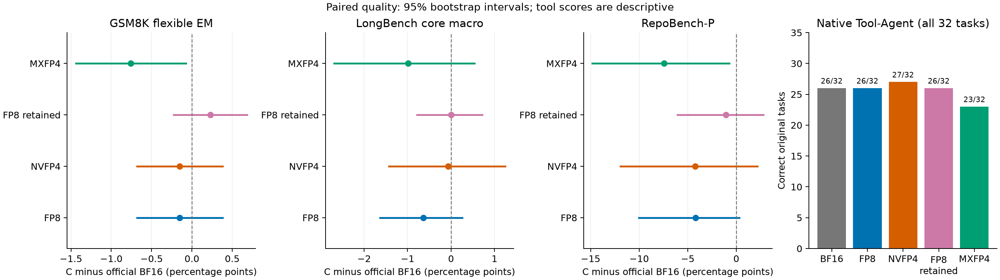
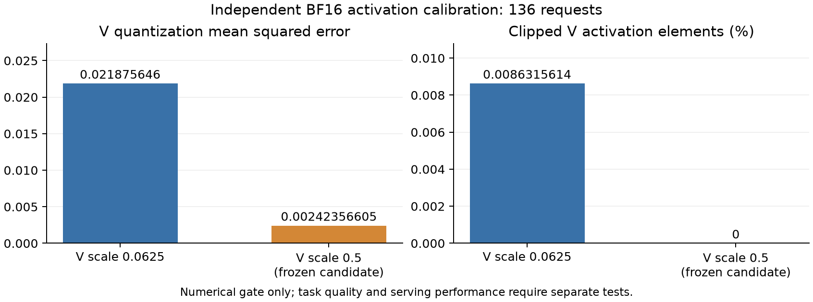
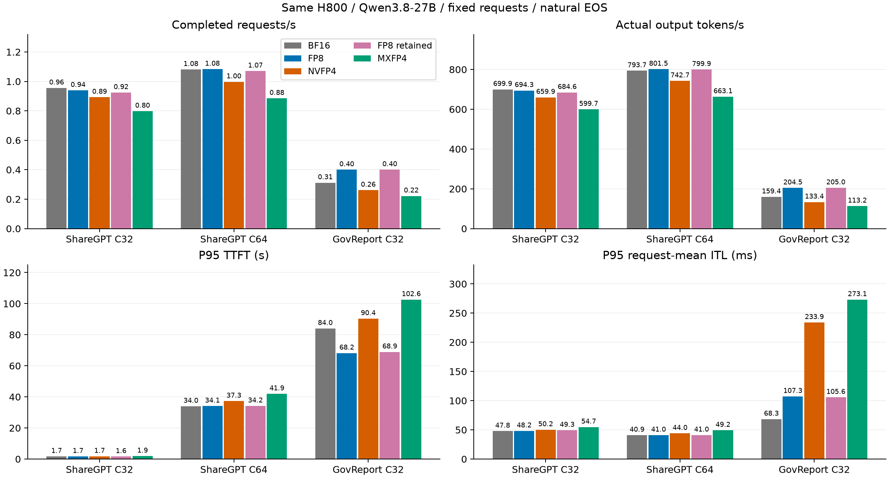
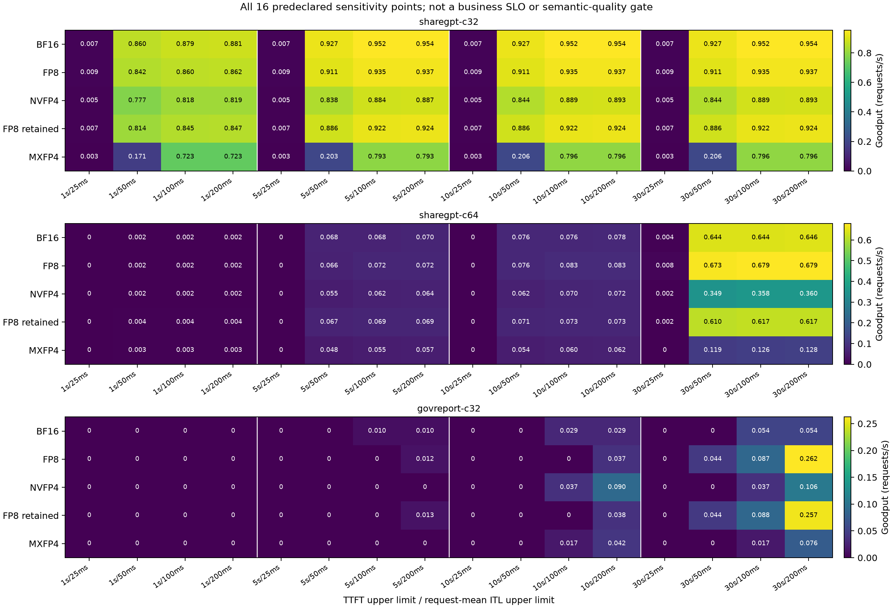
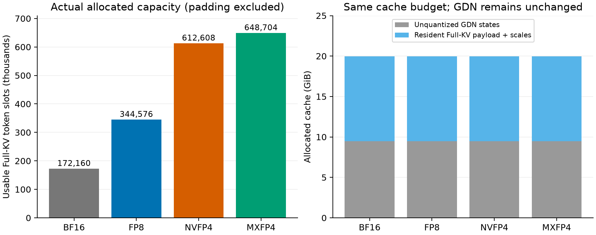

# OCP MXFP4 与质量约束下的 FP8：固定官方 xLLM 的增量评价

2026-11-06。冻结测量已全部完成并释放；新1720×2核心生成、32×2工具任务和三服务×2均通过原始记录独立复核。[上一轮固定 A/FP8/NVFP4 报告](../upstream-production-kv-20261102/REPORT.md)保留不变。

## 主要结果

- MXFP4 已建立真正的 E2M1 / block32 / E8M0 常驻 KV 路径，通过 CPU 位级、H800 算子、模型、Page Copy、Prefix/GDN 恢复及实际 Graph 调用资格。完整质量未通过预先固定门槛，不能作为生产支持推荐合入。
- FP8 最终组合保留一次 XQA workspace 初始化修复、逐字节一致的 Query 转换与独立校准得到的 V Scale=.5；丢弃超过冻结算子门槛的 mixed batch 分拆。新组合通过全部工程质量点值门槛，RepoBench-P 相对 BF16 的置信区间仍不足以证明统计非劣效；相对原 FP8 三服务吞吐−1.40%/−.19%/+.26%，没有确认新的服务加速。
- 两种新候选均使用冻结的完整 1,720 条核心生成、32 项真实多轮工具任务及三组原服务请求，不根据正式答案修改配方。不反序复验，不重跑部署未变的 A/原 FP8/NVFP4。
- 压缩只作用于 16 层 Full Attention KV。48 层 GDN 状态仍占固定 10,160,308,224 字节；Full-KV 槽位倍数不能替代实测吞吐。

## 实验设置与源码

单卡 H800/SM90，固定同一物理 GPU0；Qwen3.8-27B 原只读权重、官方 Python Executor/Tokenizer。max batch=32、batch tokens=8192、page=128、显存利用率上限=.90；CUDA Graph、Chunked Prefill、Prefix Cache 和原 GDN 管理保持开启。客户端 C64 不表示 GPU 同时运行 64 条请求。质量/工具任务使用各自先前冻结的相同服务设置和物理卡，不能与服务压力测试配置混称。

| 路径 | 实测 Python 源码 | 编译源码 | 执行路径 |
|---|---|---|---|
| 官方 BF16 A，复用 | `721afdabc` | 同左 | 官方 FlashInfer/BF16；含独立 CUDA 平台构建 guard |
| 原 FP8 / NVFP4，复用 | `da7c6446` | 同左 | FP8 FA3/XQA；NVFP4 原生 FA2 |
| FP8 retained | `d163d5de` | `da7c6446` | FA3 FP8-Q Prefill、XQA Decode，K=.125/V=.5 |
| MXFP4 | `ba5eaec0` | 同左 | 私有 FlashInfer FA2 MX 页加载适配，BF16 Q |

共同官方 base 为 `261274e5f45449e98d7740144c3a958a29f1fd3e`。没有 rebase、整体 merge 旧分支或升级运行依赖：Torch 2.10/cu130、FlashInfer 0.6.18.post1、Triton 3.6；AIPerf 0.13 使用既有独立环境。交付文档提交与实测源码分开记录，见 `SOURCE_PROVENANCE.json`。没有改公共 Scheduler/Graph/Prefix Cache，因而不新增 B 的独立性能矩阵。旧 FA3+XQA BF16 D 仅作历史记录，不计算跨版本加速比。

正式服务固定 ShareGPT 512 条（独立 warmup 16），C32/C64、自然 EOS、原 cap1024；GovReport 64 条（独立 warmup4），C32、自然 EOS、原 cap512。ShareGPT 经该模型 Tokenizer 重算 prompt 均值 1143.37109375、最大3229；GovReport 均值12596.140625、最大19481。模型 context262144。完整测量区间和所有原请求进入分母，空答案、触顶输出和失败不删除。

## 完整质量与数值风险

| 格式/配方 | GSM8K flexible EM %，1319题 | LongBench Macro，8×50题 | RepoBench-P | 工具任务，32项 |
|---|---:|---:|---:|---:|
| 官方 BF16 A | 96.73995451099317 | 53.898444013479164 | 43.92 | 26/32 |
| 原 FP8，V=.0625 | 96.58832448824867 | 53.264214441734495 | 39.74 | 26/32 |
| 原 NVFP4 | 96.58832448824867 | 53.829656388243365 | 39.68 | 27/32 |
| FP8 retained，V=.5 | 96.96739954510993 | 53.90334247013884 | 42.84 | 26/32 |
| MXFP4 | 95.98180439727066 | 52.91470227877436 | 36.48 | 23/32 |

额外一条独立长文保持原输入，五条路径分数均为50；它不进入八项 Macro，N=1 仅描述。完整 Strict/Flexible、八项、触顶数及精确来源在 [65 行质量 CSV](quality-exact-a1/all_quality_metrics.csv)。RepoBench-P 是原代码相似度评分，不是执行成功率。工具分数来自实际模型多轮调用、受限内存工具执行和独立状态/响应复核，不代表 BFCL 排行榜成绩。

[查看新答案前固定的工程门槛](FROZEN_SCOPE.json)为相对 A 与原 FP8：GSM8K 最多下降.5pp、Macro 1pp、Repo2pp、工具最多少1项，原始 API 契约失败为0。这些是研究工程门槛，不是用户业务 SLO。配对95%区间复用原方法：4000次 bootstrap、seed20261027；GSM按配对题、LongBench按各任务完整同 context 题簇重采样，八项等权。FP8 retained 全部点值通过，工具逐项成败与原 FP8 相同；相对 A 的 Repo 差为−1.08pp，配对95% CI [−6.0605,2.801]，总体统计非劣效仍未确立。相对原 FP8，Repo +3.10pp，CI [.22,7.2815]。不能将组合质量变化单独归因于 V Scale，没有进行正式答案驱动的消融或调参。

MXFP4 相对 A：GSM −.7581501137225171pp，CI [−1.4404852160727823,−.0758150113722517]；Repo −7.44pp，CI [−14.821,−.72]。GSM/Repo/工具门槛未通过。Macro −.9837417347048074pp，CI [−2.691893746908593,.5402208186266941]。保留8条空 EOS、81条触顶核心生成及2项工具预算耗尽；FP8 分别为6、85和1。两者1720条原始 API 契约失败均为0，预算耗尽仍计入工具分母。

独立136请求校准观察8,681,488,384个有效 V 元素，最大149。原 V=.0625 恢复范围±28，裁剪749,348个（.008631561396557874%），MSE .021875646033588377；V=.5 恢复范围±224，观察裁剪0，MSE .0024235660469954477（下降88.92116811876436%），非零值舍为零从581,418增至4,657,459。该统计来自 BF16 轨迹，不保证量化后的所有正式轨迹无裁剪。校准136与正式1720完整输入 SHA 交集为0，不是语义/子串无重叠证明；没有使用正式正确答案反调 Scale。

## 服务吞吐、延迟与 Goodput

本轮 FP8 retained 没有新增可确认的端到端吞吐收益；MXFP4三项被测服务结果均为负向。GovReport相对A的FP8优势延续自原FP8容量路径，同时存在较差的请求平均ITL分位。

五条路径使用同一H800 GPU UUID、Qwen3.8-27B、官方base、镜像、冻结输入与服务预算（page128、max batch32、8192 tokens/batch、显存比例0.9）。ShareGPT C32/C64各512条正式响应、外置预热16条；GovReport C32为64条正式响应、外置预热4条。每个压力点使用新 server；15个正式窗口协议成功率均为100%，核心质量与工具成败另行评分。原FP8的V scale=0.0625，本轮=0.5，K scale均0.125，因此比较整条冻结路径，不能将差异单独归因query融合。

[服务图SVG](service-figures-a1/service.svg) · [完整15行精确CSV](service-exact-a1/service_all15_exact.csv) · [数据provenance](service-exact-a1/provenance.json)

表格只做显示舍入，CSV保留原float精度。RPS/TPS均来自完整正式窗口，外置预热不计入。ITL P50/P95/P99是每请求平均interval跨请求的分位，非逐token间隔的尾分布。

| 路径 | 场景 | RPS | tokens/s | 平均输出tokens | 窗口s | P95 TTFT(s) | P95请求平均ITL(ms) | P95 E2E(s) |
|---|---|---:|---:|---:|---:|---:|---:|---:|
| A BF16 | ShareGPT C32 | 0.955407 | 699.865 | 732.531 | 535.897 | 1.705 | 47.791 | 46.923 |
| A BF16 | ShareGPT C64 | 1.081007 | 793.692 | 734.215 | 473.632 | 33.962 | 40.874 | 72.579 |
| A BF16 | GovReport C32 | 0.311813 | 159.351 | 511.047 | 205.251 | 84.030 | 68.330 | 115.538 |
| 原 FP8 | ShareGPT C32 | 0.939001 | 694.296 | 739.398 | 545.260 | 1.681 | 48.167 | 47.726 |
| 原 FP8 | ShareGPT C64 | 1.083115 | 801.475 | 739.973 | 472.711 | 34.077 | 40.965 | 72.100 |
| 原 FP8 | GovReport C32 | 0.399904 | 204.451 | 511.250 | 160.038 | 68.188 | 107.304 | 122.130 |
| 原 NVFP4 | ShareGPT C32 | 0.892532 | 659.901 | 739.357 | 573.649 | 1.743 | 50.246 | 50.007 |
| 原 NVFP4 | ShareGPT C64 | 0.997207 | 742.742 | 744.822 | 513.434 | 37.267 | 43.993 | 78.922 |
| 原 NVFP4 | GovReport C32 | 0.261107 | 133.405 | 510.922 | 245.110 | 90.370 | 233.874 | 202.129 |
| 本轮 FP8 retained | ShareGPT C32 | 0.924249 | 684.558 | 740.664 | 553.963 | 1.600 | 49.303 | 47.971 |
| 本轮 FP8 retained | ShareGPT C64 | 1.070344 | 799.917 | 747.346 | 478.351 | 34.165 | 41.015 | 72.389 |
| 本轮 FP8 retained | GovReport C32 | 0.400447 | 204.979 | 511.875 | 159.822 | 68.921 | 105.633 | 122.116 |
| 本轮 MXFP4 | ShareGPT C32 | 0.797921 | 599.692 | 751.568 | 641.667 | 1.887 | 54.748 | 54.549 |
| 本轮 MXFP4 | ShareGPT C64 | 0.884838 | 663.112 | 749.416 | 578.637 | 41.950 | 49.242 | 88.265 |
| 本轮 MXFP4 | GovReport C32 | 0.221604 | 113.229 | 510.953 | 288.803 | 102.601 | 273.101 | 234.405 |

按ShareGPT C32/C64/GovReport C32顺序，新FP8相对A的TPS变化为-2.187%/+0.784%/+28.633%，RPS变化为-3.261%/-0.986%/+28.425%；相对原FP8的TPS变化为-1.403%/-0.194%/+0.258%，RPS变化为-1.571%/-1.179%/+0.136%。本轮没有新增可确认吞吐收益。每case只有一次完成窗口，缺少重复样本、置信区间或显著性检验，不能将微小差异宣称为显著收益。

GovReport新FP8相对A的TPS为+28.63338873007899%，但P95请求平均ITL为105.63278218982386ms，A为68.3295669892368ms。旧FP8与新FP8均为2693个物理Full-KV页，A为1346；Gov采样Running最大分别为A13/旧FP824/新FP824，符合既有容量优势延续，而非本轮新增容量或优化收益。

MXFP4的TPS相对A为-14.313%/-16.452%/-28.943%，三项均下降；P95请求平均ITL为54.74792666556696/49.242452749099094/273.10149378767125ms，均高于相应A。MXFP4有5069个物理Full-KV页、Gov采样Running最大32，更多容量没有在当前冻结路径中转成服务吞吐收益。上述Running最大值均仅来自约1秒顺序采样，可漏瞬时峰值；CSV保留Running/Waiting/UsedBlocks的min/mean/max，不能把采样值当作硬容量上限或连续峰值。

保留自然EOS及既定输出上限（ShareGPT1024、GovReport512），并未固定生成长度。新FP8三项实际输出均值为740.6640625/747.345703125/511.875 tokens，总输出为379220/382641/32760 tokens；length/stop计数为237/275、241/271、62/2。各路径输出长度、停止方式及完成窗口不同，必须把RPS、TPS、实际输出量与均值一起看，不能只凭output TPS推断内核速度。

15个正式窗口的真实prefix_hit_tokens_delta及cross-request hit fraction均为0，空或纯空白答案均为0；prefix prompt admission delta与成功prompt token总数匹配。缓存块数或请求局部cached-token字段不能当作真实跨请求prefix命中。gauge按冻结collector/SHA核验，原HTML未保留；1秒采样可漏峰，Prefix块、活动使用与GDN checkpoint可能重叠，不能相加。

[Goodput SVG](service-figures-a1/goodput.svg) · [原helper 240点精确CSV](service-figures-a1/goodput_all16.csv) · [原helper服务CSV](service-figures-a1/service.csv)

Goodput为每case相同的预声明16点：TTFT上限1/5/10/30秒 × 请求平均ITL上限25/50/100/200ms，合计240点。原helper按非空响应与延迟门槛计数、保留全部原分母，单token interval按原边界处理。这是敏感性分析，不是业务SLO或语义质量；同case跨路径共享色阶，跨case色阶分别标注。本轮完整质量另见前表；正式Graph全请求覆盖未证实，Goodput本身不构成生产接受。

## 格式、算子与容量

| 格式 | 每个 D256 K/V head Token 字节 | 物理页数 | 可用 Full-KV Token 槽 | 实际 Full-KV 字节 |
|---|---:|---:|---:|---:|
| BF16 | 512 | 1346 | 172160 | 11291066368 |
| FP8（两个配方相同） | 256 | 2693 | 344576 | 11295260672 |
| NVFP4 | 144 | 4787 | 612608 | 11293949952 |
| MXFP4 | 136 | 5069 | 648704 | 11294867456 |

均保留 page0，GDN State 槽均为66。上述为分配容量，不是同时有效驻留量或单请求最大上下文。MXFP4 为128字节 Packed E2M1 +8字节 E8M0，平均.53125B/元素，Full-KV 理论比64/17≈3.7647。NVFP4 的 block16/E4M3 为.5625B/元素，不与 MXFP4 混称。

按 [OCP MX v1.0](https://www.opencompute.org/documents/ocp-microscaling-formats-mx-v1-0-spec-final-pdf)实现 E2M1/block32/E8M0、RNE、带符号零及明确的非有限值策略；不是把 NVFP4 或 SGLang `fp4_mx_block16` 改名。已安装 FlashInfer 及所审查项目的权重/MoE MX 支持不等于具备该 SM90/D256 KV 路径。本实现复用 FlashInfer FA2 planner/页加载计算骨架，在片上将 E8M0 Scale 展开并解包到 BF16 fragments，随后 BF16 Tensor Core MMA/FP32累加。无整缓存 BF16 Shadow、全历史全局解压或常驻展开 Scale；H800 没有原生 FP4 Tensor Core 加速声明。

后端研究按2026-11-06 04:47Z的固定快照记录：[FlashInfer cc71fa8](https://github.com/flashinfer-ai/flashinfer/tree/cc71fa8a5458689bb85756bf2b733231eec5810f)、[vLLM e336407](https://github.com/vllm-project/vllm/tree/e336407a3ddb204edf6cfdfdd002cb28b9715438)、[SGLang c843608](https://github.com/sgl-project/sglang/tree/c843608d390ac416791e49e0252d2f17fafdc489)、[TensorRT-LLM 0a96c51](https://github.com/NVIDIA/TensorRT-LLM/tree/0a96c515336c2a2bd2594ace92ad5365ca94c6e4)。检查的是指定形状的 KV Writer/Paged Attention 路径，不从 MX 权重/MoE 宣传推导 KV 支持；研究快照没有进入运行依赖。精确读取文件与 SHA 见 `PRIMARY_SOURCE_INDEX.json`，并不宣称所有后续版本均无对应实现。

MX Writer 实机位级覆盖 BF16 次正规数、最大值、带符号零、舍入边界、NaN/Inf 与负 slot。Attention 对正常有限值解码参考的最大绝对误差 Prefill .008329153060913086、Decode .0020748376846313477，通过原.02/.02门槛；Writer极值通过不等于完整 Attention 极值/非有限值资格。实机还验证 changed-input Writer+Attention Graph 与直接路径、整页 data/scale copy 及真实模型。

效率仍有限制：MX K/V 两次 Triton Writer 启动；Graph 每模型步还有一次小型 metadata staging；Scale 加载/展开和 pure Decode 的 split-KV/mask 路径与原生 NVFP4 不同。固定 FlashInfer 对 uint8 KV 的 `disable_split_kv=True` 是正确性保护，不为追逐吞吐关闭。eager host metadata 和 strided V 接入也可能避免复制。没有测出每项的因果耗时，不能宣称当前适配已达到成熟后端最优性能；也未建立同格式成熟 SM90 MX Attention 的独立性能参考。算子/模型217文件及最终效率审查均由 Astra Max 独立核验。

FP8 workspace `torch.empty` 与 XQA 要求首次清零的契约不符，最终组合仅初始化一次原128MiB workspace，不增加逐 Token 清零或显存预算。修复后直接 FA3/XQA 对照逐值一致。旧 mixed 候选的三 case 延迟比为1.2223488814140813/.3866250406271028/.7877233187379983，因首项超过预定1.15上限整体拒绝；原失败、编译超时及冲突停止记录全部保留。Qwen该路径 RoPE 后 `torch.cat` 产生连续 Query，不能用非连续 microbenchmark 的约2倍收益宣称该模型服务加速。

## 混合批次、Prefix、Graph 与 VMM

公共执行路径保持固定上游行为：混合批次仍走整批 Prefill/FA3（MX 为其 FA2 paged 路径），纯 Decode 才能进入普通 Decode Graph（FP8 Attention 为 XQA）。Attention 内同流拆分不能绕过 GDN/MLP 或长 Prefill，也不能自动建立完整模型混合 Graph 覆盖。诊断队列 mixed 中 Decode 行比例2.31756%不是时间比例或正式服务 Graph 覆盖率，不据此计算理论收益。

模型资格均为16/16已知答案；独立请求介入后重复前缀真实从0到8192 Token，GDN恢复和答案一致；各捕获到6次实际 CUDA Graph API 调用。它证明该窗口执行了 Graph，不证明所有正式请求处于 Graph。正式性能窗口不挂 Graph observer，保留真实运行日志及采样范围。跨请求 Prefix 采用引擎准入 Token 计数器差分，不使用有请求内 self-match 问题的 API `cached_tokens`。

默认 CUDA 分配器未关闭任何原本启用的生产机制。固定官方 base 在 CUDA 入口即拒绝 VMM（NPU专用），先前 BF16 尝试已保留失败；因此不宣称 MX/FP8/NVFP4 获得 Elastic VMM、映射回收或 unmapped page 资格。MX 显式限制为 SM90/BF16 Query/Q24/KV4/D256/page128/paged、K/V全局Scale=1，不支持 ragged、FP16 Q、其他硬件、PD/Offload；不是静默 fallback。

## Agentic 筛选、原始数据与合入意见

只评估一种最接近已有真实工具任务的轨迹。原 BF1632项共352次调用，prompt中位4561.5/最大6492 Token，录制输出最大459；按每任务自身历史峰值同时驻留为158967 Token、1256页，低于 BF16有效1345页。该录制轨迹未显示明显 KV 容量瓶颈；GDN槽/maxbatch也会限制并发，跳过额外 GPU Agentic 压测。界限只适用于录制输出，不保证候选新生成相同长度。AIPerf0.13 Agentic Code 默认合成共享 Prefix 不作为真实 Agent 分布；真实32工具质量循环与未运行的 Trace Replay 性能测试明确区分。5060Ti/SM120复现已取消，没有其他模型/硬件结论。

原始数据位于本报告同级 `raw/*/SHA_MANIFEST.json`，私有可移植封存位于 `results/archive/mxfp4-fp8-20261105/`。原始输入、标签、生成、私有机器票据不公开；公开精确聚合 CSV、PNG/SVG、源码身份和归档 SHA 供对账。完整地址及成员验证见 `EVIDENCE_CATALOG.json`；历史 A/FP8/NVFP4 复用上一轮封存，不复制为本轮新实验。

明确合入建议：

| 部分 | 建议 | 实验证据与边界 |
|---|---|---|
| XQA workspace 首次清零 | 独立提交 API 正确性修复评审 | 一次初始化、原显存预算；直接库/模型/完整质量与服务已验证，旧失败保留，不将其声称为独立性能收益 |
| FP8 V=.5 | 该模型显式校准配方，保持实验支持 | 完整工程质量点值通过、Repo相对A统计非劣效未立；新服务与原FP8基本持平，Gov容量收益附尾延迟代价；不改全局默认 |
| FP8 Query转换 | 可审阅的通用实现候选，暂不以该模型加速名义合入 | 连续Query性能约中性，非连续fixture收益不能外推 |
| Mixed分拆 | 拒绝本候选合入 | 冻结三case中一项超过1.15上限，完整组件淘汰 |
| MXFP4 codec/layout/capability检查 | 可作为标准格式基础独立审阅 | 真E2M1/block32/E8M0及物理驻留已验证 |
| MXFP4私有Attention集成 | 研究级，不生产合入 | GSM/Repo/工具门槛失败，三服务均负收益；后端优越性未建立，受限版本/形状维护成本明确 |
| 原NVFP4 | 保留原有限实验支持级别 | 继承原质量/SM90性能限制，不由MX或已取消SM120计划外推Blackwell收益 |

公共混合调度/Graph 优化未在本轮实现，不归因为量化收益。源码仅推用户 fork 的独立分支，没有向官方 xLLM 创建 PR。用户在本轮结束后另行指定了 SGLang标准MXFP4与vLLM+FlashInfer Hopper NVFP4的只读审计和分项Profiling；该独立任务尚不构成本报告的比较证据。
