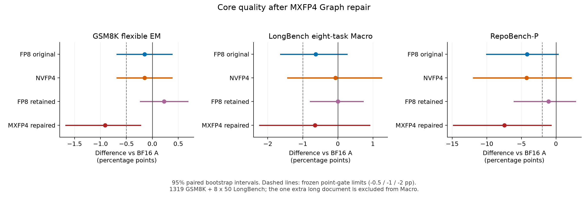
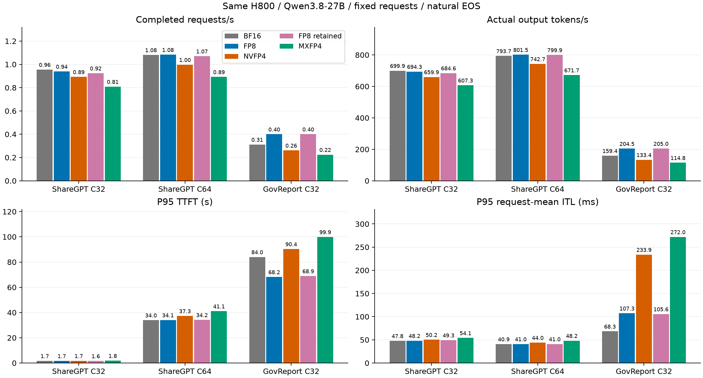
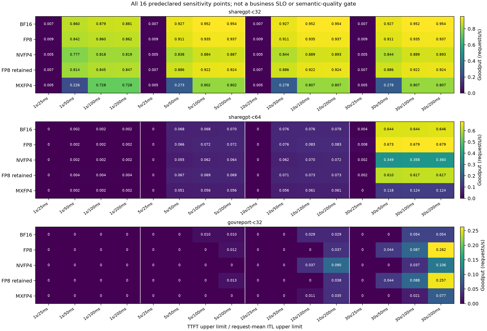
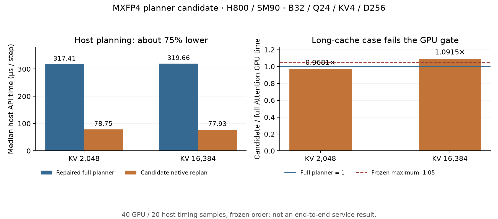

# MXFP4 Graph 修复与有限规划优化

1720条正式质量、32项工具及三场真实服务已完成独立原始数据核验。修复后的MXFP4仍未通过冻结质量门槛，三场输出吞吐相对官方BF16分别下降13.23%、15.37%、27.98%，不能推荐作为生产默认格式。Graph正确性修复与标准压缩格式支持可以独立评审。

已修复固定 FlashInfer 的 non-split Graph 有效任务掩码初始化与绑定。新路径保持 OCP E2M1 / block32 / E8M0、压缩物理页、BF16 Query 和原 uint8 split-KV 保护，未改变公共 Scheduler、Graph 或 Prefix Cache。

## 修复后完整核心质量

| 格式 | GSM8K flexible EM % | LongBench Macro % | RepoBench-P | 工具正确/32 |
|---|---:|---:|---:|---:|
| 官方BF16 A | 96.73995451099317 | 53.898444013479164 | 43.92 | 26 |
| 原FP8，V=.0625 | 96.58832448824867 | 53.264214441734495 | 39.74 | 26 |
| NVFP4 | 96.58832448824867 | 53.829656388243365 | 39.68 | 27 |
| FP8 retained，V=.5 | 96.96739954510993 | 53.90334247013884 | 42.84 | 26 |
| MXFP4，修复后 | 95.83017437452615 | 53.245939605415 | 36.48 | 23 |

[SVG](quality_core.svg) · [精确差值与区间](quality_core_delta_exact.csv) · [绘图来源](quality_core_plot_provenance.json)

[完整1720评分](MXFP4-quality-a1/summary.json)与原始响应、输入、usage及固定评分器均已绑定核验。相对A，GSM8K差为−0.9097801364670205pp，配对95% CI为[−1.6679302501895377, −0.22744503411675512]；RepoBench-P差为−7.44pp，CI为[−14.821, −.72]。两者未通过原定最多下降.5pp/2pp的点值门槛，相对原FP8也未通过。Macro差为−0.6525044080641607pp，在1pp点值门槛内，但CI为[−2.2318148124624955, .9060238761452698]，统计非劣效未确立。未因看到答案修改格式、scale、生成上限或评分规则。

[全部停止原因](QUALITY_STOP_DIAGNOSTICS.json)：82条达到原上限，8条自然停止空答案均计0分（RepoBench-P 7条、LCC 1条）。额外长文得分50%，不进入八项Macro；RepoBench-P是补全相似度，不能解读为代码执行成功率。配对数据：[A](quality-pair-A-MXFP4-a1.json)、[原FP8](quality-pair-originalFP8-MXFP4-a1.json)、[NVFP4](quality-pair-NVFP4-MXFP4-a1.json)。

[工具原始会话独立回放评分](MXFP4-tools-a1/actual_model_audit.json)为23/32（71.875%），原112个用户轮次实际完成109个；1项不完整任务留在分母并判失败，另8项为语义失败。相对A/原FP8各少3项，相对NV少4项，未通过最多下降1项的冻结门槛。客户端并发4、每轮最多10步、每次1024新token、总预算3600秒与原配置相同。该工具检查在GPU0进行，历史工具参考为GPU1，仅比较语义质量；[配对结果](tools-pair-A-MXFP4-a1.json)显式记录不同物理卡，不作工具性能或统计泛化结论。完整精确值见[六格式质量表](quality_exact.csv)与[各任务表](quality_tasks_exact.csv)。

## 真实服务：容量增加，整体吞吐未受益

[SVG](service-figures-a1/service.svg) · [完整审计](MXFP4-service-a1.json) · [A/C配对](service-pair-A-MXFP4-a1.json)

| 修复后MXFP4 | 完成请求/s | 输出token/s | 输出吞吐相对A | P95 TTFT秒 | P95请求平均ITL毫秒 | P95 E2E秒 |
|---|---:|---:|---:|---:|---:|---:|
| ShareGPT C32 | 0.8088169195589947 | 607.2856506218478 | −13.22822048022075% | 1.83245 | 54.10105 | 54.08846 |
| ShareGPT C64 | 0.8922087465185584 | 671.7286304159918 | −15.36654313791279% | 41.09401 | 48.16785 | 87.00357 |
| GovReport C32 | 0.22441441836409554 | 114.7634296662263 | −27.98072182726427% | 99.92809 | 272.01321 | 229.48174 |

原512/512/64条测量请求全部完成，另有16/16/4条独立warmup，测量答案无空白。完成吞吐按首请求至末请求的真实窗口计算，原输入、自然EOS、输出上限均保持；不是固定输出长度的纯kernel比较。P50/P95/P99、实际token数、显存和全部格式的精确值见[精确服务表](service_exact.csv)。ITL分位数是各请求平均ITL的分布，不是单token间隔尾部。

| 采样机制证据 | BF16 A | 修复后MXFP4 |
|---|---:|---:|
| ShareGPT C32最大Running / 最大有效KV页 | 32 / 505 | 32 / 518 |
| ShareGPT C64最大Running / 平均Waiting | 32 / 28.818181818181817 | 32 / 28.839441535776615 |
| GovReport最大Running / 平均Running | 13 / 10.492682926829268 | 32 / 25.86013986013986 |
| GovReport平均Waiting / 最大有效KV页 | 16.190243902439025 / 1247 | 5.426573426573427 / 3420 |

ShareGPT的batch32限制先于KV容量，扩大槽位没有增加实际并发；GovReport确实从最多13条驻留提高到32条，但融合Attention的计算成本抵消了容量收益，P95请求平均ITL为A的3.98倍、P95 E2E为1.99倍。MX三场显存采样峰值依次75287/75287/75281 MiB，正常使用既定显存预算。三场真实跨请求Prefix Hit均为0；Prefix驻留与活动页/GDN检查点可能重叠，不能将缓存页计数相加当作额外物理容量。1秒采样可能漏峰值，原HTML未留存，指标绑定冻结采集器与文件SHA。

[SVG](service-figures-a1/goodput.svg) · [全部阈值精确数据](goodput_all16_exact.csv)。ShareGPT没有任何阈值下的MX优势；GovReport在10秒TTFT/200毫秒平均ITL与30秒/200毫秒两个点分别为0.035064752869389926、0.07714245631265784请求/s，高于A的0.029232455261347188、0.05359283464580318。其余点与更严格ITL限制仍不支持普遍收益。这是完整敏感性分析中的局部结果，不是预定业务SLO通过，也不能抵消语义质量失败。

## 有限规划优化

规划优化按预先固定规则淘汰：两种 Decode 形状的 host API 时间下降约 75%，但 B32/KV16384 的 Attention Graph CUDA-event 时间增加 9.15139517972632%，超过 5% 上限。不反序复验，不追加调参。正式版本 `e10830c9` 使用完整 planner，保留 Graph 修复。

[SVG](components.svg) · [精确 CSV](components_exact.csv) · [精确数据与源码身份](components_exact.json)

| B / KV长度 / Query长度 | 路径 | host API μs/步 | Attention Graph CUDA-event μs/调用 | CUPTI kernel-active μs/调用 |
|---|---|---:|---:|---:|
| 1 / 8192 / 8192 | 完整 planner | 130.88549999999998 | 51795.24841308594 | 51746.412 |
| 32 / 2048 / 1 | 完整 planner | 317.40999999999997 | 318.1567907333374 | 312.97860000000003 |
| 32 / 2048 / 1 | 优化候选 | 78.7535 | 308.00960063934326 | 305.4434 |
| 32 / 16384 / 1 | 完整 planner | 319.6585 | 2238.8192176818848 | 2242.5892 |
| 32 / 16384 / 1 | 优化候选 | 77.92699999999999 | 2443.7024116516113 | 2445.3599999999997 |

这里的 host 规划发生于模型步，Attention 时间是单次算子调用，不能直接相加作为模型步延迟。正式服务收益仍须端到端测量。两个 Decode 路径的 kernel 名称、launch grid/block、寄存器和共享内存参数一致；现有证据不能把观测到的 GPU 时间差确定归因于特定 kernel 改动，也不据此重新筛选结果。

小规模检查 25 组比较的最大 reference 绝对误差为 0.007230281829833984；主测量 17 组为 0.0027425289154052734，均通过原始 atol/rtol=.02。Reference使用独立解码后的量化KV进行dense Attention，验证后端计算正确性；量化相对原BF16的质量损失由模型评测单独衡量。Graph/direct 和相同输入下 full/fast 输出逐值一致。检查覆盖脏 workspace、有效/填充任务、动态长度、物理页替换、整页数据与 scale 复制、inactive rows。上述结果证明已测算子数值，不替代模型质量或正式请求的 Graph 覆盖证明。

8192-token Prefill实际计算全部query，独立dense reference覆盖预先固定的16个query行；Decode reference覆盖该batch的全部单query行。这一采样范围与完整1720条模型质量分别报告。

正式评估继续沿用官方 base `261274e5`、BF16 A `721afdabc`、原 H800 和 Qwen3.8-27B 权重、Torch 2.10/cu130、FlashInfer 0.6.18.post1。复用不变的 A/FP8/NVFP4 数据。旧 MXFP4 的 Graph 缺陷构成混杂因素，旧质量退化不能全部归因为 MXFP4 数值格式；修复后本实现/配置仍未达到冻结质量门槛。

Graph 掩码修复应独立评审；本次直接 replan 性能候选不推荐合入。MXFP4当前仅推荐实验性格式/后端支持，生产默认合入不通过质量门槛。FP8/NVFP4 的已有支持级别和限制沿用[上一轮报告](../mxfp4-fp8-20261105/REPORT.md)，本轮没有新的已验证FP8收益。

## 固定设置与支持边界

核心质量与服务沿用同一张 H800/SM90、Q24/KV4/D256、page128、max batch32、batch tokens8192、显存上限0.90。原1720条由GSM8K 1319、LongBench八项各50、额外长文1条组成；额外长文不计入Macro。工具保持原32项、112个用户轮次和全部步骤预算；历史工具卡GPU1长期被他人占用，本次在生成开始前显式改用已完成核心质量验证的GPU0，属于跨物理卡的语义质量比较，不提供工具性能对比。ShareGPT每档16条独立warmup与512条测量、自然EOS/上限1024；GovReport为4/64、上限512。客户端C64不等于GPU同时驻留64条请求。所有精确值从完整原始响应及冻结评分器导出，保留空答案、原始上限和全部16点Goodput阈值。

MXFP4常驻页确为E2M1/block32/E8M0：D256每head每token为128字节payload加8字节scale，即0.53125字节/元素。实际分配5069页，排除保留页0后为648704个Full-KV槽位，驻留11294867456字节；同预算BF16为172160个可用槽位。这不是整模型显存或吞吐的3.76倍，GDN状态和batch上限仍独立约束并发。Writer使用Triton，Attention融合片内解包后使用BF16计算；H800没有原生FP4 Tensor Core，未维护整缓存BF16 shadow，也没有全历史BF16解压workspace。

修复后实际模型检查通过16个已知答案、3个GPU cache/context检查、8192个跨请求Prefix复用token及相同GDN恢复答案；单独观察窗口有6次成功的Graph API调用、0次失败。正式服务保持正常Graph、Chunked Prefill与Prefix机制；混合batch仍整体走Prefill，不能据捕获或这6次调用宣称所有正式请求都有Graph覆盖。固定官方CUDA源码本身拒绝VMM，当前仍使用普通驻留分配器，没有GPU VMM映射/回收资格。编译主程序、Python overlay和动态JIT分别列在[源码及模型证据](SOURCE_PROVENANCE.json)。

## 复用的后端审计与Agentic结论

[三后端只读审计](../q4-backend-readonly-20261106/REPORT.md)保留2026-11-06封存源码与全部失败：SGLang三PR的标准MX部分属于D512混合latent布局，不能原样支持本目标；Hopper NVFP4可借鉴native Decode分区与merge，而非假设XQA必定适用。当前MX路径中Writer仅占已测Writer+Attention GPU-active proxy的约0.15%–1.35%；主体为融合Attention。Scale/Unpack没有独立可识别的时间占比，不能用MX减NV或寄存器数伪造该归因。新的Graph修复消除了已确认的有效任务mask缺陷，不回写旧Graph受限结果，也不把旧质量损失全部归因为格式数值。

源码能确认的额外成本是E8M0 tile内展开、同步scale加载/复制，以及uint8 KV下保留的split-KV限制；D256实测kernel使用255个寄存器/thread。寄存器占用并不直接证明occupancy或stall，本轮未分离测量这些机制各自的因果占比。已测结论是Attention占主导、Writer优化空间较小、host planning显著变快也未带来稳定GPU收益；不能据此承诺继续改外围就能使MX在SM90获胜。

Agentic沿用上一轮CPU预筛选：原32项真实工具轨迹估算峰值1256页，低于BF16的1345个有效页；没有新增足以证明容量瓶颈的真实轨迹，因此不新增GPU压力矩阵。本轮32项是受限内存工具环境中的真实多轮质量检查，不称为Agentic Trace Replay吞吐或完整BFCL榜单成绩。FP8 retained沿用独立校准得到的V=.5及已完成同版本质量/服务数据；未依据正式答案调scale。额外NV Writer P1仅有本地实现与失败fixture修复，没有成功的新GPU资格，暂不形成合入或性能结论。

## FP8的结论保持有限

独立校准观测到V最大值149，原V=.0625的可恢复范围为28；V=.5扩大到224，校准集观测截断从749348/8681488384降至0。保留候选的主要已证实价值是修正数值范围并恢复质量：GSM8K 96.96739954510993、Macro 53.90334247013884、RepoBench-P 42.84、工具26/32，均通过冻结工程点值门槛；Repo对A的统计非劣效仍未确立。冻结质量答案未用于校准。

| FP8 retained负载 | 输出token/s | 相对A | 相对原FP8 |
|---|---:|---:|---:|
| ShareGPT C32 | 684.5581115382291 | −2.18717425309329% | −1.40252967867168% |
| ShareGPT C64 | 799.9170299392437 | +0.78436496697547% | −0.19440225559618% |
| GovReport C32 | 204.9785728877432 | +28.633388730079% | +0.2579875528786% |

因此不能把既有FP8对BF16的GovReport收益宣称为本次优化新增收益。该负载相对A的P95 TTFT下降17.98%，但P95请求平均ITL增加54.59%、P95 E2E增加5.69%；ShareGPT没有稳定吞吐提升。FP8可作为固定模型及已校准scale下的可选压缩路径评审，不能宣称已实现普遍吞吐与尾延迟双赢。

## 合入建议

| 部分 | 本轮决定 | 依据 |
|---|---|---|
| MXFP4 codec、压缩页、Writer、page copy与能力检查 | 可独立提交为实验性支持 | 标准格式、压缩常驻及已测生命周期/数值成立；限制SM90目标形状 |
| non-split Graph mask修复 | 值得独立评审 | 修复明确正确性缺陷，保留原full planner与split保护 |
| MXFP4生产默认Attention路径 | 不建议合入为生产默认 | GSM/Repo/工具质量门槛失败，三场整体吞吐下降、尾延迟变差 |
| FP8 retained | 校准后的可选路径 | 工程点值质量通过；已有GovReport收益可复用，无新增稳定全场景性能提升 |
| NVFP4现有SM90路径 | 继续实验性、限定场景 | 原结果保留，不能据Blackwell硬件能力推断H800收益 |
| P1快速planner / NV新Writer | 不进入本轮生产交付 | 前者触发冻结GPU回退门槛；后者修复fixture后尚无成功的新GPU资格 |

没有修改公共Scheduler、Graph调度或Prefix策略，因此本轮没有新增公共BF16性能矩阵。split-KV调度、scale布局和混合batch公共路径仍是独立工程问题，不把未测方案计入本轮收益，也不以继续增加候选作为本轮完成条件。

## 代码与原始数据

实际修复源码为[`e10830c9`](https://github.com/MingASA/xllm_quant_kvcache/commit/e10830c907bbae57e8e5dbb9e316303996059ef0)，交付分支为[`research/mxfp4-graph-repair-20261109`](https://github.com/MingASA/xllm_quant_kvcache/tree/research/mxfp4-graph-repair-20261109)；后续文档提交不改变实测代码身份。被淘汰的planner候选[`3bc2b2e1`](https://github.com/MingASA/xllm_quant_kvcache/commit/3bc2b2e1e10fa5409a6a4c4461bdb1ca760df8d4)与尚未取得新GPU资格的NV P1 [`e710e6f2`](https://github.com/MingASA/xllm_quant_kvcache/commit/e710e6f214cf72525ada73f959492882896fb9a0)保留独立分支。

全部新原始回执、失败、响应和评分保存在本地`reports/operations/kv-p1-20261109a/`，核心/服务/工具原run分别为`upstream-fast-kvp0-20261109g-mx-quality-0001`、`upstream-fast-kvp0-20261109g-mx-service-0001`、`upstream-fast-kvp0-20261109h-mx-tools-0001`。私有完整证据归档为`results/archive/mxfp4-p0-20261109/evidence-a1/evidence.tar.gz`；其SHA、成员目录身份及公开衍生数据见[证据目录](EVIDENCE_CATALOG.json)。该归档未上传GitHub，不含模型权重/容器镜像，也不声称归档了JIT二进制payload；旧A/FP8/NV原始记录沿用既有归档。

[精确数据导出脚本](export_exact.py)、[核心质量绘图](plot_core_quality.py)、[组件绘图](plot_components.py)和[服务绘图脚本](../../../scripts/plot_upstream_service.py)使用冻结评分/审计结果。完整CSV保留6种状态、18场历史及本次服务、288个Goodput点，历史MX的Graph混杂明确标注。只读网络传输失败、NV fixture失败、未启动任务与工具CPU汇总文件名错误均保留；恢复仅续传或读取既有结果，没有为获得正数重跑生成。全部137条账本已SETTLED，累计31.4558503225 GPU小时；本轮GPU任务和监督已退出，无新增实验排队。
