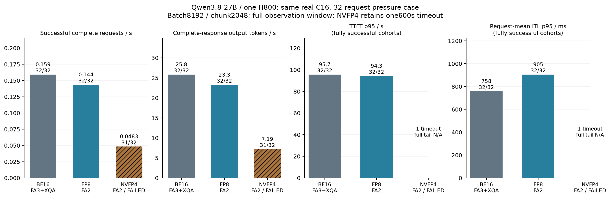
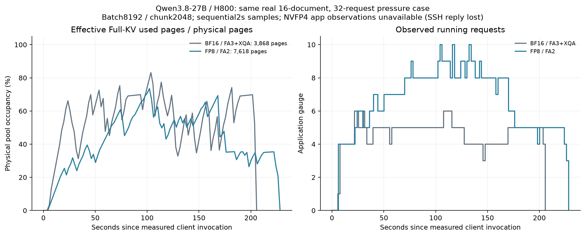

# 同一真实长文压力场景：完成与失败分别报告

同一H800 GPU7、Qwen3.8-27B、相同16原始文档/32原始两轮请求、C16、自然EOS与原生成上限。调度为8192 batch token budget、2048 chunk、max sequences16、GDN slots32、memory0.9、page64、Graph/prefix开启；单次原始观察。BF16为FA3+XQA，低精度为FA2/BF16 Q。这是部署组合比较，不是纯dtype因果或业务SLO接受。

| 格式/后端 | 原终态 | 成功/原offered | 完整窗口秒 | 成功请求/s | 完整响应输出token/s | TTFT p95秒 | 请求平均ITL p95毫秒 | E2E p95秒 |
|---|---|---:|---:|---:|---:|---:|---:|---:|
| BF16 / FA3+XQA | COMPLETE | 32/32 | 200.924 | 0.159264 | 25.8406 | 95.681 | 758.491 | 119.853 |
| FP8 / FA2 | COMPLETE | 32/32 | 222.837 | 0.143603 | 23.2502 | 94.325 | 905.386 | 192.692 |
| NVFP4 / FA2 | FAILED | 31/32 | 641.248 | 0.048343 | 7.1907 | N/A | N/A | N/A |

BF16 WC与FP8 XC全部32请求/16完整两轮、原payload、SSE、usage、官方JSON tokenizer计数、20known/A-B-A/实际Graph及GPU释放通过独立审计。物理原始镜像分别113SHA/14499329B与118SHA/19048893B。FP8请求率比同配置BF16低9.833365%，输出率也较低；自然输出总数5192与5181，不强制相同输出长度。

NVFP4 YC原终态FAILED，115SHA/18493427B完整保留；32个原offered请求中31成功、1个GovReport59首轮TimeoutError，实际599.725532秒。它已经接收HTTP200和496个非空content包，但没有最终DONE/usage，因此部分输出不计完整成功输出。AIPerf处理完32条（工具is_complete=true）不等于32成功；严格worker正确拒绝了该负载。保持C16、600秒超时和原caps，不为获得pass而改变条件或重跑同一实验。

31个成功响应的SSE、usage与官方token数分别核对，成功完整输出共4611token；用整个641.248253秒窗口计算0.0483432116成功请求/s、7.190662865完整输出token/s，成功比例96.875%。失败仍保留在32offered分母中。成功子集的条件性TTFT/请求平均ITL/E2E p95为293.813秒/2817.137毫秒/575.272秒，不能当作完整32请求的尾延迟。全队列尾部在图表标N/A，条件性p50/p95/p99单列在[CSV](pressure-outcomes-v1/pressure_observations.csv)；[NVFP4失败独立审计](../../operations/session-recovery-20261030-01a1765d/mixed-NVFP4-YC-independent-failed-load-audit-a1.json)没有改写原FAILED或过滤错误请求。

ITL是AIPerf每个请求的生成阶段耗时除OSL−1，再在请求之间求分位数；不是全部单token间隔样本的分位数或GPU kernel时间。原始SSE非空内容包接收间隔另作诊断：旧2048 BF16 O的p95为26.727ms，新8192 BF16 WC为787.247ms、FP8 XC为999.653ms。包可合并接收且token数可变，不能称逐token时延；它们支持新配置确有流式停顿。新BF16相对旧O的328.678秒观察变为200.924秒，但请求平均ITL p95从26.541ms增到758.491ms，吞吐/首token和流式生成存在取舍。没有把配置改动归因于某个writer kernel，也没有Nsight/CUPTI硬件带宽证据。

## 有效驻留与独立约束

BF16与FP8的32条prompt token数逐项与官方JSON一致，总1317971、范围27241–67736；原cap+padding单请求最大1062页。BF16同一采样5running/3217有效FullKV页，独立running峰6；FP8同一采样9running/5600页，独立running峰10。FP8实际有效页数超过同预算BF16整个3868页物理池，提供了已观察的密度收益，仍不能推出最大成功并发或吞吐收益。

应用数值来自顺序2秒采样，不是原子快照；max running与max used来自不同点时分别标记。FullKV有效used页、可回收前缀索引与GDN leaf是不同视角，不相加制造容量。BF16/FP8观察区间新增prefix hit均0；prompt显示差4token的科学计数法精度边界保持exact-span=false，不把API cached_tokens当跨请求命中。

NVFP4实际模型的880320槽/16226058240 FullKV字节及5234098176 GDN字节、20known/A-B-A/Graph已核；附加只读采样SSH reply丢失，没有收到原始应用采样，因此其active页与running峰为unknown。没有把丢失补0，没有为补采样重跑GPU。该断线与请求Timeout之间的因果关系未验证，分别保留证据。每token张量存储与scale开销见[实际存储算术](actual-cache-storage-accounting-a1.json)，不能以分配槽位或NVML显存占用替代活动驻留。

完整压力证据的[本地归档验收入口](../../../results/archive/nextgen-native-kv-20261030/mixed-pressure-a1/ARCHIVE_ACCEPTANCE.json)包含三个原run（包括FAILED）、原始API/usage/telemetry、两组完整应用采样、NVFP4采样断线记录、独立成功/失败审计、全尾表及图。它不含权重/安装环境，不代表默认生产接受。原W请求会话重复的协议失败与WC修复另归档，仍保留其原FAILED，不混入这三项结果。
