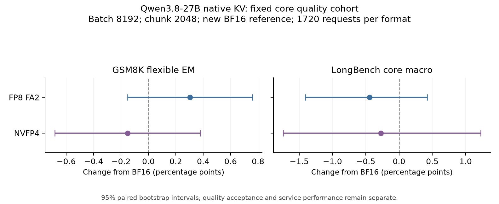

# 新调度配置的完整质量证据

三种格式均由单次原始 COMPLETE 运行生成完整 1720 条响应，已释放 GPU、结清账本，并逐 SHA 镜像和独立评分。这里的质量结果属于 `mixed8192_chunk2048_v1`，应与同配置 BF16 T 配对。

服务实际参数为 batch token budget8192、prefill chunk2048、max sequences16、GDN slots32、memory utilization0.9、page64、Graph/prefix开启、TP/CP1、MTP0。Python模型源03134b72，C++源862c29ca、binary SHA dbc1c53a6d711ad883d2227c55429c1977347acd9e1bfa50b1fb479a0cc25f09均未改变。BF16使用FA3/XQA；低精度使用FA2/BF16 Q，不将比较解释为单个dtype的因果效应。

| 格式/后端 | 完整响应 | GSM flexible % | GSM strict % | LongBench macro % | 空 stop，保留计0 | 实际请求跨度秒 |
|---|---:|---:|---:|---:|---:|---:|
| BF16 FA3 + XQA | 1720 | 96.5883 | 96.6641 | 53.8767 | 6 | 1073.015 |
| FP8 E4M3 FA2 / BF16 Q | 1720 | 96.8916 | 96.8158 | 53.4349 | 7 | 1103.915 |
| NVFP4 FA2 / BF16 Q | 1720 | 96.4367 | 96.5125 | 53.6044 | 7 | 1791.198 |

每臂包含1319个GSM8K问题、8个LongBench任务各50条，以及1条原始长文未截断补充。补充请求保留在完整协议分母中，不改变400条LongBench核心宏平均。请求跨度取自原始请求单调时钟；三臂均0 client error。这些数值不作为AIPerf吞吐或长期soak。

FP8相对新BF16的GSM flexible变化为+0.303260pp，配对95%区间[-0.151630,+0.758150]pp；LongBench宏变化-0.441744pp，文档簇配对区间[-1.410130,+0.423936]pp。NVFP4对应变化为-0.151630pp[-0.682335,+0.379075]与-0.272292pp[-1.738845,+1.226025]。区间均跨0，不据此宣布数值等价或业务质量接受；区间描述固定问题/文档簇的配对不确定性，未估计重复部署的运行方差。

图从完整评分JSON生成，输入SHA及绘图值存于[图输入](quality-figure-v2/inputs.json)。[BF16完整评分](bf16-t-v1/summary.json)、[FP8完整评分](fp8-u-v1/summary.json)、[NVFP4完整评分](nvfp4-v-v1/summary.json)与两组[FP8配对](fp8-u-vs-bf16-t-a1.json)、[NVFP4配对](nvfp4-v-vs-bf16-t-a1.json)均保留全部样本。旧2048/2048配置的分数和中断恢复保持独立，不合并两种调度条件来扩大样本数，也不将新旧差异解释为配置已修复质量损失。

物理Full-KV token slots为247552/487552/880320；Full-KV实际字节分别16223567872/16225730560/16226058240，GDN状态三臂均5234098176字节。槽数之比不等于最大可接纳并发、整服务显存缩小比例或业务goodput。BF16真实pilot S已在同一应用采样中观测4 running、2265 active Full-KV pages，超过单请求829页保守上界；这是有限序列采样的驻留证据，仍需后续压力实验。

按实际分配张量的shape、dtype和字节逐项重算，16个Full Attention层合计的每逻辑token存储如下。没有省略现有分配器的scale缓冲。

| 格式 | K/V payload B/token | scale缓冲 B/token | 合计 B/token |
|---|---:|---:|---:|
| BF16 | 65536 | 0 | 65536 |
| FP8 | 32768 | 512 | 33280 |
| NVFP4 | 16384 | 2048 | 18432 |

GDN包含48层、实际34行的conv BF16与SSM FP32状态，三个格式的5234098176B相同。这里的压缩节省被分配器用于扩大token池，因此每臂实际Full-KV预算仍约162亿字节；不能把2倍或4倍payload压缩率说成整个服务显存缩小2倍或4倍。实际槽比为1.969493和3.556101；FP8保留scale缓冲、NVFP4块scale、page对齐均已计入。[逐张量算术与来源SHA](actual-cache-storage-accounting-a1.json)及[CSV](actual-cache-storage-accounting-a1.csv)。

W原压力实验FAILED：32个实际请求中只有27个唯一session-turn，5个快会话首轮重复、5个慢会话后轮缺失。原终态和全部109SHA文件保留，禁止将其作为完整压力测量。CPU负对照复现了仅按request-count停止的问题；修复增加准确session数限制，同时保留原32请求上限。五个冻结cohort共194条真实负载经实际CLI/C16异质延迟验证，逐HTTP payload、实际session-turn元数据、原顺序、SSE与使用量均核对；测试用虚假一token响应，不证明模型速度或质量。新WC以显式恢复契约重测同一有限压力case，XC/YC及32任务原生工具仍待完成，不能由本质量表替代。

本阶段原始镜像、逐条分数、配对图及跨度证据已在本地归档：[归档验收](../../../results/archive/nextgen-native-kv-20261030/mixed-quality-a1/ARCHIVE_ACCEPTANCE.json)。289个成员、168284282字节未压缩，压缩包53890603字节，SHA256 `d96c90e28ed815421bd40b6cecc7a177c5b9b4096d63642fa5087220d54e4f7b`；全部成员写包后重新读取校验。归档不含权重或安装环境，不是可直接部署镜像。
