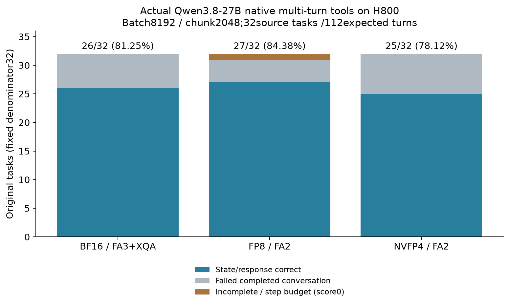

# 同配置原生工具多轮的完整结果

同一Qwen3.8-27B文本模型、H800 GPU7、8192 batch/2048 chunk、maxseq16/GDN slots32、Graph/prefix、固定source/reference/checker及原32任务/112期望用户轮。C4、每轮最多10步assistant/tool、自然1024生成cap；不提前注入下一用户问题，不把gold送上serving路径。BF16为FA3+XQA，FP8/NVFP4为FA2/BF16 Q；这是部署组合观察。

| 格式 | 原终态/释放/账本 | 完整会话/32 | 原用户轮/112 | 实际model API / 内存tool调用 | state-response正确/32 | 原GPU分配秒 |
|---|---|---:|---:|---:|---:|---:|
| BF16 ZC | COMPLETE / released / SETTLED | 32 | 112 | 355 / 263 | 26 (81.25%) | 565.397475 |
| FP8 ZA | COMPLETE / released / SETTLED | 31 | 110 | 359 / 276 | 27 (84.375%) | 614.111395 |
| NVFP4 ZB | COMPLETE / released / SETTLED | 32 | 112 | 355 / 264 | 25 (78.125%) | 1083.615308 |

原GPU分配时间包括冷编译、启动、资格验证与工具生成，不是AIPerf测量窗口、工具goodput或同质量服务成本。独立scorer逐原始HTTP/history/SSE/usage/官方tokenizer/工具状态回放核验；三组分别280SHA/17747378B、286SHA/22665269B、286SHA/21779727B。全部32题均保留，不能把COMPLETE解释为32题答对。

FP8任务multi_turn_base_2原5用户轮仅完成3轮，触及10步预算，未注入未来两轮；整个任务计0，仍留在32分母中。其余四个完整但错误的任务是4、6、152、154。BF16失败任务为0、2、4、6、52、152；NVFP4失败为0、2、4、6、52、54、152，均没有过滤。

对同配置BF16，FP8新增正确任务0、52，新增失败154，净+1题/+3.125pp；NVFP4新增失败54，没有新增正确，净-1题/-3.125pp。两组逐ID配对均绑定同source/reference、每轮checker AST、service、设备、模型与协议；[FP8配对](fp8-za-vs-bf16-zc-a1.json)、[NVFP4配对](nvfp4-zb-vs-bf16-zc-a1.json)。图从三组真实audit与全SHA清单生成，输入/绘图值在tools-figure-v1/inputs.json，PNG已实际查看。

旧2048配置对应26/26/24of32是另一组单次观察，不与新配置合并提高样本量，也不因新总分26/27/25就宣称调度改善质量。新BF16总分与旧R同为26，但任务0新失败、156新成功；这是任务结果变化，未估计部署间运行方差。32题结果不是完整BFCL榜单、最终自然语言回答质量、业务SLO或统计泛化结论，不把某个语义失败直接归因于KV数值误差。

完整本地原始证据、独立逐任务/逐轮结果、输入身份、配对、绘图源和此分析归入mixed-tools-a1。CPU完整protobuf/minja224 fixture及H800无GPU image资格仍是协议前提，实际模型分数单独来自上述原生API记录。
