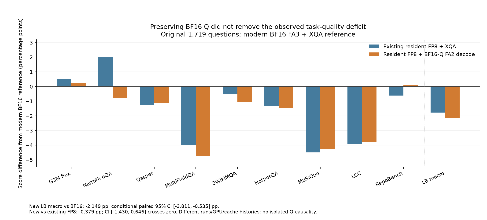

# 保留BF16 Q的resident FP8：完整质量未显示整体修复，停止扩大服务矩阵

2026-10-27。run `prod-quality-bf16q-full1719-c128-r1-20261027b` 原COMPLETE/driver释放，123文件44462952B逐SHA、所有1719原题/响应/prompt/tokenizer/usage/weights/scorer/source/真实模型Graph及官方重评分完整验收。这里的完整性通过不等于用户接受质量。

## 生产决定

不扩大这个BF16Q_FA2候选的额外GPU服务矩阵。它没有修复主要LongBench/代码缺口；保留现代BF16默认与既有FP8-XQA按模型/业务有条件可选的建议。没有对新候选运行新的AIPerf，旧ShareGPT约+32%收益不能移植给它。用户尚未接受1pp等数字门槛。

这是具体部署配置未显示整体质量改善，不证明Q量化无影响，也不隔离Q/K/V、kernel、batch、缓存和GPU/时间为唯一根因。算子数值/Graph128门槛通过仍不能替代端到端任务质量。

## 配置、输入和参考

H800 GPU0、Qwen2.5-14B-Instruct/TP1、source `acc0ed6bf8bcd4500d8e5260cec17c2b5c67a9e9`，binary277bd8...、同固定镜像；模型权重BF16，resident FP8 KV，FA2 prefill+decode均保留BF16 Q，K=.125/V=.0625，无完整BF16shadow，原Graph/prefix/chunked128seq/10240token/200admission/.8。参考是已独立验收的现代BF16 FA3+XQA及原FP8-XQA C128同1719，保留其原预测，不重新生成BF16。

全1319 GSM8K+8×50 LongBench，原顺序/5-shot/任务cap/自然EOS/scorer。逐题record/prompt和实际prompt token一致；actual GPU batch由调度决定，clientC128不是固定GPU batch128。旧参考GPU3与本次GPU0、时间/缓存/调度历史不同；模型weights/metadata/版本/评分协议一致，除显式attention候选外runtime源码一致，评分AST只新增严格profile字面值。actual weights SHA `cf67b8e03cf159dd6017e36da84c28e143e59ce766261db2f6c97aabca7aae73`。

## 原题逐项分数

前三列是百分比分数；最后两列是百分点差。LongBench宏平均为8任务等权，GSM不混入。

| 任务/指标 | BF16 % | 原FP8-XQA % | 新FP8-BF16Q % | 新−BF16 pp | 新−原FP8 pp |
|---|---:|---:|---:|---:|---:|
| gsm8k/flexible_em | 89.3101 | 89.8408 | 89.5375 | 0.2274 | -0.3033 |
| gsm8k/strict_em | 68.5368 | 71.3419 | 70.2805 | 1.7437 | -1.0614 |
| narrativeqa/official_score | 32.5448 | 34.5297 | 31.7340 | -0.8108 | -2.7957 |
| qasper/official_score | 42.9912 | 41.7424 | 41.8617 | -1.1295 | 0.1192 |
| multifieldqa_en/official_score | 48.6327 | 44.6327 | 43.8765 | -4.7563 | -0.7562 |
| 2wikimqa/official_score | 58.7115 | 58.1732 | 57.6398 | -1.0717 | -0.5333 |
| hotpotqa/official_score | 64.7322 | 63.3989 | 63.2905 | -1.4417 | -0.1084 |
| musique/official_score | 37.6155 | 33.1269 | 33.3322 | -4.2833 | 0.2053 |
| lcc/official_score | 67.1400 | 63.2200 | 63.3600 | -3.7800 | 0.1400 |
| repobench-p/official_score | 49.1400 | 48.5200 | 49.2200 | 0.0800 | 0.7000 |
| LongBench_macro/equal8_task | 50.1885 | 48.4180 | 48.0393 | -2.1492 | -0.3786 |

固定原题配对bootstrap5000次、seed20261026，LongBench任务内分别重采样后等权平均：新−BF16 −2.149157pp，95%区间[−3.810786,−.535092]pp；新−原FP8-XQA −.378637pp，区间[−1.429630,+.646427]pp。后者跨0，不称显著变差，但未观察整体修复。区间仅对这些固定题目条件成立，不是GPU重复或所有生产任务的保证。

GSM flexible新89.5375%、比BF16+.227445pp，配对区间[−.985595,+1.442381]pp；严格分数70.2805%。MultiFieldQA −4.7563pp、MuSiQue −4.2833pp、LCC −3.78pp仍是风险。LCC/RepoBench各50次length cap来自冻结benchmark64token协议，不能单独当模型失败；code_sim不是代码执行。

## 复用原质量请求时钟，不新增GPU

原封存journals含请求起止、完整JSON响应耗时与usage，逐文件绑定worker seal并核对同record/prompt后派生9个有限cohort的描述性时钟。GSM新候选相对BF16有限cohort完成RPS+18.07%，相对原FP8-XQA −20.78%；LCC相对BF16约−9.00%、MuSiQue约−15.88%。其余完整数据见buffered_cohort_clocks.csv。

这些是不同run/GPU/时间/缓存历史下的固定benchmark cohort与cap，首请求到末响应包含client offering/drain；不是AIPerf稳态峰值、流式TTFT/ITL或已接受SLO goodput。每任务50题的尾分位只作描述，不把它们改成新正式服务收益或全局kernel速度因果结论。

## 失败、恢复与成本

先前a/sourcebecc8dd7在模型加载前因_plan默认auto臂与FP8-only约束冲突FAILED；72文件独立保留，零预测，实际.001074001824GPU-h。b修复默认臂、85source/207controller CPU与整个真实1719 dry-run（46资产/全部输入协议SHA/数量/顺序）通过后新编号派发，不是重跑成功预测或独立统计replicate。

本次首次xz镜像SSH keepalive超时退出255，partial保留；只读重连证实同一COMPLETE后改gzip和本客户端60秒短暂失联容忍，所有ownership/大小/解包/SHA边界不变，完整123文件成功，无GPU重跑。b实际.229912209589GPU-h，累计9.724063727778、预留0/无active或UNKNOWN。

## 来源与下一步

- [独立1719审计](../../operations/20261026T075846Z/bf16q_full1719_quality_independent_audit_b1.json)、[三部署逐题对照/区间](../../operations/20261026T075846Z/bf16q_full1719_quality_comparison_b1.json)、[封存时钟复用](../../operations/20261026T075846Z/bf16q_full1719_quality_cohort_latency_b1.json)。
- [算子前置审计](../../operations/20261026T075846Z/bf16q_decode_operator_independent_audit_a2.json)、[a失败](../../operations/20261026T075846Z/bf16q_quality_a_independent_failure_evidence_v1.json)、[b完整CPU dry-run](../../operations/20261026T075846Z/bf16q_quality_b_full_actual_dry_run_CPU_v1.json)。
- 原始镜像results/mirrors/prod-quality-bf16q-full1719-c128-r1-20261027b-terminal-b2-gzip/files；task_scores.csv含完整精度，所有raw保留，quality_accepted=false。

停止该候选矩阵后，下一步仅CPU核实长文/代码heldout范围诊断的真实数据与独立性、可落地配方/后端支持。短聊天无饱和不能排除长文范围问题；不盲调global scale、不从该比较推单因子根因、不重跑已完成实验。整体生产支持工程仍未标完成。

[SVG](figures-v1/quality_deltas.svg)、[绘图原始数值CSV](figures-v1/quality_delta_data.csv)与manifest包含输入/生成器/产物SHA；图中所有差值以现代BF16为参考，不能把不同配置和run解释成Q的单因子效应。
