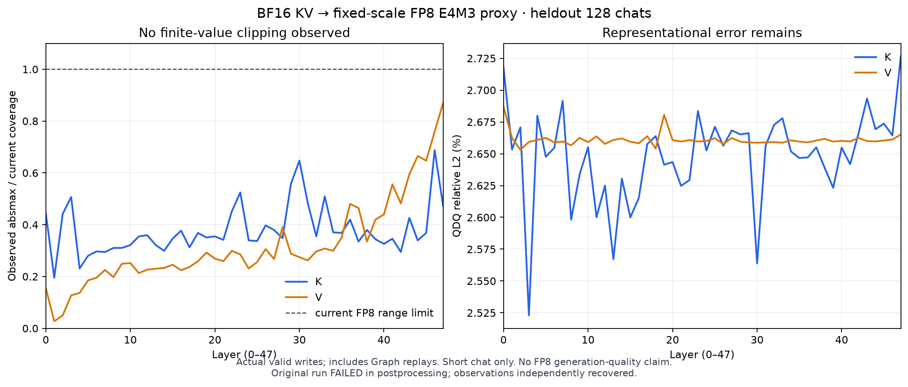

# 真实K/V分布已独立恢复：不支持继续全局scale调参

更新2026-10-27T11:59:38.595966+00:00。c原始root仍为FAILED（尾部吞吐核验精度错误），未创建COMPLETE或worker measurement seal；87个原始文件/26902590bytes逐SHA、全部128原payload/SSE/usage/AIPerf完成、真实Graph和1536个GPU统计分组已独立验收。本报告认证观测证据的完整性，不改写原作业终态，也不认证FP8模型质量或新增服务收益。

## 生产决定

按查看真实统计之前冻结的规则，K=.125/V=.0625保持不变，没有新的global scalar候选或相同配置GPU重跑。短聊天数据中没有饱和，普通数值区的FP8表示舍入主导QDQ误差；不要把改scale名字当作质量修复。该结果不排除长文/代码/FP8生成反馈中的范围问题，也不把LongBench下降归因给任意单一机制。

## 实际观测

BF16 FA3+XQA、Qwen2.5-14B/H800/TP1，生产Graph/prefix/chunked128seq/10240token/200admission/.8，source5e2c99f9；固定模型/二进制/config与原始heldout128自然聊天，C128/自然EOS/cap1024，只有Profiling阶段、无额外warmup请求。诊断只保留105216B GPU计数与FP32 moments，不保留完整activation/cache shadow。

| 元数据phase/种类 | absmax | 固定scale覆盖 | 饱和 | 非零→零占比 | QDQ相对L2 |
|---|---:|---:|---:|---:|---:|
| decode/key | 36.750 | 56 | 0 | 0.008064% | 2.6473% |
| decode/value | 24.375 | 28 | 0 | 0.015379% | 2.6609% |
| prefill/key | 38.500 | 56 | 0 | 0.008263% | 2.6506% |
| prefill/value | 24.000 | 28 | 0 | 0.015527% | 2.6607% |

每层15次prefill/mixed路径、1023次纯decode路径；有效writer tokens为141864+73122=214986。与独立HTTP usage严格对账：143037 prompt−2048 prefix命中+74125 completion−128首个输出=214986。48层、全部head/K/V计数一致。每种K/V累计10566991872个有限值只是相关的层/head/维度观测，不能当作独立请求样本；真正请求只有128条。

prefill标签包含chunked/mixed batch中的decode行，不能直接当作全部prompt值；缓存命中的2048个旧prefix tokens未重新写入，统计也不重复算。该语义解释了两个phase的数量，Graph padding/reserved page0与启动预热已排除，所有请求时间在RESET_ACK之后。

非零下溢造成的平方误差保守上界：K≤.051619、V≤.024370，仅为全部QDQ平方误差的≤1.90e−9/4.75e−9。此为表示误差能量上界，不是任务敏感度或质量无影响结论；Q和attention累加/softmax并未由本探针测量。

c实际生成74125 tokens，109次stop/19次length。b相同原始128请求的71945 tokens、115/13分别保留；来源/配置相同下生成数量并非逐题固定，不拼成更多独立用户或拿长度变化当效率收益。调度/batch数值敏感性是待验证解释，不从这两个编排修复run断言原因。

## 原始失败与恢复

| run | 原始终态 | 独立证据与原因 | 实际GPU-h |
|---|---|---|---:|
| a/r0 | FAILED | 小算子/Graph/14B admission/reset通过，CLI拒绝显式warmup0；无128正式请求或模型统计 | .0981441367 |
| b/r1 | FAILED | 83文件逐SHA、128服务结果独立恢复；8个合法U+2028被str.splitlines误拆128→136，统计尚未导出即清理 | .1074331000 |
| c/r2 | FAILED | 先导出后审计保留完整统计；ISO时间精度误拒绝已CPU核实，不需要GPU重跑 | 0.1071926814 |

物理LF UTF8 JSONL读法保留全部Unicode，真正坏JSON仍拒绝。新的统计导出位于client完成后的无请求边界，早于任何结果解析，避免后处理故障丢数据。小探针的合成control_probe导出与真实模型range_probe导出严格分开。

c原报TPS2631.463161961653与按ISO区间算2631.4631041360035之差来自时间导出：官方速率使用纳秒窗口，JSON exporter用datetime.fromtimestamp(ns/1e9)量化到微秒。RPS/TPS共同隐含28.168739381秒，ISO为28.168740秒，差619ns，位于从datetime/FP64精度计算的1241ns界内。没有放宽request/usage/模型数值容差；仅按可表示的时间区间验速率，错误token数与10µs差异仍被测试拒绝。四个实际H800 exporter/metric源码SHA与CPU参考一致。

当前全部driver释放、无active/UNKNOWN，累计9.4507125811GPU-h/预留0，第一12未重置。200项控制器CPU通过，原始失败/请求/统计不修改。

## 证据与复算

- 独立完整审计：reports/operations/20261026T075846Z/range_probe_c_independent_recovered_audit_v1.json；原终态SHA f52185fc65d457ee666b937c70ab1f9ea33f1aa47548cbbae301a13ba7d51981。
- 覆盖/误差能量界：reports/operations/20261026T075846Z/range_probe_c_coverage_and_error_mechanism_v1.json。
- 预导出规则与不变scale：reports/operations/20261026T075846Z/range_probe_candidate_scale_rule_before_export_v1.json、range_probe_c_derived_scalar_proposal_v1.json。
- 原始镜像：results/mirrors/prod-calib-bf16xqa-heldout128-r2-20261027c-terminal-c1/files。
- 生成器scripts/audit_kv_range_run.py（显式recover-postprocessing-failure）、derive_kv_scale_candidate.py、render_kv_range_figures.py；未重写原FAILED。

[SVG](figures-v1/kv_range.svg)、[逐层CSV](figures-v1/layer_data.csv)、[1536组CSV](figures-v1/group_data.csv)及manifest含输入/生成器/产物SHA；仅用于这批实际观测。

下一步先在CPU核实可部署的BF16 Query解码路径：当前FP8 XQA内部仍使用FP8 Q，而本诊断不测Q，也不能证明它就是质量损失原因。只有实际wrapper/Graph/生产上限可行、维护成本可接受时才独立方案/实机门槛/必要质量与端到端，不借旧16K/C4结果代替，不通过伪造planner字符串绕过C++保护。
