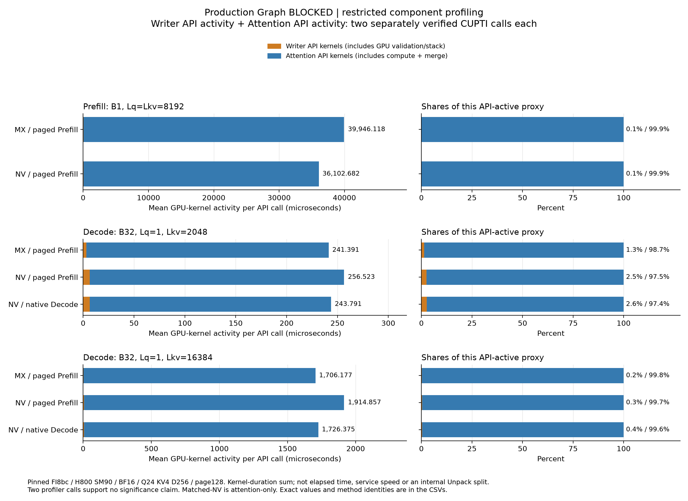
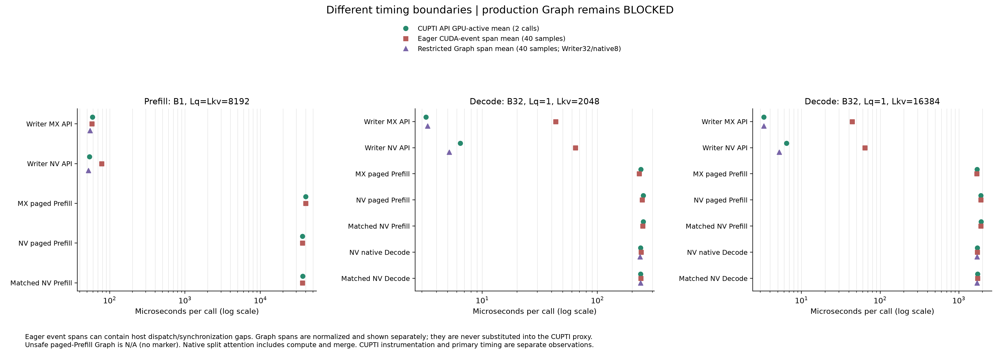

# Q4后端审计：生产Graph BLOCKED；受限组件测量完成

本轮完成固定三case的受限组件测量与独立raw复核，**生产Graph仍为BLOCKED**。`production_graph_qualification=false`、`all_requested_graph_paths_supported=false`；三个unsafe pagedPrefill Graph路线保持BLOCKED/N/A。没有新模型质量或服务benchmark，也没有升级/修复冻结backend。

实测为GPU7上的NVIDIA H800/SM90（132 SM）、BF16、Q24/KV4/D256、page128；自定义MX源`ba5eaec0`，driver `71bf6439`，Torch2.10.0+cu130与部署FI0.6.18.post1@`8bc3b578`。GPU已释放，main原状态COMPLETE仅表示受限范围完成。[方法](MEASUREMENT_METHODS.md)、[精确来源](SOURCE_PROVENANCE.json)与[独立Graph更正](GRAPH_AUDIT_FOLLOWUP.md)分别列证。

## 支持边界

| 路径 | Source/API与shape | 本轮GPU证据 |
|---|---|---|
| 自定义OCP MX | block32/E8M0；目标SM90/BF16/D256的私有FA2；Eager Prefill及单query路径 | 有限独立参考、Writer Graph通过；persistent pagedPrefill Graph BLOCKED |
| SG三PR固定head | 有SM90 WGMMA及真正MX部分；固定共享D512 latent、Q64/128、KVlatent1；448 MX+64 BF16 RoPE | 原样Q24/KV4/D256被真实guards拒绝，目标全部N/A；不换shape补测 |
| vLLM当前源码 | b2094acc：Hopper plain NV走native FA2，非XQA；D256支持，Hopper框架page≤64 | 本轮page128库组件不等于vLLM engine；4over6不适用 |
| 部署FI8bc plain NV | 固定安装版本，不升级 | 合法Eager及独立native split Decode Graph的限定hard gates通过；non-split pagedPrefill Graph N/A |
| current FI4c2 | 当前API、Graph mask修复与长Prefill repack仅作源码审计 | 未运行新版runtime，不代表latest FI性能或完整vLLM |

SG三PR按审计时封存元数据均closed/unmerged；MX部分为block32/E8M0，但整个混合行是5.75 bits/value，与独立K/V D256布局不等价。Triton对E8M0=255解为Inf、CUDA解为NaN的差异保留；finite writer不能补成全nonfinite Attention资格。

## 相同GPU-active分母

下表均为**每组件两个独立CUPTI调用的kernel duration和之平均**。Writer API包含其全部GPU工作，NV尤其保留scalar-stack/validation辅助kernel；Attention包含compute及split/merge。分母为二者之和，是component proxy，不是elapsed、区间并集或服务时间。显示值取三位小数，CSV保留原float精度。

| 固定case | 路线 | Writer API µs | Attention API µs | 合计proxy µs | Writer占比 |
|---|---|---:|---:|---:|---:|
| Prefill B1 / 8192 | MX / Prefill-wrapper | 59.120 | 39886.999 | 39946.118 | 0.148% |
| Prefill B1 / 8192 | NV / Prefill-wrapper | 54.080 | 36048.602 | 36102.682 | 0.150% |
| Decode B32 / 2048 | MX / Prefill-wrapper | 3.248 | 238.142 | 241.391 | 1.346% |
| Decode B32 / 2048 | NV / Prefill-wrapper | 6.431 | 250.091 | 256.523 | 2.507% |
| Decode B32 / 2048 | NV / native Decode | 6.431 | 237.359 | 243.791 | 2.638% |
| Decode B32 / 16384 | MX / Prefill-wrapper | 3.312 | 1702.865 | 1706.177 | 0.194% |
| Decode B32 / 16384 | NV / Prefill-wrapper | 6.464 | 1908.393 | 1914.857 | 0.338% |
| Decode B32 / 16384 | NV / native Decode | 6.464 | 1719.911 | 1726.375 | 0.374% |

[SVG](figures-a1/component_gpu_active.svg) · [8行精确proxy CSV](exact-main-a1/component_proxy.csv) · [19组件双调用CSV](exact-main-a1/gpu_active.csv) · [58条kernel与资源](exact-main-a1/kernels.csv) · [6条copy](exact-main-a1/copies.csv)

在这个限定API-active proxy内，融合Attention占97.36%–99.85%。MX Prefill的Attention约39.887ms，旧部署NV Prefill约36.049ms；两个Decode的MX约238.142/1702.865µs，旧NV Prefill约250.091/1908.393µs，native NV约237.359/1719.911µs。方向随case/路线变化；每组件仅两次profiler调用、固定执行顺序，不能据此宣称显著收益或稳定候选排名。

同decoded-KV的matched NV Attention控制也完整保留，未给它伪配Writer benchmark。其差值仍捆绑scale load/转换、page stride、编译与资源计划等实现差异。**Scale/Unpack独立毫秒与百分比均N/A**，不能用MX减NV当作Unpack计时。

NV Writer trace能按真实kernel名精确分出`CatArrayBatchedCopy`与`NVFP4QuantizeAppendPagedKVCacheWithSlotMappingKernel`；[逐调用分项](exact-main-a1/writer_nv_breakdown.csv)保留全API总值及全部其他工作。CUPTI暴露的register/shared/grid字段是资源证据，不是独立stall、spill或实际occupancy测量。

核心归因与可取机制：同decoded控制下，MX相对matched-NV的Attention active差异依次为+9.685%/−4.869%/−11.018%，不能统一归为“MX Unpack慢”。native Decode实际仍是同FA2 `BatchPrefillWithPagedKVCacheKernel`家族，改为NON_CAUSAL+split1，grid从128变256 CTA；计入3.248/3.280µs merge后，同cache NV总active分别降低5.091%/9.877%。这些包含分区、mask、部分状态及merge，不能化成纯wrapper开销。Writer GPU份额小，NV scale D2H/host校验成本另列；255 registers及Kineto occupancy=0不是已测stall或occupancy。SG的producer warpgroup双缓冲、device scheduling及Graph-aware专属arenas可借鉴，D512语义不直接适用。current4c2的mask修复和tile repack具有源码上的改进机制，本轮未测新版速度。

合入建议：当前MX因Graph blocker不作生产合入，codec、writer和物理layout可作实验性review；部署FI8bc的NV库级路径有本轮限定证据，不能冒充latest FI或完整vLLM。SG不支持原目标，不照搬D512实现。H800无native FP4 TensorCore，本轮以packed常驻KV、BF16 MMA/FP32累加工作；timed Attention无全history BF16 shadow，当前输入激活及matched压缩控制cache另计。MX E2M1/block32/E8M0为0.53125 B/element，NV block16/E4M3为0.5625 B/element；[上轮真实分配slots](https://github.com/MingASA/kv_research_agent/blob/3ef170357e84d48bdc424406ec7a7300d2cad3ce/reports/experiments/mxfp4-fp8-20261105/REPORT.md)保留，不以这些存储比推导吞吐或整模型容量倍数。

## Eager、Graph span与host成本分开

[SVG](figures-a1/timing_boundaries.svg) · [38行span表，含9个blocked N/A](exact-main-a1/event_spans.csv) · [1160原始span样本](exact-main-a1/event_samples.csv)

Eager event span包括可能的host enqueue/同步间隙；Writer Graph32和native Attention Graph8是分别归一化的独立测量。以2048 Decode为例，MX Writer的API-active为3.2485µs，Eager span均值43.45904015004635µs，Graph32 span均值3.348974986001849µs，不能混用这些边界伪算份额。unsafe Prefill Graph没有点，也不填零。

Host CPU API-return均值如下，单位µs，**一次/model step，不乘16层**；异步drain wall、全部样本与其他plan scope在[50行host表](exact-main-a1/host.csv)、[1000原样本](exact-main-a1/host_samples.csv)。诊断pageable metadata不代表vLLM的pinned staging实现。

| case | MX Eager plan | NV Eager plan | native NV Eager plan | native fast plan | native staging |
|---|---:|---:|---:|---:|---:|
| Prefill B1 / 8192 | 113.618 | 114.655 | N/A | N/A | N/A |
| Decode B32 / 2048 | 283.120 | 286.009 | 178.562 | 56.148 | 23.598 |
| Decode B32 / 16384 | 279.383 | 284.674 | 179.310 | 57.461 | 24.946 |

## 正确性、失败与因果边界

main的13条Eager route独立decoded reference均在原.02/.02门槛通过；8192 Prefill实际执行全部query，但独立reference仅固定16个query rows。六组Writer changed-K/V Graph/direct检查、四条native Decode Graph及八份split/mask plan guards均通过。main的7个原.001/.001比较均为true，同fused MX/matched-NV三个case的maxabs均0；它们不能回写旧Pilot的strict false或证明跨native route恒等。

| 原证据 | 保留状态与解释 |
|---|---|
| 首资格Pilot（driver876） | FAILED：跨NV Prefill/native Decode在.001/.001下maxabs0.00390625；五路.02独立参考通过，原失败不改 |
| v2资格Pilot（driver7e87） | FAILED：CUDA illegal address；non-split Graph padding-mask源码合约缺陷成立，异步栈不唯一定位首kernel |
| 首受限component Pilot | 原UNKNOWN保留，独立CONFLICT释放证书结清；资源冲突不计算法失败或有效测量，旧ID不重跑 |
| fresh-ID受限Pilot | 只做组件/仪器资格，所有Pilot时延排除main表与图 |
| 本main（driver71bf） | 三固定case受限完成并释放；原两资格失败及生产Graph BLOCKED保持 |

pinned planner把2个真实work索引padding到66个entries，4 KV heads展开264个CTA、仅8个有效；non-split缺validmask。旧217成员的普通wrapper capture（use_cuda_graph=False）与模型6-launch窗口仍是有效的历史观测，不能推广全batch安全。旧1720/32工具/服务分数及原raw均保留；persistent Graph缺陷带来执行安全混杂，**不能仅凭旧分数把退化独立归因于OCP格式数值，也不能断言每个旧请求都触发缺陷**，覆盖未知。见[独立follow-up](GRAPH_AUDIT_FOLLOWUP.md)及[3ef原报告](https://github.com/MingASA/kv_research_agent/blob/3ef170357e84d48bdc424406ec7a7300d2cad3ce/reports/experiments/mxfp4-fp8-20261105/REPORT.md)。

current FI4c2已把mask allocation/init和paged-run pointer移至独立Graph分支。另有可适用于SM90/D256长Prefill的FP4 tile-local repack；需launcher capability、1字节KV、D≤256、D_V≠64、CTA_Q>16，并增加shared-buffer预算。CTA_Q16短Decode不启用；软件pack-scale PRMT fallback在SM90硬件转换分支不适用。两项都是值得借鉴的源码机制，本轮未升级/移植或测其速度。

## 可复核范围

原main mirror376文件/15460172字节、63资产、294测量证据引用、38独立rawtrace已由root/supervisor链核；本读取器再次逐trace核SHA/事件并重算均值。独立CPU审计解码45份保存的样本tensor，主测量大tensor仅保留full SHA与固定lossless样本，不能冒称重算全部大tensor。原raw和私有运行证据不公开复制；[本轮证据摘要](EVIDENCE_CATALOG.json)给出身份与SHA，[支持矩阵](SUPPORT_EVIDENCE.json)区分源码、历史、受限测量及blocked状态。

没有新质量、生产服务、latest-FI最优速度或完整vLLM结论；不再派GPU或搜索新候选。
