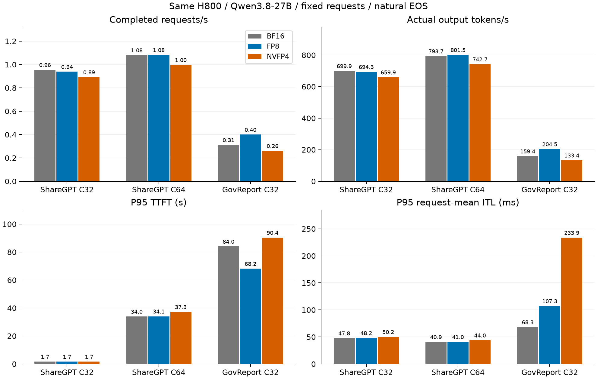
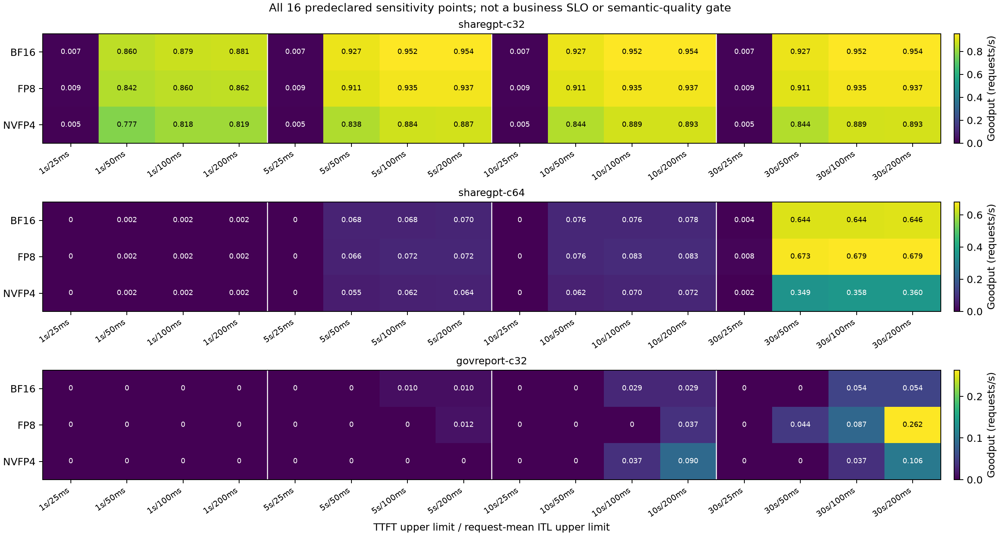
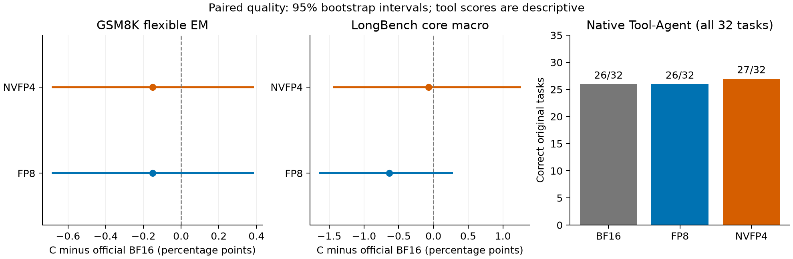
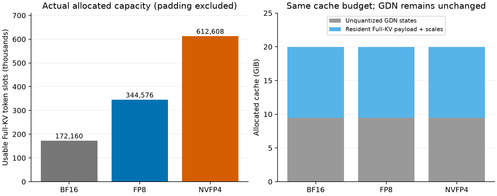
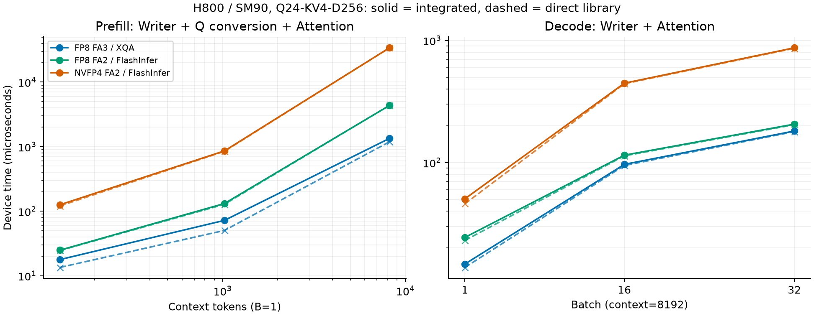

# 最新官方 xLLM：原生 KV 量化的真实服务增量

完成固定A/C实验；负结果、原始失败和限制均保留。本报告的“BF16 A”是官方源码加两行CUDA构建guard，完全不含我们的KV量化扩展。

FP8在ShareGPT C32/C64的输出吞吐为A的0.992×/1.010×，未显示稳定主负载收益；GovReport为1.283×，但P95请求平均ITL从68.33升至107.30ms、P95端到端从115.54升至122.13s。NVFP4三场吞吐比分别为0.943×/0.936×/0.837×。增量价值应按容量和延迟约束选择，不能把压缩倍数当吞吐倍数。

质量方面原工具32题为BF16/FP8/NVFP4 26/26/27；RepoBench-P量化均下降约4.2pp。没有用户给定的非劣效界限，不宣称无损或已接受生产质量。

## 固定版本与协议

| 角色 | 实际版本/范围 |
|---|---|
| 官方A0 | `xLLM-AI/xllm@261274e5f45449e98d7740144c3a958a29f1fd3e`，2026-11-02任务开始时同步的main，干净worktree保留 |
| 实测BF16 A | `721afdabc1de1af8e594b4da3e6fa926def50821`，仅给NPU-only MTP helper调用补两行CUDA平台guard；A0原编译失败保留 |
| 实测量化C | `da7c6446ff4361c8060633b04d6bfb77e6f737ff`；从同一官方base选择性移植，7个独立提交、无旧分支merge；[源码归属](SOURCE_PROVENANCE.json) |
| B回归 | C公共改动的最小BF16功能/Cache/Prefix/GDN/Graph验证；无完整B性能矩阵 |
| 历史D | `production/nextgen-native-kv-v1@03134b72`保留；不同版本结果不计算A/C加速比 |
| 模型/硬件 | 相同既有Qwen3.8-27B文本权重，H800/SM90单卡；核心质量和服务固定GPU0，三格式工具固定GPU1 |
| 公共服务配置 | Python Executor、正常FlashInfer BF16基线；Graph/Chunked Prefill/Prefix开启，max batch32、batch token8192、HBM上限0.90、page128 |
| 依赖 | 复用torch2.10.0+cu130、FlashInfer0.6.18.post1@8bc3b578、Triton3.6、transformers5.3镜像；A/C完全相同 |

复用镜像高于官方Docker列出的Torch2.7.1/cu128、FlashInfer0.6.14，结论不冒充官方发布镜像CI。单卡非PD构建一致关闭etcd组件（原镜像无Go）；私有ZeroMQ4.3.5/Cutlass-core4.8.1覆盖未修改共享全局环境。18个既有权重分片55,563,006,776 bytes逐SHA冻结，无模型下载；[权重与Tokenizer身份](MODEL_IDENTITY.json)列出每个分片SHA。实际A/C binary SHA分别为`b774ace2fd7341bc70477be0cd7a44d930330a15311a42c1af216287c021721a`、`74668d5e5d73a0dc23f70679350851b10c11c99e42c6961f511dee33ab7f60e9`。

| 真实负载 | warmup/测量 | 客户端压力 | 原生成规则 |
|---|---:|---|---|
| 历史ShareGPT原始文本/消息/历史 | 16/512，各压力同一批 | C32、C64 | temperature0/top_p1、自然EOS、原max_tokens1024 |
| GovReport完整8K–20K文档 | 4/64 | C32 | 同上，自然EOS、原max_tokens512 |

ShareGPT原索引0:16仅warmup、16:528测量。27B官方Tokenizer重算平均/最大1143.371/3229 tokens；GovReport测量平均12596.141。所有服务端prompt usage逐条核对，没有沿用14B token数。每格式1088正式请求、36独立warmup；每场新服务进程，固定AIPerf0.13与同一批输入。正式服务不并行其他我方模型，不在有效负结果后改变配置。C64不表示64请求同时驻留；GDN固定66槽约9.46GiB，max batch32避免压缩Full-KV预算以强行追求C128。这是预先固定、考虑GDN预算的单点生产配置，未穷尽调度/批量参数最优值。

## 服务结果

所有场次由完整原始HTTP/SSE、usage、实际启动命令、输入Token和正式窗口独立重算。A/C衡量完整量化集成路径的增量，含格式所需Attention后端差异，不把全部收益解释为存储压缩的单因果。吞吐以第一真实请求开始至最后完成为窗口；冷启动/加载/首次JIT及独立warmup在窗口外，实际占用时间仍进入资源账本。ITL尾部是**请求平均ITL**分位数，不能解读为逐token间隔尾部。

| 负载 | 格式 | 请求/s | 输出token/s | token/s比A | P95 TTFT(s) | P95请求平均ITL(ms) | P95 E2E(s) | Running峰值 |
|---|---|---:|---:|---:|---:|---:|---:|---:|
| sharegpt-c32 | BF16 A | 0.9554 | 699.87 | 1.000× | 1.705 | 47.79 | 46.923 | 32 |
| sharegpt-c32 | FP8 C | 0.9390 | 694.30 | 0.992× | 1.681 | 48.17 | 47.726 | 32 |
| sharegpt-c32 | NVFP4 C | 0.8925 | 659.90 | 0.943× | 1.743 | 50.25 | 50.007 | 32 |
| sharegpt-c64 | BF16 A | 1.0810 | 793.69 | 1.000× | 33.962 | 40.87 | 72.579 | 32 |
| sharegpt-c64 | FP8 C | 1.0831 | 801.48 | 1.010× | 34.077 | 40.97 | 72.100 | 32 |
| sharegpt-c64 | NVFP4 C | 0.9972 | 742.74 | 0.936× | 37.267 | 43.99 | 78.922 | 32 |
| govreport-c32 | BF16 A | 0.3118 | 159.35 | 1.000× | 84.030 | 68.33 | 115.538 | 13 |
| govreport-c32 | FP8 C | 0.3999 | 204.45 | 1.283× | 68.188 | 107.30 | 122.130 | 24 |
| govreport-c32 | NVFP4 C | 0.2611 | 133.41 | 0.837× | 90.370 | 233.87 | 202.129 | 32 |

每场仅一次正式观测，未声称统计显著、稳定胜出或跨版本胜负；P50/P95/P99、实际输出长度、完整窗口和HBM见[FP8全部指标](service-pair-A-FP8-a1.csv)、[NVFP4全部指标](service-pair-A-NVFP4-a1.csv)。ShareGPT两档FP8平均输出约比A长7/6 tokens，不能将约1%的token/s变化全归因于执行加速。A的ShareGPT224/228条、GovReport63/64条达到原上限，其余自然EOS；所有样本保留。

GovReport容量压力的实际采样如下（1秒顺序采样，各峰值不同步）：

| 格式 | Running峰值/均值 | Waiting峰值/均值 | 有效使用页峰值/物理页 | HBM峰值(MiB) | 真跨请求Hit tokens |
|---|---:|---:|---:|---:|---:|
| BF16 A | 13/10.49 | 30/16.19 | 1247/1346 | 75251 | 0 |
| FP8 C | 24/19.79 | 30/9.72 | 2529/2693 | 75387 | 0 |
| NVFP4 C | 32/25.72 | 30/5.64 | 3420/4787 | 75253 | 0 |

FP8 C相对A在GovReport预声明16点Goodput中提高/持平/降低为5/9/2；NVFP4 C相对A在GovReport预声明16点Goodput中提高/持平/降低为3/10/3。阈值预先固定为TTFT≤1/5/10/30s × 请求平均ITL≤25/50/100/200ms，全部16点保留；不是业务SLO，也未对完成答案做语义合格过滤。空答案不计Goodput，单token答案的ITL条件为空条件。

三格式九场服务的真实跨请求Prefix Hit均为0，不能把驻留规模宣称为Prefix服务收益。Prefix blocks含GDN检查点且可能与active重叠，不能与used/free相加推算物理所有权。Running/Waiting、HBM采样可漏峰，worker解析的数值与固定collector源码/SHA绑定；未保存HTML，不宣称独立重解析原HTML。

## 同版本质量与原生工具

每格式原1319 GSM8K、400 LongBench核心（8任务等权）及1独立长文补充，共1720请求；未截断原文，最大prompt67736，逻辑上下文262144。补充长文不进入宏平均（均50分）。原最大生成、自然EOS、所有空输出和失败均保留：A/FP8/NVFP4达上限89/87/85，合法空EOS6/6/7，协议错误0。代码相似度不是执行成功。

| 指标 | BF16 A | FP8 C | NVFP4 C |
|---|---:|---:|---:|
| GSM8K flexible EM | 96.740% | 96.588% | 96.588% |
| GSM8K strict EM | 96.816% | 96.664% | 96.664% |
| LongBench core宏平均 | 53.898% | 53.264% | 53.830% |
| 原生Tool-Agent原32题 | 26/32 | 26/32 | 27/32 |

| 相对A变化，pp [配对95% CI] | GSM8K flexible | LongBench宏平均 |
|---|---|---|
| FP8 C | -0.1516 [-0.6823, 0.3791] | -0.6342 [-1.6331, 0.2611] |
| NVFP4 C | -0.1516 [-0.6823, 0.3791] | -0.0688 [-1.4288, 1.2467] |

GSM按原问题配对，LongBench按同context问题整簇重采样；4000次、seed20261027。RepoBench-P为43.92→39.74/39.68（FP8/NVFP4），下降4.18/4.24pp，不被宏平均掩盖；全部逐任务/簇数/区间见[质量CSV](quality-per-task.csv)。用户没有给定非劣效界限，CI跨0不等于质量等价或生产接受。

工具固定原32会话/112用户轮、4并发、每轮10步、原1024上限、ThinkFalse、原生`qwen3_coder`。全部历史/API/SSE/usage及CPU状态-响应重放通过；无外部工具副作用、gold不进入服务路径。A/FP8/NVFP4实际模型API为352/353/349、内存工具调用269/266/265，完成107/109/110原用户轮。预算未完成任务A1/2、FP8 0、NVFP4 2均计0、保留32分母。FP8相对A新增通过1/52、失败0/156；NVFP4新增通过1/52、失败54。分数仅描述这32题，不是完整BFCL榜单、自然语言文风评分或模型整体优劣。

[6个质量/工具原作业的实际命令/缓存绑定](inference-binding-a2.json)与三场服务逐例日志都确认真实格式、Scale、Query、Writer及resident bytes；不是仅凭请求配置猜测执行路径。

## 算子、容量与兼容边界

| 格式 | Writer/常驻 | 实际Prefill/纯Decode | 可用Full-KV token槽（不含page0） |
|---|---|---|---:|
| BF16 | 官方BF16页 | 官方FlashInfer | 172160 |
| FP8 | fused Triton量化scatter；byte owner+FP8 alias | FA3 FP8-Q / XQA BF16-Q；K/V scales .125/.0625 | 344576 |
| NVFP4 | FlashInfer native slot writer；E2M1 packed数据+E4M3 block16 scales同页owner | FA2/FlashInfer BF16-Q；global K/V scales1/1 | 612608 |

实测Full-KV常驻A/FP8/NVFP4为11291066368/11295260672/11293949952 bytes（NVFP4另8 bytes全局Scale，FP8为0），GDN均66槽/10160308224 bytes且不量化。没有整缓存BF16 Shadow或异常后的隐藏fallback。NVFP4每D256 head为128packed+16scale=144字节；FP8为256、BF16为512。H800无Blackwell FP4 Tensor Core；FI SM90在tile shared/register解包到BF16 MMA，没有全局整缓存BF16 staging。

固定SM90 Q24/KV4/D256/P128，50次device Graph计时（微秒；不代表服务吞吐）：

| 单层阶段 | FP8 FA3/XQA | FP8 FA2/FI | NVFP4 FA2/FI |
|---|---:|---:|---:|
| Prefill B1/L8192，native Writer+Q+Attention | 1343.29 | 4356.39 | 34013.84 |
| 对应直接Attention | 1190.77 | 4363.28 | 33982.68 |
| Decode B32/L8192，native Writer+Attention | 181.19 | 206.21 | 869.87 |
| 对应直接Attention | 179.19 | 204.09 | 862.05 |

FA3的8K Query cast约120.75µs、Writer23.03µs，解释大部分额外开销；NVFP4在直接库也慢，不能归结为集成层隐藏解压。阶段规划单独计时、按16个Full Attention层摊销，预定规则选择FA3/XQA（Decode综合成本比.707106），没有用正式服务结果倒选后端。FP8 FA2和NVFP4 FA2通过原dense .02诊断；FP8 FA3 Prefill原dense .02失败保留（1044/1585152，max abs .055533）。独立Torch Q/K/V量化字节相同、直接FI完全复现误差、三阶段native/direct逐位相等；FA3会在PV前量化P。因此不能把原dense失败改成通过，也不能用直接库一致代替模型质量检查。没有重写Attention kernel工程。

- **混合批次/Graph：** [固定源码审查](EXECUTION_COMPATIBILITY.json)确认整批Prefill/Chunked标记排除Decode Graph，Full Attention/GDN整批走Prefill；FP8该批Decode行用FP8-Q/FA3，不走XQA。共享后端每步规划一次供16层复用，Graph bucket复用wrapper/plan。正式混合比例/Graph覆盖率未采集，不宣称所有请求进入Graph。A及C三格式资格各有实际服务6次Graph成功API/0错误；原torch profiler不支持的失败保留，正式服务无透明计数观察器。
- **Prefix/GDN：** 三格式均真实GovReport 11054-token冷请求Hit0，间隔独立请求后重发Hit8192且同答，恢复LINEAR checkpoint/GDN状态；不用API `cached_tokens` self-match作跨请求命中率。3项GPU-context Cache测试及完整页复制通过。服务九场Hit0与资格真实复用分别报告。
- **VMM：** 官方[`xllm.cpp:382`](https://github.com/xLLM-AI/xllm/blob/261274e5f45449e98d7740144c3a958a29f1fd3e/xllm/xllm.cpp#L382)在CUDA明确拒绝`enable_vmm_kvcache`、仅NPU支持。独立BF16 VMM尝试在加载模型前FAILED/released；FP8/NVFP4阶段未执行，无绕过或重试。746369024-byte core原地保留完整SHA，只下载84小证据，省略声明保留。正常CUDA默认allocator不启用VMM，没有为量化关闭正常功能。typed byte/gcd对齐只有CPU几何证据，不能称H800 Elastic VMM兼容；XQA/VMM显式拒绝。
- **B与公共改动：** 独立BF16最小回归通过16已知答案、3 Cache测试、Prefix8192/GDN恢复、6服务Graph API。CUDA guard、VMM几何、BF16 lazy import单独提交；没有公共Scheduler/Graph/Prefix改写，也不把公共优化收益归给量化。D128、其他GQA/模型、PD、offload、弹性回收均无本轮完整模型资格。

参考固定[vLLM FI源码](https://github.com/vllm-project/vllm/blob/f451c6254fe526a8108c291c6e6839f37f70dd1f/vllm/v1/attention/backends/flashinfer.py)的按Prefill/Decode切分、[SGLang](https://github.com/sgl-project/sglang/tree/582168dd7c3821198c92766f0319b9e1c8c17bd3)、[FI较新main](https://github.com/flashinfer-ai/flashinfer/tree/40f92526b5c6a513720ddb97f04a491462561d73)：SM90 FA3 FP8 KV仍要求FP8 Q、不支持NVFP4；experimental Cake NVFP4仅SM100/103/120、D128、dense/equal heads，不能迁用至H800/D256/GQA6。未穷尽所有后端/版本，也未为此更换共享环境。

公开[vLLM H100 Benchmark（2026-04-22）](https://vllm.ai/blog/2026-04-22-fp8-kvcache)的C8长文实验：Llama输出450.3→517.5 token/s，gpt-oss跳短窗量化831.6→871.8；D256 Gemma Decode ITL斜率约68%、TTFT二次项约1.6倍。硬件/模型/后端不同，仅支持阶段取舍的工程参考，不用于本轮加速比。旧约41K输入/约160输出长文负收益见[历史D报告](../../synthesis/NEXTGEN_NATIVE_KV_20261030.md)，不替代当前真实Decode负载。

## 合入建议与交付

1. CUDA/NPU构建guard值得单独提交审查。typed VMM对齐修复保留独立提交/CPU测试，需原支持平台审查，不能附带H800 VMM兼容声明。
2. FP8值得作为明确范围的可选后端审查：真实2倍Full-KV容量、容量压力吞吐收益、无整缓存Shadow；保持Scale/形状限制和后端标注。ShareGPT没有稳定收益，RepoBench-P与延迟取舍需要业务质量/SLO验收，不建议全局替换BF16默认。
3. NVFP4可审查存储/布局/Writer/Cache生命周期实现；H800直接算子的计算代价明确，本轮三场吞吐均下降且容量压力延迟明显变差；部分Goodput阈值仍有收益，但不建议将当前H800路径默认用于生产；不能以3.56倍Full-KV容量为由启用。更快原生FP4 compute应在有相应硬件/成熟内核的后续独立任务处理。
4. 混合批次阶段切分、Decode Graph覆盖、Prefill headroom属于独立公共引擎优化。若以后实施，单独提交并补受影响BF16场景；本轮没有扩展这项工程或在负结果后搜索配置。

[实现分支](https://github.com/MingASA/xllm_quant_kvcache/tree/research/upstream-native-kv-20261102)、[BF16 A分支](https://github.com/MingASA/xllm_quant_kvcache/tree/research/upstream-official-A-cuda-fix-20261102)均在用户fork；无官方PR。交付分支`a5ce9684`在实测后仅更新三个Markdown文件，运行时代码与`da7c6446`逐文件相同。原始证据、失败、精确源码/输入/binary SHA与本地归档验收见[EVIDENCE_CATALOG.json](EVIDENCE_CATALOG.json)；图均附CSV与source SHA。权重/共享环境不在证据压缩包中。资源与原票据最后只读结清、监控退出、最终权重身份复核见交付清单，不把计划或CPU打包当实机证明。
