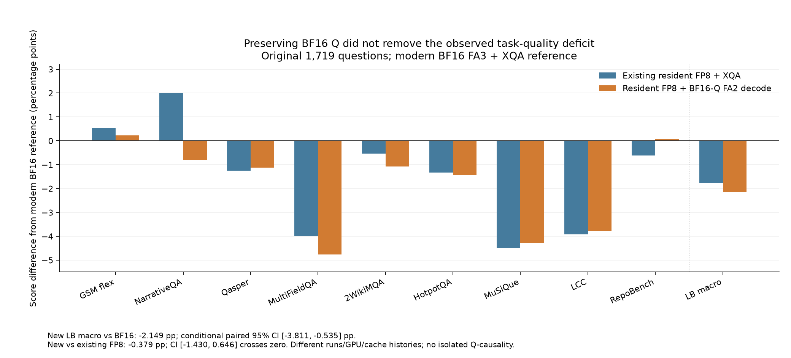

# 第46条补充：BF16 Q完整模型已验证，但未整体恢复质量

**生产决定：停止扩大本次 BF16Q_FA2 候选的额外服务GPU矩阵。** 保留BF16默认，原FP8-XQA已测到的有条件服务收益继续有效。本候选已经通过真实Graph128算子门槛和完整14B模型生成，完整1719题官方重评分也独立验收；但LongBench仍比现代BF16低2.1491572pp，没有观察到主要质量缺口的整体修复。这是明确配置的部署取舍，不能证明Q无影响，也不能把损失唯一归因KV或某个kernel。[候选原始审计](../operations/20261026T075846Z/bf16q_full1719_quality_independent_audit_b1.json)、[完整质量对照](../operations/20261026T075846Z/bf16q_full1719_quality_comparison_b1.json)

本篇是**原45条冻结快照之后的第46条补充**。原45行INDEX、STATE摘录、截至45的费用记录、原16张表和CSV都保留原字节；第45条模型前FAILED仍然成立。第46条b修复的是a未产生预测前的计划默认臂冲突，不是重跑成功预测，也不增加独立题目或用户。原索引第46摘录在取证时仍可能写“独立重评分pending”，新独立audit已完成，证据时间与层级分列，不改写源索引。[原45快照](data/INDEX_SNAPSHOT.csv)、[第46单行原索引摘录](data/POST45_INDEX_RUN46.csv)、[后续证据与决定](data/POST45_EVIDENCE_RUN46.json)

## 1. 本轮验证的候选与公平比较边界

| 项目 | 保留现代BF16参考 | 保留原FP8-XQA | 新FP8-BF16Q候选 |
| --- | --- | --- | --- |
| 模型 | Qwen2.5-14B-Instruct，BF16权重 | 同模型/权重 | 同模型/权重 |
| resident KV | BF16 | FP8 E4M3，无完整BF16 shadow | 仍为FP8 E4M3，无完整BF16 shadow |
| prefill | FA3 BF16-Q/BF16-KV | FA2 BF16-Q/FP8-KV | FA2 BF16-Q/FP8-KV |
| decode | XQA，内部BF16 Q | SM90 XQA，内部FP8 Q | 原生FA2，保留BF16 Q，核内转换FP8 K/V片段 |
| 质量run | 原完整C128配对的BF16臂 | 同一原完整C128配对的FP8臂 | 第46条，仅新候选单臂 |
| GPU/时间 | 原GPU3，同原配对时间 | 原GPU3，同原配对时间 | 新GPU0/不同时间 |
| 固定配置 | C128、prefix/Graph/chunked prefill；128seq/10240token/200admission/.8 | 同左，K=.125/V=.0625 | 同左，固定scale不改 |

来源：新旧audit的`production_configuration`、`model_weights_sha256`、`model_metadata_sha256`、`versions`、`protocol_files_sha256`；新run为`prod-quality-bf16q-full1719-c128-r1-20261027b`，源`acc0ed6bf8bcd4500d8e5260cec17c2b5c67a9e9`。[新audit](../operations/20261026T075846Z/bf16q_full1719_quality_independent_audit_b1.json)、[原现代双臂audit](../operations/20261026T075846Z/production_C128_quality_independent_audit_b1.json)

实际权重identity仍为`cf67b8e03cf159dd6017e36da84c28e143e59ce766261db2f6c97aabca7aae73`；模型metadata、Torch/Triton/Transformers版本、tokenizer与评分协议逐项一致。新旧引擎源码SHA仅`flashinfer.py`、`native_profile.py`两个显式attention/profile文件变化；评分器仅新增strict profile识别literal，评分/提取逻辑AST一致。[评分兼容证明](../operations/20261026T075846Z/bf16q_quality_scoring_compatibility_CPU_v1.json)、[本汇报字段核对](data/POST45_checks.json)

相同原始记录、prompt与协议支持逐题部署配置比较；**不同run、GPU、缓存历史、调度和attention实现，不构成Q单因子实验。** C128是客户端并发上限，不是固定实际GPU batch128。本次也没有新增SLO容量曲线，不能把原XQA的页数、最大服务能力或ShareGPT吞吐直接认证给新路径。

## 2. 完整1719题：主要质量缺口仍在

| 指标 | 记录/arm | 现代BF16 % | 原FP8-XQA % | 新FP8-BF16Q % | 新−BF16 pp | 新−原FP8 pp |
| --- | --- | --- | --- | --- | --- | --- |
| GSM8K strict_em | 1319 | 68.5367703 | 71.3419257 | 70.2805155 | +1.7437453 | -1.0614102 |
| GSM8K flexible_em | 1319 | 89.3100834 | 89.8407885 | 89.5375284 | +0.2274450 | -0.3032600 |
| narrativeqa | 50 | 32.5448077 | 34.5296942 | 31.7339799 | -0.8108278 | -2.7957143 |
| qasper | 50 | 42.9912087 | 41.7424455 | 41.8616883 | -1.1295204 | +0.1192428 |
| multifieldqa_en | 50 | 48.6327240 | 44.6326848 | 43.8764554 | -4.7562685 | -0.7562294 |
| 2wikimqa | 50 | 58.7114846 | 58.1731602 | 57.6398268 | -1.0716578 | -0.5333333 |
| hotpotqa | 50 | 64.7321839 | 63.3988506 | 63.2904762 | -1.4417077 | -0.1083744 |
| musique | 50 | 37.6154808 | 33.1268905 | 33.3322055 | -4.2832753 | +0.2053151 |
| lcc | 50 | 67.1400000 | 63.2200000 | 63.3600000 | -3.7800000 | +0.1400000 |
| repobench-p | 50 | 49.1400000 | 48.5200000 | 49.2200000 | +0.0800000 | +0.7000000 |
| LongBench 8任务macro | 8×50 | 50.1884862 | 48.4179657 | 48.0393290 | -2.1491572 | -0.3786367 |

来源：[质量比较JSON](../operations/20261026T075846Z/bf16q_full1719_quality_comparison_b1.json)，`task_scores`、`task_deltas`、`LongBench_macro`；[同表CSV](data/post46_quality_scores.csv)。GSM1319条、LongBench八任务各50条；百分比为官方分数×100，pp为百分点差，macro是8任务等权平均。三列重复原题，不能相加成更多独立用户。

复用主线已核验的[SVG图](../experiments/production-bf16q-quality-20261027/figures-v1/quality_deltas.svg)与[图源manifest](../experiments/production-bf16q-quality-20261027/figures-v1/manifest.json)，本汇报已目视检查并核对输入/产物SHA，没有复制或重画。蓝/橙柱分别为原FP8-XQA和新BF16Q配置对同一现代BF16参考的差值；图不能当Q单因子因果证据。

新候选GSM flexible89.5375284%，比BF16高.2274450pp、比原FP8-XQA低.3032600pp；strict70.2805155%，比BF16高1.7437453pp。strict和flexible的差异仍提示格式/答案提取影响，不能把strict增幅当同等数学能力提升。

长文、多跳与代码风险未解除：新MultiFieldQA43.8764554%（对BF16−4.7562685pp）、MuSiQue33.3322055%（−4.2832753pp）、LCC63.3600000%（−3.7800000pp）。LCC对旧FP8-XQA仅+.14pp、MuSiQue+.2053151pp，NarrativeQA对旧FP8-XQA则−2.7957143pp；各任务有升有降，未观察到整体修复。RepoBench略高于BF16也不覆盖其他任务的损失。代码仍是字符串相似度，不是执行正确率或完整agent成功率。[原字段及原始逐题分数](../operations/20261026T075846Z/bf16q_full1719_quality_comparison_b1.json)

| 指标 | 比较 | 实测差 pp | 配对bootstrap 95%区间 pp |
| --- | --- | --- | --- |
| LongBench macro | 新−BF16 | -2.1491572 | [-3.810786, -0.535092] |
| GSM flexible | 新−BF16 | +0.2274450 | [-0.985595, +1.442381] |
| LongBench macro | 新−FP8_XQA | -0.3786367 | [-1.429630, +0.646427] |
| GSM flexible | 新−FP8_XQA | -0.3032600 | [-1.516300, +0.833965] |

来源同一比较JSON，`bootstrap`、`paired_bootstrap_95ci`；5000次、seed20261026，LongBench在每任务内重采样，再对8任务等权平均。题目重采样不是GPU重复，也不是目标生产总体的质量保证。本汇报核对既有结果，没有再生成模型预测或重新选择题目。

新对BF16的LongBench差−2.1491572pp，95%区间[−3.810786,−.535092]pp，当前样本仍显示损失。新对原FP8-XQA差−.3786367pp，区间[−1.429630,+.646427]pp跨0，**不能声称新配置显著更差、不能从跨0证明等价；可成立的是本轮未观察整体修复。** 用户尚未接受数值非劣界，不能把1pp工程提案改写成用户的生产验收标准。

## 3. 逐题互换与生成上限都保留

| 指标 | 记录/arm | length次数 BF16/原FP8/新 | 新vsBF16 上/下/持平 | 新vs原FP8 上/下/持平 |
| --- | --- | --- | --- | --- |
| GSM8K strict_em | 1319 | 3/1/3 | 100/77/1142 | 59/73/1187 |
| GSM8K flexible_em | 1319 | 3/1/3 | 35/32/1252 | 28/32/1259 |
| narrativeqa | 50 | 0/0/0 | 2/6/42 | 1/7/42 |
| qasper | 50 | 0/1/0 | 2/4/44 | 4/1/45 |
| multifieldqa_en | 50 | 7/7/8 | 4/10/36 | 9/5/36 |
| 2wikimqa | 50 | 1/0/0 | 2/2/46 | 1/1/48 |
| hotpotqa | 50 | 1/2/2 | 0/2/48 | 0/1/49 |
| musique | 50 | 3/3/3 | 2/8/40 | 2/5/43 |
| lcc | 50 | 50/50/50 | 6/8/36 | 3/3/44 |
| repobench-p | 50 | 50/50/50 | 7/7/36 | 4/3/43 |

来源：比较JSON `paired_score_changes`、`cap_finish_counts`；本汇报从两份已评分audit的`paired_items`再次核对分数均值、源索引/ID和上/下/持平计数。[同表CSV](data/post46_quality_flips_caps.csv)、[核查记录](data/POST45_checks.json)。表中顺序“BF16/原FP8/新”固定；上/下指官方得分，不等同每个任务的二元对/错。

GSM flexible对BF1635改善/32退化/1252持平，对原FP8则28/32/1259；同分附近仍有逐题变化。MultiFieldQA相对原FP8虽9条改善、5条退化，均值仍低.7562294pp，说明改善条数不能替代分数变化幅度。两个代码任务三配置均50/50触及原64token上限，按冻结协议评分，未把length直接判错、提高cap或删题来修复负分。

## 4. 质量journal的有限cohort时钟：有参考价值，不新增正式服务收益

本节复用同一质量运行的完整JSON请求journal，起点为该任务第一个请求、终点为最后一个响应，包含client offering与drain。没有额外GPU实验，**没有新AIPerf稳态测量、流式TTFT/ITL或用户接受SLO goodput**。旧参考GPU3、新候选GPU0且时间/缓存/调度历史不同；N=50任务的尾分位只作描述。[时钟派生原件及限制](../operations/20261026T075846Z/bf16q_full1719_quality_cohort_latency_b1.json)

| 任务 | N | BF16有限RPS | 原FP8有限RPS | 新BF16Q有限RPS | 新vsBF16 % | 新vs原FP8 % |
| --- | --- | --- | --- | --- | --- | --- |
| gsm8k | 1319 | 12.018798 | 17.912775 | 14.190392 | +18.0683 | -20.7806 |
| narrativeqa | 50 | 0.628026 | 0.553578 | 0.622423 | -0.8921 | +12.4364 |
| qasper | 50 | 2.654829 | 2.256329 | 2.537949 | -4.4026 | +12.4813 |
| multifieldqa_en | 50 | 2.007133 | 1.881358 | 1.999341 | -0.3882 | +6.2712 |
| 2wikimqa | 50 | 1.797088 | 1.635633 | 1.744524 | -2.9250 | +6.6574 |
| hotpotqa | 50 | 1.126470 | 0.999719 | 1.025653 | -8.9498 | +2.5942 |
| musique | 50 | 0.924591 | 0.805677 | 0.777762 | -15.8804 | -3.4648 |
| lcc | 50 | 3.792270 | 3.530502 | 3.450950 | -9.0004 | -2.2533 |
| repobench-p | 50 | 1.210834 | 1.186107 | 1.178114 | -2.7023 | -0.6738 |

来源：时钟JSON `tasks.{task}.metrics.{arm}.finite_cohort_completed_RPS`、`paired_descriptive_changes`；[同表CSV](data/post46_cohort_rps.csv)。RPS=完成N/该有限任务first-request→last-response时间；它不是持续到达下的峰值吞吐。

全部9任务×3配置的时间窗口、实际输出总token/TPS、均值、完整JSON延迟P50/P95/P99/max与length次数在[27行完整时钟CSV](data/post46_cohort_all_metrics.csv)。例如GSM新RPS14.190392，较BF16+18.0683%，却较原FP8-XQA−20.7806%；新实际输出212843tokens，对BF16211508、原FP8211793。不能把+18%单独当新生产加速headline，更不能沿用原自然ShareGPT约+32%。

LCC三配置都生成3200tokens，新有限RPS较BF16−9.0004%、较原FP8−2.2533%；MuSiQue新较BF16−15.8804%、较原FP8−3.4648%。这些观测提示本候选也没有无条件的效率优势；它们仍不能分离kernel速度、GPU差异和调度/缓存影响，更不能据一轮短cohort给全局服务性能结论。

## 5. 完整性、成本与取证恢复

第46原root COMPLETE、driver释放，123文件/44462952B逐SHA完整取回；全部1719原记录、prompt/tokenizer/API/usage、实际weights、官方scorer、模型Graph与源码身份已独立核验、重评分通过。本汇报再次核对123镜像文件SHA与原终态绑定，仅复核文件/已评分数据，没有重复GPU或模型预测。[原audit](../operations/20261026T075846Z/bf16q_full1719_quality_independent_audit_b1.json)、[完整gzip镜像manifest](../../results/mirrors/prod-quality-bf16q-full1719-c128-r1-20261027b-terminal-b2-gzip/files/SNAPSHOT.json)

| 成本口径 | 数值 | 分母/含义 |
| --- | --- | --- |
| 原45条已结算累计 | 9.494151518055556 GPU-h | 原截止保留 |
| 第46实际占用 | .22991220958916667 GPU-h | 原allocation interval的纳秒时长；不是只计算生成阶段 |
| 第46结算时长 | 827683955 µs | driver释放边界按微秒向上取整 |
| 截至第46已结算累计 | 9.724063727777779 GPU-h | 与上轮累计+本轮ceil微秒计费一致 |
| 截至第46结算时 | reserved0、无active/UNKNOWN | 不预支后续CPU提案或其他任务 |

来源：原mirror中的[root result.json](../../results/mirrors/prod-quality-bf16q-full1719-c128-r1-20261027b-terminal-b2-gzip/files/support/agent_work/runs/prod-quality-bf16q-full1719-c128-r1-20261027b/result.json) `allocation_intervals_ns`、原audit `actual_gpu_hours`；累计账由主agent最终结算给出，本地按ceil微秒重算一致，见[后续费用记录](data/POST45_EVIDENCE_RUN46.json)。没有货币价格或标准生产冷启动成本，不能从该质量run计算上线每请求账单。

首次xz镜像因SSH keepalive无响应退出255，partial保留且未当有效raw；只读重连核实同一COMPLETE后，改gzip完整取回。客户端`ServerAliveCountMax`从2改6，`ServerAliveInterval=10s`，约60s保活窗口；size/hash/归属边界没有因此放宽，两次取证均`remote_writes=0`。这是**取证恢复，不是GPU/模型失败**，原实验没有重跑。[失败transport](../../results/mirrors/prod-quality-bf16q-full1719-c128-r1-20261027b-terminal-b1/transport.json)、[成功transport](../../results/mirrors/prod-quality-bf16q-full1719-c128-r1-20261027b-terminal-b2-gzip/transport.json)

## 6. 决策影响与下一步

| 项目 | 第46之后的判断 |
| --- | --- |
| 此BF16Q_FA2候选继续额外服务GPU矩阵 | 按预案停止：未观察到主要质量缺口整体修复，继续扩服务证据的决策价值不足 |
| 原FP8-XQA的条件化价值 | 保留：真实resident容量与既有聊天/压力结果属于原配置，不因本候选未修复而抹除 |
| 默认配置 | 仍BF16；本候选原始完整性与官方评分通过，不等于质量被接受 |
| Q是否是主要根因 | 未确定：本轮未隔离Q单因子，不能证明Q无影响或KV/某kernel为唯一根因 |
| 下一证据方向 | 主agent仅CPU核实长文/代码heldout KV范围证据与可部署配方；这是proposal，不是新激活、scale或GPU结果 |

算子正确、完整模型生成、任务质量可接受、正式服务净收益是分开的门槛。本轮前两层已过，质量没有显示整体修复，因此在此候选停止扩张，项目总体继续按生产价值推进。短聊范围探针不覆盖长文/代码；仍不根据评测答案盲调全局scale，也不重跑已完成GPU来填矩阵。

新增4表及CSV由[补充生成器](build_post45_supplement.py)派生；[9组补充核查与12个SHA绑定](data/POST45_checks.json)、[新增输入SHA](data/POST45_sources.json)、[35个原文件冻结SHA](data/POST45_FROZEN_ORIGINALS.json)分别记录第46的证据与原45层的保留边界。原[正式实验报告](../experiments/production-bf16q-quality-20261027/REPORT.md)保留全精度task_scores.csv及27行journal时钟；完整来源与本汇报最新产物SHA统一更新于[SOURCES](SOURCES.md)。
