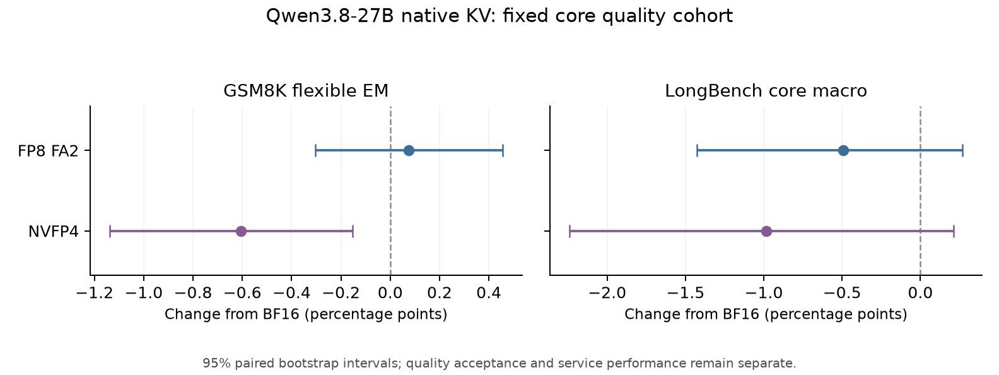
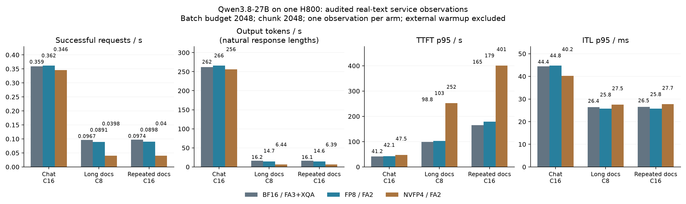
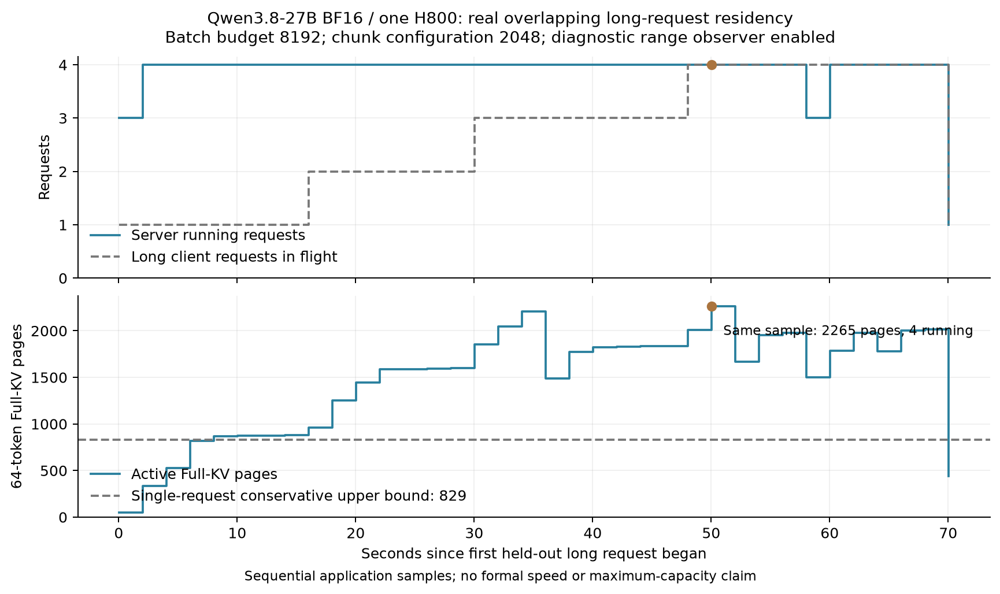
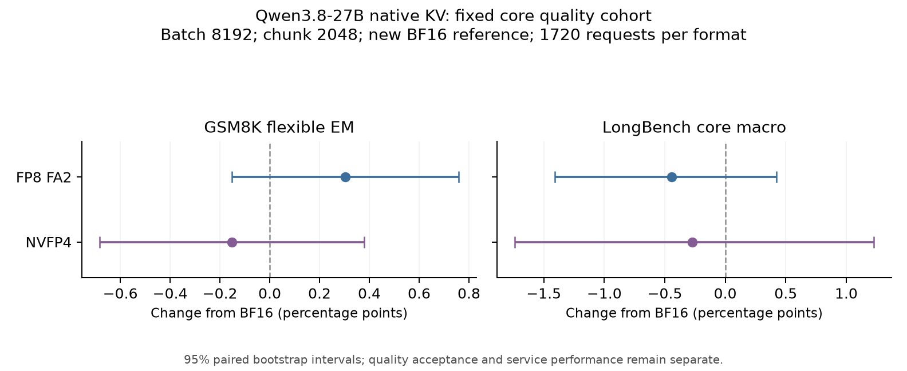
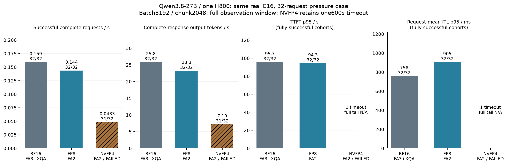
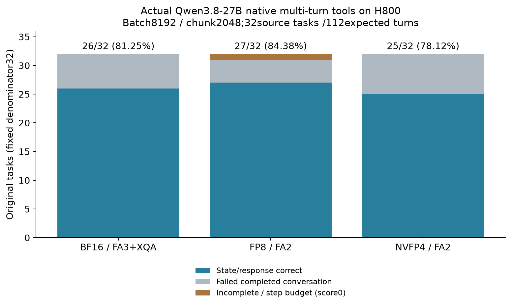

# Qwen3.8-27B 原生低精度 KV Cache 工程与生产实验

状态：本轮实现、实机实验、独立评分、图表、归档与资源收尾已完成；本报告只把已完成独立原始审计的结果列为 confirmed。2026-10-30 本轮来自原会话完整恢复后的真实续接，旧 project-briefing 仍封存第 46 条。

## 当前结论

BF16、原生 FP8 E4M3 和原生 NVFP4 已在同一 H800 GPU 7 上运行 Qwen3.8-27B 文本模型，实际完成 CUDA Graph、20 条已知答案、A/B/A 缓存重用和 128 个真实聊天请求。三格式分别有完整的 1720 条核心质量评分。短聊天中的单次吞吐差异较小；当前更明确的收益是固定 Full-KV 预算下的物理 token 槽位增多。质量接受阈值和业务 SLO 未由用户指定，因此没有自动宣布低精度方案可默认上线。

原2048配置的三格式聊天、独立长文、重复文档服务共9组，以及三格式真实工具32任务均已完成原始审计与独立评分。新8192/2048候选已通过BF16真实136请求pilot及同采样并发驻留资格，随后三臂各完整1720质量均已独立评分与归档。新压力W因CLI重复会话被严格审计拒绝，原FAILED保留；修复协议已通过实际194条CPU CLI、442项测试和新WC真实GPU的全部32请求。新压力三条件已完成独立取证：BF16/FP8各32成功，NVFP4为31成功/1个600秒超时且原FAILED保留；新工具三格式已独立26/27/25of32（FP8一项未完成保留计0）。所有GPU作业已结束/释放、83条账本记录全SETTLED，最终证据目录和完整范围审计已补齐。

## 当前部署判断

| 方案 | 当前判断 | 直接依据与条件 |
|---|---|---|
| BF16 / FA3+XQA | 作为已验证的文本服务参照 | 原配置真实聊天/长文/工具与新配置质量、压力均有原始证据；新调度增加流式停顿，仍须按业务尾延迟选择配置。 |
| 原生 FP8 / FA2、BF16 Q | 有条件保留为显式开启的容量选项 | 实测有效FullKV页超过BF16整个物理池；本次新压力请求率较BF16低9.83%，质量与工具得分不等于业务已接受。FP8 XQA模型路径未取得资格。 |
| 原生 NVFP4 / FA2、BF16 Q | 保留实验实现；当前高压部署条件不接受 | 原配置有限负载可完成，压缩存储/真实模型/Graph已验证；新C16压力1/32超时且成功尾延迟较高，不能因物理槽位多而默认启用。 |

这个判断针对固定H800、模型、后端版本和已测服务组合。源码可进入带能力检查与opt-in边界的本地评审；没有宣布所有平台、服务SLO或默认生产配置完整验收。最大admission、持续到达trace、长时间soak、硬件带宽和最终自然语言工具答案质量仍未验证。本轮不追加无边界实验来把这些未知包装成通过。

## 来源与执行边界

- 源码工作树：`/home/mingasa/projects/xllm_quant_kvcache-agent-nextgen-native-kv-20261027`，分支 `production/nextgen-native-kv-v1`。评审差异为 `11e7cddbfe33eb21d209c7f48f5e461ac56545eb..03134b72ec904254890300a647c939095f7900e2`，40 个文件、2136 行新增、87 行删除。
- 实际 C++ binary 源码 `862c29cade05e47691147b8f50c979a812495470`；binary SHA-256 `dbc1c53a6d711ad883d2227c55429c1977347acd9e1bfa50b1fb479a0cc25f09`。Python 源码 `03134b72ec904254890300a647c939095f7900e2`。二者的差异只含已核查的 Python/测试/文档更改，没有用新 C++ 源码冒充已构建 binary。
- 固定镜像 `sha256:a77472b8bcd25797bad288712f7abd676beae6264b353de301ec43a08bd39dc2`；实际 FlashInfer `0.6.18.post1`。模型、tokenizer、runtime、输入和结果的逐文件 SHA 保留在各 run 镜像及审计中。
- 物理设备 `GPU-47211491-ba0d-78bf-5c84-f968c0648213`；单卡 H800/SM90。共享节点允许其他卡被他人使用，未占用、修改或停止他人任务。每个新 GPU run 都经一次性 launcher、原始票据、120 秒选卡空闲窗口、资源/预约/身份检查和独立 watchdog。
- 新模型直接使用已有只读权重；没有下载大权重、安装全局依赖、在 H800 运行 Codex、修改共享环境或向官方 push/发 PR。当前私有授权使用同一 budget_id 和累计账本，没有清零历史 GPU 用量。

完整恢复材料：[恢复报告](../operations/session-recovery-20261030-01a1765d/RECOVERY_REPORT.md)、[全部 37 条用户消息](../operations/session-recovery-20261030-01a1765d/USER_INSTRUCTIONS_FULL.md)、[会话转接提示词](../operations/session-recovery-20261030-01a1765d/NEXT_SESSION_PROMPT.md)。原始 JSONL 的 SHA-256 为 `3c38100d41de4af38ccfd4f67fe9383e7c52af763307c126a0d38cc9ebe587d8`，共 35,205 条记录；原会话 ID 为 `01a1765d-9953-7760-a9fa-102c05c766d7`。

## 模型与存储

核查的本地配置为 `qwen3_5_text`：64 层中 16 层 Full Attention、48 层 GDN；hidden 5120，24 个 query heads、4 个 KV heads、head_dim 256。本轮输入/历史的验收预算为 131072，已测长文约 27K–68K token；该预算显式属于 `validation_input_budget_not_server_context_cap`，不是服务器通过 CLI 强制设定的 context cap。没有把配置里的 262144 当作已验证服务长度。视觉、MTP、TP/CP 扩展没有在本轮验收。

| 格式 | Full-KV 常驻表示 | 实际物理 token 槽位 | 相对 BF16 | Full-KV 常驻字节 | GDN 常驻字节 |
|---|---|---:|---:|---:|---:|
| BF16 | BF16 K/V | 247552 | 1.000 | 16223567872 | 5234098176 |
| FP8 E4M3 | FP8 K/V；全局 K/V scale；现有分配器仍保留 scale slots | 487552 | 1.969 | 16225730560 | 5234098176 |
| NVFP4 | E2M1 打包 K/V + 每 16 分量一个 E4M3 block scale + 8 字节全局 scale | 880320 | 3.556 | 16226058240 | 5234098176 |

这些是运行时实际张量分配与物理池容量，不是最大成功并发，也不是整台服务显存缩小相同倍数。 NVFP4表中的Full-KV字节是分页payload/block-scale池；共享attention backend另持有两个FP32全局scale，共8字节，不按token或层重复计入。分页池+GDN+该固定scale合计21460156424字节，仍不含权重/workspace。GDN conv/recurrent state 保持原有 dtype；三格式总 cache 分配约 21.46 GB，权重和 workspace 另计。FP8/NVFP4 算子直接消费常驻压缩 pages，没有全缓存 BF16 shadow。SM90 上的 NVFP4 表示压缩存储和片上解码，不表示 Blackwell 原生 FP4 Tensor Core 计算。

BF16 使用 FA3 prefill + XQA decode；低精度主测使用 BF16 query 的 FA2 paged prefill/decode。后端不同是明确的部署选择，结果不解释为 dtype 单因素因果效应。FP8 XQA 的算子证据与模型就绪分开：原 `o` 的算子检查有独立复算，模型启动 900 秒超时仍未解决，不能声称该模型/XQA 组合已通过。

## 核心质量

相同冻结 cohort：1319 条 GSM8K、400 条 LongBench 核心长文/检索/代码项目和 1 条完整长文补充。全部实际 HTTP/SSE/usage 与输入身份经过独立核查。代码项目使用的相似度分数不是代码执行成功率。

| 格式 | 预测条数 | GSM8K flexible EM % | strict EM % | LongBench 核心 macro % |
|---|---:|---:|---:|---:|
| BF16 | 1720 | 96.8158 | 96.8916 | 54.2612 |
| FP8 E4M3 | 1720 | 96.8916 | 96.9674 | 53.7692 |
| NVFP4 | 1720 | 96.2092 | 96.2092 | 53.2782 |

FP8 相对 BF16 的 GSM flexible 差为 +0.0758 pp，配对区间 [-0.3033, +0.4549] pp；LongBench macro 差 -0.4920 pp，区间 [-1.4263, +0.2679] pp。NVFP4 相对 BF16 的 GSM flexible 差 -0.6065 pp，区间 [-1.1372, -0.1516] pp；LongBench macro 差 -0.9830 pp，区间 [-2.2386, +0.2102] pp。区间来自保留样本/文档簇的配对分析，不是多次部署的运行方差估计。

BF16 原 `j` 是 FAILED run 的 1720 条原始输出恢复，六条空 stop 仍计零分；没有改其终态。FP8 来自 FAILED `t` 保留的 918 条与 COMPLETE `ab` 的不重叠 802 条，按预先冻结 ID 补齐，未按答案正确性选择，也不是一次不中断的运行。NVFP4 `p` 为原 COMPLETE 的完整 1720 条。所有失败和原始响应保留。

[FP8 配对分析](../experiments/nextgen-quality-20261030/fp8-fa2-t-ab-vs-bf16-j-a1.json)；[NVFP4 配对分析](../experiments/nextgen-quality-20261028/nvfp4-p-vs-bf16-j-a1.json)。

图由 `scripts/render_nextgen_quality_comparison.py` 从上述 JSON 生成，输入 SHA 与绘图值在图目录的 `inputs.json`。

## 端到端服务

聊天使用 128 个真实源请求、并发 16，另有 16 条外部 warmup。长文使用 16 个不重复、未截断原始文档、并发 8，另有 2 条外部 warmup。原生成上限保留，自然 EOS；不要求固定输出长度。Graph、分页、chunked prefill、prefix cache 开启；max batch 16、linear state slots 32、chunk token budget 2048。冷启动和外部 warmup 不计入正式速率。该闭环需求不是生产到达时间 trace。

<!-- SERVICE_TABLE_BEGIN -->
| 场景 | 格式 | 完成/请求 | 请求/s | 输出 token/s | TTFT p95 s | ITL p95 ms | 平均输出 token | stop/length |
|---|---|---:|---:|---:|---:|---:|---:|---:|
| chat-c16 | bf16 | 128/128 | 0.359442 | 262.171 | 41.169 | 44.444 | 729.38 | 74/54 |
| chat-c16 | fp8_e4m3 | 128/128 | 0.362153 | 266.279 | 42.081 | 44.811 | 735.27 | 69/59 |
| chat-c16 | nvfp4 | 128/128 | 0.345728 | 256.366 | 47.488 | 40.194 | 741.52 | 64/64 |
| long-unique-c8 | bf16 | 16/16 | 0.096722 | 16.171 | 98.797 | 26.429 | 167.19 | 12/4 |
| long-unique-c8 | fp8_e4m3 | 16/16 | 0.089110 | 14.670 | 102.633 | 25.763 | 164.62 | 12/4 |
| long-unique-c8 | nvfp4 | 16/16 | 0.039829 | 6.445 | 252.453 | 27.530 | 161.81 | 13/3 |
| long-prefix-c16 | bf16 | 32/32 | 0.097360 | 16.083 | 165.367 | 26.541 | 165.19 | 24/8 |
| long-prefix-c16 | fp8_e4m3 | 32/32 | 0.089763 | 14.609 | 179.027 | 25.781 | 162.75 | 24/8 |
| long-prefix-c16 | nvfp4 | 32/32 | 0.039983 | 6.389 | 401.110 | 27.717 | 159.78 | 26/6 |
<!-- SERVICE_TABLE_END -->

同一聊天观察中，FP8 相对 BF16 请求率 +0.754%、输出 token 率 +1.567%；NVFP4 分别 -3.815%、-2.214%。自然输出均长分别为 729.38、735.27、741.52 token，必须和 token 速率一起读。每格式每场景目前只有一个观察，不宣称统计显著收益、业务 SLO goodput 或默认质量接受。

原始独立审计：[BF16 E](../operations/session-recovery-20261030-01a1765d/BF16-E-independent-AIPerf-audit-a1.json)、[FP8 C](../operations/session-recovery-20261030-01a1765d/FP8-C-independent-AIPerf-audit-a1.json)、[NVFP4 B](../operations/session-recovery-20261030-01a1765d/NVFP4-B-independent-AIPerf-audit-a1.json)、[长文 BF16 F](../operations/session-recovery-20261030-01a1765d/long-BF16-F-independent-AIPerf-audit-a1.json)。各结果都要求全部请求完成、原始 payload/SSE/usage/时钟/telemetry、源码和实际 Graph 通过，而非读取 worker 摘要就判成功。

完整尾延迟和单GPU时间成本见 [逐场景CSV](../experiments/nextgen-service-20261030/tabular-original-nine-v2/service_observations.csv)，含TTFT/ITL/E2E的p50/p95/p99、实际输入输出、stop/length、正式GPU秒/成功请求与完整资源租期秒/请求。每行重新执行完整SHA/raw审计；后者包含冷启动、门槛和回收，不当作长期稳态单价，没有套用外部云价格。原配置9行均已完整回收并逐行重新审计；包含528条正式请求、60条外部warmup及180条已知答案检查。

AIPerf 导出的无时区 wall clock 在本环境比主机 UTC 快 8 小时，报告使用其持续时间和核对过的 epoch/monotonic 记录；没有给这些无时区字符串加上 UTC 标签。GPU memory-controller utilization 是活动百分比，未当成 HBM GB/s。

三格式长文各16请求现都已独立审计：FP8 H 179.554秒、0.0891096请求/s，较BF16 -7.871%；NVFP4 G 401.715秒、0.0398292请求/s，较BF16 -58.821%。FP8额外/vars计数完整覆盖659006prompt、0prefixhit，不能用物理池增益推断该unique场景的吞吐增益。图由 `scripts/render_nextgen_service_figures.py` 生成，逐输入SHA和绘图值在图目录。

## 调度配置的后续修正

当前9条服务观察均属于batch2048/chunk配置2048。C++实录确认两者相等；DecodeFirstPolicy先预留decode token，hybrid prefill又要求chunk对齐，这提供了长文running峰值1的明确配置风险。源码解释仍需真实验证，现有结果不能代表更有headroom的配置或所有生产部署。控制仓仅实现一个显式8192/2048候选；真实BF16136请求pilot S已完成独立资格，同配置T/U/V完整质量亦已通过。后续正式实验仍绑定该实际pilot和对应新质量快照，旧配置结果不冒充新配置。候选、接受条件及有限顺序见 [执行计划](../../plans/MIXED_PREFILL_PILOT_20261030.md)。

## 调度、复用与资源开销

长文 BF16 F 已完整审计 16/16，659006 输入 token、2675 输出 token、165.422 秒。另一个受原容器 ID/UID/lease 约束的 stdlib 只读读者采样 `/vars`，不发模型请求、不调用 GPU、不写远端文件。88 个采样中 85 个在正式 worker 区间且可解析，1020 个数值从原 HTML 独立重解析；结尾三个连接拒绝保留为服务退出后的观测错误。

采样最高活动 Full-KV 使用 1024 blocks（最多 65536 个分配槽）、running requests 1、waiting requests 7；采样不能保证捕获峰值。计数器增量精确匹配正式 659006 输入 token，prefix hit 增量为 0。因此并发需求的逻辑输入和不能证明 live KV 达到 247552 容量。源码 `SchedulerPolicy` 的 chunked-prefill 预算/运行队列与短自然回答提供了调度解释，但尚未测得硬件瓶颈因果分解。

额外 `/vars` 读者在原容器的既有CPU quota内每2秒读取应用指标；它不调用GPU或模型，但CPU/HTTP采样开销没有单独量化。F/G/H/P/Q采用该附加观察，G原reader提前触及上限、O因前置时序失败未获得采样。GPU KV observation counter在正式服务中均关闭。这些观测与共享节点其他卡的动态负载均作为部署比较的限制保留，不把实测速率差解释为纯kernel或dtype因果。

CompositeBlockManager 的 prefix block gauge 对 Full-KV 和 GDN leaf 求和，不能把它除以 Full-KV 页数当作使用率。free blocks 为零时，仍可能有可回收 cached prefix；没有据此宣布活动 KV 耗尽。应用采样审计：[F 原 HTML/时钟核查](../operations/session-recovery-20261030-01a1765d/long-bf16-f-application-metrics-original-a1/INDEPENDENT_SUMMARY_a2.json)。

前缀驻留压力与活动KV压力需分开读。F/H的Composite prefix-index峰值为3898/7648项；源码确认该文本配置只有KV和LINEAR两个leaf，实际GDN张量仅34行，因此保守扣除34后，FullKV索引项至少3864/7614，分别接近3868/7618物理page预算（99.897%/99.947%）。这是由实测计数和固定分配得到的下界推断，表示前缀索引已接近池预算；不是直接把Composite计数除page数，也不是活动请求同时耗尽或最大admission证明。[计算、输入SHA与限制](../operations/session-recovery-20261030-01a1765d/prefix-index-pressure-derived-bounds-a1.json)。

为验证实际可复用容量，已完成的同配置场景为同 16 个文档各两个问题、32 个请求、并发 16；输入在本轮结果之前已准备，仍使用相同服务配置和同一质量 snapshot。它不等于完整 RAG 系统。 源数据具体为11篇 narrativeqa 各两个不同原始问题、5篇 gov_report 重复同一原摘要请求；总32请求、1,317,971逻辑输入token。后5篇并非额外独立样本；1720核心质量不覆盖gov_report摘要任务，所以没有该域的质量接受结论。实际 hit、排队、成功请求与尾延迟一起核对，不能只看物理容量倍数。

NVFP4 G 的同一完整长文16请求已独立通过117SHA/12,488,426B：401.715秒、0.0398292请求/s、6.444866输出token/s，对比 BF16 F 请求率 -58.821%，TTFT p95 252.453秒（BF16为98.797秒）。自然输出均长为161.81（BF16 167.19），不同后端和长文 prefill 成本一起影响结果；不解释为压缩dtype的单因素效应。该附加应用观察触及原16MiB上限，只覆盖604178/659006输入token计数，不能给出整个cohort的prefix命中率；完整AIPerf原始结果仍全部16条通过，没有为补采样重跑GPU。后续reader保持900秒、将纯CPU/本地回传上限改为48MiB，并明确记录上限。

BF16 O 的共享文档32请求已完整独立审计：328.678秒、0.0973598请求/s、16.0826输出token/s，TTFT p95为165.367秒，24 stop/8 length。NVFP4 P和FP8 Q均已完成独立完整审计。该场景证明请求可完成，暂不证明跨请求缓存复用收益。

新增原始计数审计发现 API 口径问题：O 的 `cached_tokens` 合计1,224,704/1,317,971（92.923%）；但独立长文 F 也有612,352/659,006（92.921%），同一 F 的应用初次准入 prefix-hit 计数却是0。源码显示 hybrid chunked-prefill 在块边界重新匹配已发布前缀，`Request` 保存整个请求过程中 shared-prefix 的最大值，而应用 hit counter 只记录首次准入。由此，API 值可以包含本请求先前计算的块，**不能当作跨请求命中率或省去的计算量**。O 因附加观察在ACK前失败，没有初次准入计数的完整采样；保留这一缺口，不为补数据重跑GPU。早期 a1 的原始数字保留，其“prefix reuse”解释由 [口径纠正](../operations/session-recovery-20261030-01a1765d/native-API-cached-counter-semantics-correction-a1.json) 和 [v2计数审计](../operations/session-recovery-20261030-01a1765d/prefix-BF16-O-independent-native-API-cache-a2.json) 覆盖。

NVFP4 P前缀场景已独立117SHA/18,534,119B通过：32/32、800.333秒、0.0399833请求/s、6.38859输出token/s，26stop/6length；较BF16 O请求率变化-58.932%，TTFT p95 401.110秒。额外407个采样/4848个原HTML值独立重解析，所采区间hit counter增量0。prompt counter显示从125093到`1.44306e+06`，解析增量1,317,967与原API总1,317,971差4 token；这与HTML科学计数法精度兼容，但原“精确全cohort覆盖”flag仍为false，没有改原计数或放宽门槛。[完整性能](../operations/session-recovery-20261030-01a1765d/prefix-NVFP4-P-independent-AIPerf-audit-a1.json)、[显示精度边界](../operations/session-recovery-20261030-01a1765d/prefix-P-application-counter-display-precision-a1.json)。该比较仍为不同后端的一组部署观察，非纯dtype因果。

FP8 Q亦已独立117SHA/19,062,395B：32/32、356.492秒、0.0897635请求/s、14.6090输出token/s，24stop/8length，TTFT p95 179.027秒；对BF16 O请求率-7.802%。额外184采样/2172原HTML值重解析，counter显示同样1317967输入增量/0hit，仍比实际1317971差4且exact-span=false。P/Q最终API cached counter均为1224704，但该请求最大shared值不证明跨请求复用。原配置三场景各三格式均完成；新调度profile另行验证，不把两种配置合并为同一对照。

下表是聊天作业 GPU 资源租期的单调时钟长度。剩余列包含算子/JIT、模型启动、正确性门槛、CLI/export 和回收等所有非 warmup/正式 AIPerf 观察时间，不能当作单独的量化 writer kernel 开销。

| 格式 | 资源租期 s | 正式 AIPerf s | 外部 warmup s | 其他租期 s |
|---|---:|---:|---:|---:|
| bf16 | 664.509 | 356.107 | 34.346 | 274.056 |
| fp8_e4m3 | 694.738 | 353.441 | 33.656 | 307.640 |
| nvfp4 | 1154.430 | 370.233 | 35.227 | 748.971 |

NVFP4 B 启动期已看到本作业私有 ninja/nvcc/fatbinary 在推进，GPU 1047 MiB/0% 不代表卡死。每次隔离冷启动的编译成本与正式稳态性能分开记录。尚无 Nsight/CUPTI 硬件 HBM 流量、量化 writer 独立 kernel 占比或长期故障率结论。

有限稳定性证据还包括原质量运行中的实际请求区间：BF16 j 的1720请求覆盖1366.666秒（原FAILED保留），NVFP4 p的1720覆盖2141.280秒且原COMPLETE，FP8 t918覆盖357.086秒/原FAILED、ab802覆盖1083.021秒/原COMPLETE。它们是实际原请求单调时钟跨度，排除了请求前冷启动，不能当作AIPerf吞吐或多日soak；FP8两个区间也不能拼成连续1720。详见 [原始服务跨度与状态](../operations/session-recovery-20261030-01a1765d/bounded-original-quality-serving-spans-a1.json)。

空回答亦保留：BF16为6条，FP8/NVFP4各7条，均为RepoBench-P的一token/stop空文本，在逐条质量文件中计0。BF16原client还把12条旧tokenizer元数据差异算作contract异常，已用固定官方JSON tokenizer独立纠正；不能直接比较不同历史client的原 `contract_valid` 数量充当模型可靠性。HTTP200、协议完整、答案正确和长期稳定性分别报告。

## 原生工具多轮

工具路径发现并修复了一个实际验收漏洞：原 CPU 探针直接把有序 wire JSON 传入 minja，没有经过生产 `proto::Tool`/`JsonFunction` 转换；schema 的键序、number→double、额外 `response` 字段丢弃都与服务器不同。这会在真实 API usage gate 处失败。修复只作用于渲染副本，不改原始 HTTP 请求、工具状态字典顺序或字符串 arguments 历史。

新探针真实解析 `google::protobuf::Struct`，执行从固定 `request_params.cpp` 逐字提取的转换函数，再用固定 minja gitlink `1e65bd7254aa974d4bc01f9819acec0a0f7bb2d3` 渲染。完整 224 条动态历史、32 会话/112 用户轮、173 次真实有界内存工具调用通过；224 条 SSE 仍是 CPU fixture，不能称作模型输出。完整 CPU 单测 424/424 通过。

新 H800 CPU f 容器实际 runc、network none、2 CPU、8 GiB、无 GPU compute device、未载入模型、退出 0/OOM false；原 acceptance SHA `53bb95d7ad9ab01a0aa2d4577127f4dc6996b64ce6693ea7ea125dce0f5200be`。当前 gate 绑定完整 protobuf 协议版本、C++ proof SHA、五个 runtime 源码 SHA 和实际完成的原容器。旧 AE/AF/i/j/k 包已 INVALID，不能派发；CPU e 的较窄 proof 也保留并明确被覆盖。

[当前 CPU f 独立资格](../operations/session-recovery-20261030-01a1765d/native_tools_CPU_f_independent_image_qualification_a1.json)；[完整 protobuf C++ proof](../operations/session-recovery-20261030-01a1765d/full-protobuf-CPP224-proof-original-a1.json)。控制仓修复 commit `1d99bcd`。

<!-- TOOL_MODEL_RESULTS_BEGIN -->
原2048配置三格式均有实际native add准入、20known/A-B-A/Graph、完整原始镜像和独立state/response回放评分，全部保留32个原任务。

| 格式 | 原会话完成/32 | 用户轮完成/112 | 真实model API / 内存tool调用 | state/response正确/32 | 百分比 |
|---|---:|---:|---:|---:|---:|
| BF16 R | 32 | 112 | 347 / 259 | 26 | 81.25% |
| FP8 N | 31 | 110 | 365 / 281 | 26 | 81.25% |
| NVFP4 M | 32 | 112 | 351 / 260 | 24 | 75.00% |

FP8任务2触及每轮10步assistant/tool预算，未来两个用户问题没有强行注入，整题计0且留在32分母中。FP8与BF16总分相同，但配对有一项新增失败154、一项修复156；不能说输出/失败集合相同。NVFP4相对BF16为-6.25pp，新增失败0与106，原BF16六项失败仍失败。两组都绑定同source、reference、checker AST、service、设备及协议，不作32题之外的统计外推。

[BF16实际模型完整审计](../experiments/nextgen-tools-20261030/bf16-r-v1/actual_model_audit.json)、[FP8完整审计](../experiments/nextgen-tools-20261030/fp8-n-v1/actual_model_audit.json)、[NVFP4完整审计](../experiments/nextgen-tools-20261030/nvfp4-m-v1/actual_model_audit.json)；[FP8逐ID配对](../experiments/nextgen-tools-20261030/fp8-n-vs-bf16-r-a1.json)、[NVFP4逐ID配对](../experiments/nextgen-tools-20261030/nvfp4-m-vs-bf16-r-a1.json)。这不是完整BFCL榜单、最终自然语言答案质量或服务速度，也不是自动业务接受。

BF16失败ID为2、4、6、52、152、156（`multi_turn_base_`前缀），没有预算截断。任务2首轮只要求在documents创建TeamNotes.txt，模型纠正路径后额外写入模板，严格state checker预期空文件而判失败；这说明调用格式/会话完成不能替代状态正确。未改grader、未重选问题，不把所有语义失败解释为缓存误差。

旧L因main过早登记proposal到INDEX触发history去重，已核实无runsrow/ticket/root/CID/0GPU，INVALID/history/once锁保留。今后新INDEX必须实际原ticket+ledger+ACK后首登记。新R/M/N均按原一次性派发完成，M只读镜像十分钟TTL后续传，没有GPU重跑。
<!-- TOOL_MODEL_RESULTS_END -->

## 源码和主线评审

评审固定源码差异，未声称已经 rebase 或通过当前官方主线 CI。没有向官方发送 PR。可复核材料已生成：[源码来源与 SHA](../mainline/nextgen-native-kv-20261030/SOURCE_PROVENANCE.json)、[基于固定 base 的补丁](../mainline/nextgen-native-kv-20261030/native-kv-from-pinned-base.patch)、[增量 Git bundle](../mainline/nextgen-native-kv-20261030/native-kv-incremental-a2.bundle)。bundle 已通过 `git bundle verify`，补丁对干净 HEAD 的 reverse check 通过；增量 bundle 明确要求已有固定 base。固定源码的原 CPU Python backend/reference 测试日志为 86 passed，另一个 checkpoint shape 测试为 1 passed；控制器完整测试为442 passed；239个源码指纹中238仍相同，唯一后续更改是服务图ITL标签文字，数据/计算未变；[精确测试来源范围](../operations/session-recovery-20261030-01a1765d/final-tested-controller-source-accounting-a1.json)。失败压力清单4项正反例另列。这些 CPU 检查分别列证，不充当 GPU 验收。

### Strengths

- `LayerCache.storage_signature()`（`xllm/python/attention/backend.py:59`）覆盖 payload、scales、GDN state 的地址/shape/stride/dtype/device；`executor.py:484` 拒绝已绑定 storage 被换掉，符合 Graph 地址约束。
- `native_kv.py:15` 保留 Full Attention 的真实 layer_id 并独立统计 GDN；`flashinfer_nvfp4.py:38` 把成熟 slot writer、block-scale view 和 FA2 路径放在具体 backend 内，未向 scheduler 注入格式分支。
- `native_profile.py:25,44` 和 C++ admission 将 dtype、scale、planner/decode 不支持组合显式拒绝，typed flags 从服务到 worker/Python 有实际 binary 验证，默认 opt-in 边界清楚。

### Issues

#### Critical (Must Fix)

当前固定差异中没有已确认且仍未修复的 Critical 项。工具验收探针的 P1 漏洞已在控制仓修复，三格式实际 native add admission 与完整原始多轮审计均已完成；任务语义失败仍按原分母报告。

#### Important (Should Fix)

- `scripts/controller/official_tokenization.py:14` / `nextgen_tools_service.py:19`：旧 raw-JSON proof 缺失生产转换，不能作为 native tool API 的验收证据。新实现/真实 protobuf C++224/H800 CPU f 和三格式实际模型native API均已通过，旧包已禁用；已完成的实际32题质量与协议资格分别列证。
- `xllm/core/framework/request/request.cpp:230` / `scheduler_policy.cpp:404,537`：API最终 `cached_tokens` 与首次准入 prefix-hit 计数口径不同，chunked self-match 可导致零跨请求命中的unique场景仍报告约93%。这是固定 base 已有代码（本次40文件差异没有改这两个文件），不据此否定 HTTP/usage输入输出总数或已审计服务速率；主线维护者应在运营指标用于命中率前明确/修正语义，并验证分块、重调度和真实跨请求命中。当前冻结实验版本保持不变，报告不以该值证明缓存复用收益。
- `xllm/python/attention/native_profile.py:44` / `flashinfer.py` 的 FP8 XQA 分支：算子核查不等于实际 Qwen3.8 模型已就绪。默认采用本轮完成的 FA2/BF16-query 路径；该组合不得以“优化后端已通过”宣传，后续仅在明确修复启动问题时再做有限资格验证。
- `xllm/python/attention/flashinfer_nvfp4.py:38`：目前只对固定 SM90/FlashInfer/形状/文本服务组合有真实证据。合入时必须保留能力检查与显式 opt-in；其他架构/版本/视觉/分布式组合需要独立资格，不能从本轮外推。

#### Minor (Nice to Have)

FP8 原生全局 scale 路径仍保留分配器的 token/head scale slots。当前报告已把这些实际常驻字节计入，因此容量增益为 1.969 倍；将来可在不破坏缓存 page-copy/reference 共用布局的前提下精简，必须另行验证，而非在统计中把它们省略。

### Recommendations

围绕 typed native backend、hybrid storage 生命周期和实际能力矩阵组织最小主线补丁；把 operator 数值资格、真实模型/Graph、benchmark 质量、端到端服务和控制器安全分成独立验证层。GPU KV observation counter、原始 benchmark 审计与报表保持可选工具，正式计时关闭GPU KV counter。本轮长文的额外2秒/vars纯CPU采样单独记录，不声称零开销。保留数值 scale provenance 和失败证据，业务方决定质量/SLO 接受阈值后再讨论默认开启。

### Assessment

**Ready to merge?** 可进入**保留显式opt-in和能力边界的维护者评审**；不作为默认生产配置完整接受。固定源码的hybrid生命周期、三种原生格式、实际模型Graph与有限质量/负载证据已具备；新压力揭示流式停顿与NVFP4超时，应随实现一并交付。API cached-token语义、未取得模型资格的FP8 XQA及其他架构/版本不得被包装成已解决。当前补丁固定base，未验证最新官方主线CI，也没有提交或合并官方PR。

## 失败、恢复与归档

原质量 t 的原子改名扫描竞态、FP8 XQA o 启动超时、BF16 AA 的 frozen evidence import 缺失、D SSH uncertain 后双 S0 证实零 GPU/未创建，以及全部 CPU 初始失败均保留原结果。修复采用新 ID/明确恢复证书，未重跑旧编号或覆盖回执。新 GPU 派发只走 `python3 -B -m scripts.launch_guarded_once`。

质量部分已完成本地归档：4个原run的逐SHA镜像、旧/新cohort、完整逐条分数与配对图，共342个成员、282,723,086未压缩字节；压缩包92,731,072字节，SHA256 `2d64a53410634d203810159950b8bd2f70bc10f98338205f4a030679db9141eb`。全部成员在写包后重新读取并逐SHA验证。[归档验收](../../results/archive/nextgen-native-kv-20261030/quality-a1/ARCHIVE_ACCEPTANCE.json)。归档在本地，不含权重/安装环境，不冒充可直接部署包。

原配置九条服务及补充raw采样也已本地归档：1109成员/421,224,917原字节，压缩69,959,131字节，SHA256 `9f4463510f538af2f9ba0eaaadfc7638d160342da3189fef7927ead0826d57aa`，全部重读SHA过。[服务归档验收](../../results/archive/nextgen-native-kv-20261030/service-original-a2/ARCHIVE_ACCEPTANCE.json)。最初清单错误及未写入前退出的打包日志保留，a2以类型检查和前置退出码门槛恢复，无实验重跑。

本轮新配置的原始COMPLETE/FAILED、GPU释放、全SHA/raw镜像与独立审计已逐项保留。最终资源核查确认83条controller记录全SETTLED、无UNKNOWN/current reservation、无running labelled容器；原始数据在本地results/mirrors。状态入口是[NEXTGEN_ACTIVE_RECOVERY](../../state/NEXTGEN_ACTIVE_RECOVERY.md)，新旧profile不合并统计，失败不改写为通过。

原配置工具证据本地归档 `results/archive/nextgen-native-kv-20261030/tools-original-a2` 已独立重读验证1214成员、124721218原始字节；gzip21033830B，SHA-256 `e26be8e20a26db2828da78b975de6c64977604abdf2267c6135f596a6e1d4a25`。三组原镜像与逐条评分/失败/配对均保留；不含模型权重或整个原会话内部日志。最新442项CPU检查全部通过；首次本机PSI导致的测试fixture失败与仅测试侧确定性修正均保留，未放宽生产资源门槛。

指标口径补充：本报告ITL p50/p95/p99来自每个请求的平均ITL分布（AIPerf按生成阶段耗时除OSL−1，单token无ITL），不是逐个token到达间隔的总体分位数，也不是GPU kernel耗时。旧9组及新WC实际argv均未开启per-chunk usage，审计逐行核验该公式；原数值未改。[实际SDK/命令与公式来源](../operations/session-recovery-20261030-01a1765d/ITL_METRIC_DEFINITION-a1.json)。

## 单一8192/2048调度候选的实际pilot

S已独立验证完整93SHA/6303597B、20known/A-B-A/实际Graph和136真实校准请求。实际C++已解析的batch8192、chunk2048、maxseq16、linear32、memory0.9、CP1、MTP0与候选一致。同一个2秒采样处于多个长请求实际在途区间时，server running4、active Full-KV2265页，超过任何单请求原cap+padding的保守829页上界；不是把两个不同时刻峰值拼合。应用403样本中400有效，原HTML逐值重解析；有限序列采样不是原子硬件观测，也不证明最大容量或正式性能。BF16实际分配仍247552 token槽、Full-KV16223567872B与GDN5234098176B。

[独立pilot资格](../operations/session-recovery-20261030-01a1765d/mixed-bf16-s-independent-residency-pilot-a1.json)；[真实范围校准](../operations/session-recovery-20261030-01a1765d/mixed-bf16-s-independent-calibration-a1.json)。新来源候选scale仍为FP8 K0.0625/V0.5、NVFP4 K0.015625/V0.0625；数值相同但独立来源绑定保留。S启用了诊断range observer，不用于正式质量或计时。有限计划只含新profile三格式完整1720、一个重复文档压力case及同32工具任务，见 `plans/MIXED_PREFILL_PILOT_20261030.md`；旧profile质量不能给新profile主测作资格。

此图由 `scripts/render_nextgen_headroom_pilot.py` 从实际proof/原应用HTML及原始请求时钟生成，逐点数据和SHA见图目录inputs.json。新profile T/U/V均已完成完整1720独立评分；该pilot图只展示S资格证据，不代替新质量/压力结果。

新profile BF16 pilot本地归档 `mixed-pilot-a1` 为123项/115267187原字节、12822104B gzip，SHA-256 `5a81e704eba77b7f120db0dd583cb8481f681eaab0f622fe15fd72eecee491ed`，全部成员独立重读SHA通过。另一次有界只读Luna盘点报告四个现有归档均通过；其首次脚本漏计归档自带manifest的false alarm已保留并纠正，不修改原归档。

### 新profile完整质量

三臂均来自单次原始COMPLETE运行，全部1720请求/协议完成并逐SHA、独立评分，GPU释放/SETTLED；共5160条。旧2048的分数不替代新配置资格，也不与新配置合并扩大统计样本。

| 新配置格式 | GSM flexible % | GSM strict % | LongBench核心macro % | 原始请求跨度秒 | 空stop保留计0 |
|---|---:|---:|---:|---:|---:|
| BF16 T | 96.5883 | 96.6641 | 53.8767 | 1073.015 | 6 |
| FP8 U | 96.8916 | 96.8158 | 53.4349 | 1103.915 | 7 |
| NVFP4 V | 96.4367 | 96.5125 | 53.6044 | 1791.198 | 7 |

对新T，FP8 GSM变化+0.303260pp，95%配对区间[-0.151630,+0.758150]；LongBench变化-0.441744pp，文档簇区间[-1.410130,+0.423936]。NVFP4对应-0.151630pp[-0.682335,+0.379075]和-0.272292pp[-1.738845,+1.226025]。这些区间均跨0，不据此声称数值等价、配置修复了质量损失或默认生产接受；它们也不是重复部署的运行方差估计。[完整新质量分析与逐条来源](../experiments/nextgen-mixed-prefill-20261030/QUALITY_ANALYSIS.md)。

新T/U/V质量镜像、逐条评分、配对图和连续请求跨度证据已经本地归档，289成员/168284282原字节、53890603B gzip，SHA256 `d96c90e28ed815421bd40b6cecc7a177c5b9b4096d63642fa5087220d54e4f7b`，全部成员写包后独立重读SHA验证。[归档验收](../../results/archive/nextgen-native-kv-20261030/mixed-quality-a1/ARCHIVE_ACCEPTANCE.json)。原T只读连接到期的partial与失败保留；后续新连接只对原SHA相同冻结input/runtime复用本地文件，原始模型输出仍来自远端，未为镜像问题重跑GPU。

### W真实压力失败与有限恢复

原W在AIPerf CLI结束后被严格请求审计拒绝：32条HTTP成功记录只有27个唯一(session,turn)，5个快NarrativeQA首轮重复、5个慢GovReport后轮缺失。原FAILED、GPU释放/SETTLED及109SHA/13645634B完整镜像保留，不能过滤重复项后作为该冻结32请求性能。实际开销490355487GPUus单列。

CPU负对照实际复现了仅按request-count停止时的会话循环。修复显式指定冻结session总数，同时保留原32请求安全上限。五个未改cohort共194条通过实际CLI/C16异质延迟，原HTTP payload、实际session-turn唯一性/全集/顺序、SSE完成/usage均独立核对；1005个SDK Python源码与远端逐SHA一致，442项CPU测试通过。CPU一token假响应不是模型速度或质量证明。[原失败审计](../operations/session-recovery-20261030-01a1765d/mixed-bf16-w-independent-failure-audit-a1.json)、[CPU协议证明](../operations/session-recovery-20261030-01a1765d/session-stop-full-CLI-independent-CPU-proof-a1.json)、[恢复说明与排查失败](../operations/session-recovery-20261030-01a1765d/SESSION_PROTOCOL_REPAIR_NOTES.md)。

新WC以replicate1、typed session_protocol_recovery绑定原W票据/失败终态/raw/source与修复证明，模型、质量、输入、GPU/服务配置相同；原W不会再启动。原未派发X/Y冻结包标INVALID保留，后续XC/YC使用新协议。WC已原COMPLETE/释放/SETTLED，独立113SHA/14499329B和全部32请求/16完整两轮通过。实际200.924261秒、0.159263993请求/s、25.8405828输出token/s；TTFT p95 95.681秒、请求平均ITL的p95 758.491ms、E2E p95 119.853秒。对旧BF16 O的328.678秒、0.0973598请求/s与ITL p95 26.541ms，这显示吞吐/首token与流式生成间隔的明显取舍，不能自动称为更好的生产默认。XC/YC的最终结果列于下节，没有增加聊天/长度/并发网格。附加只读vars reader在原ACK后启动，wait2100、observe900秒/48MiB；这是CPU应用采样，不改变GPU作业，也未量化其CPU开销。

控制代码和冻结资产记录在261ceea。WC原票据记录发票时HEAD fd2238d，当时未提交的每个controller运行模块现已逐SHA确认与261ceea一致；原票据未改。模型源031、C++源862和binary SHA原样。完整映射见[冻结到提交的来源对账](../operations/session-recovery-20261030-01a1765d/session-protocol-code-provenance-a1.json)。

WC额外107个应用采样中的103个在measured worker区间，原HTML1248值已重解析；同一采样running5、有效Full-KV使用3217页，超过该32条真实输入在原cap下的单请求1062页上界。独立running峰为6，不能和另一时刻的3217页拼成同一峰。全部32条prompt token数亦与官方JSON tokenizer逐条相同（范围27241–67736、合计1317971）。prefix counter仍有4-token科学显示差异，exact-span=false保留；所采区间hit delta0，不把API cached_tokens当跨请求命中。[驻留与官方计数审计](../operations/session-recovery-20261030-01a1765d/mixed-BF16-WC-independent-residency-a1.json)。

原始SSE另行计算相邻非空内容包的客户端接收间隔，保留同次receive造成的0间隔：旧O的5230个gap p95/p99/max为26.727/27.007/28.445ms；新WC的5136个gap为787.247/925.962/1093.456ms。包可含不同token数，这项诊断不称为逐token或kernel时间；它支持确有流式到达停顿，而非只由请求平均分位数口径造成的表象。[旧O诊断](../operations/session-recovery-20261030-01a1765d/old-BF16-O-raw-content-gaps-a1.json)、[新WC诊断](../operations/session-recovery-20261030-01a1765d/mixed-BF16-WC-raw-content-gaps-a1.json)。

## 新配置压力阶段的最终条件结果

同一C16/16文档32请求和600秒request timeout，WC/XC分别32/32成功，YC为31/32成功并保留原FAILED。NVFP4没有最终DONE/usage的超时请求接收了496个非空content包，其部分输出不计成功吞吐。641.248253秒完整窗口内成功率96.875%，31个成功响应的完整输出4611token，成功请求率0.0483432116/s、完整输出7.190662865token/s。31成功子集的条件性TTFT/平均ITL/E2E分位数与全队列尾部明确分开；没有通过删错误、延长超时或重跑改成pass。

完整表、失败条件尾部、有效驻留和SSE诊断见[压力阶段分析](../experiments/nextgen-mixed-prefill-20261030/PRESSURE_ANALYSIS.md)；[全尾与成本CSV](../experiments/nextgen-mixed-prefill-20261030/pressure-outcomes-v1/pressure_observations.csv)。NVFP4实际模型880320物理槽/20known/Graph已核，但其附加只读采样在SSH回复丢失后没有原始应用数据，active页/运行峰为unknown，不是0；断线和客户端timeout因果未证实，均独立保留。

三条件原始证据本地归档mixed-pressure-a1共406成员/105825228原始字节、25008811B gzip，SHA256 `15f0032a7ce31524855d64354c8f8e7ec72b0ff45005ec464f5ef88723b44e02`。全部成员独立重读校验，Luna另做有界只读流式复核并核CSV与三份审计算术。归档完整性没有升级NVFP4原FAILED。[归档验收](../../results/archive/nextgen-native-kv-20261030/mixed-pressure-a1/ARCHIVE_ACCEPTANCE.json)。

## 新配置原生工具的最终结果

| 格式 | 完整会话/32 | 用户轮/112 | 实际model API / 内存tool调用 | 独立state-response正确/32 |
|---|---:|---:|---:|---:|
| BF16 ZC | 32 | 112 | 355 / 263 | 26 (81.25%) |
| FP8 ZA | 31 | 110 | 359 / 276 | 27 (84.375%) |
| NVFP4 ZB | 32 | 112 | 355 / 264 | 25 (78.125%) |

三组原COMPLETE/释放/SETTLED、全SHA与独立HTTP/history/SSE/usage/工具回放均已核验。FP8任务2触及每轮10步预算，原5轮仅完成3轮，未来两轮没有提前注入，整题计0保留在32分母。对同配置BF16，FP8任务0、52新增正确、154新增失败；NVFP4新增失败54、没有新增正确。32题单次结果不等于完整BFCL、最终自然语言回答质量、业务SLO或运行间统计推断。

[完整工具分析](../experiments/nextgen-mixed-prefill-20261030/TOOLS_ANALYSIS.md)、[FP8逐ID配对](../experiments/nextgen-mixed-prefill-20261030/fp8-za-vs-bf16-zc-a1.json)、[NVFP4逐ID配对](../experiments/nextgen-mixed-prefill-20261030/nvfp4-zb-vs-bf16-zc-a1.json)。图来自三份actual-model audit和原SHA manifest，已实际生成并目视检查；FP8未完成项单独着色。原2048结果26/26/24与新26/27/25分别保留，不合并或声称调度改善质量。新BF16与旧R同总分，但任务0新失败、156新成功。

## 最终资源与证据交付

最终只读核查回执时间2026-10-31T01:16:52Z：83个controller run记录全SETTLED（48 COMPLETE、17 FAILED、10 NOT_LAUNCHED、7 CONFLICT、1 TIMED_OUT），当前reserved0/UNKNOWN0；75个远端run子树均为已知归属，无running labelled容器。固定账本累计20.7042928222GPUh，未更换budget_id或清零。实际平台为8张H800、driver535.216.03、每张81559MiB；该时点GPU均空闲，不推断其他用户之后的资源使用。binary/source/model SHA匹配，模型源工作树clean03134b72。[实际只读资源证明](../operations/session-recovery-20261030-01a1765d/final-resource-closeout-a1/CLOSEOUT_ACCEPTANCE.json)。

监控人工换阶段曾有611秒间隔，失败与修复保留；之后固定时钟每300秒完成9次成功S0（00:33:17至01:13:17），主Agent持续接管。资源证明通过后main写明确stop receipt，driver01:18:11Z自退，PID371559由main确认消失；executor未暴露numeric exit code，记录null而非虚报0。[最终监控回执](../operations/session-recovery-20261030-01a1765d/CLOCKED_LUNA_FINAL_EXIT_REPORTED-a1.json)。

九个证据分区均已完成。最后mixed-tools-a1归档1182成员/110242030原始字节，gzip17462604B，SHA256 `f8c3d8d09dceea87542b77e2a9467cf68e716e7ae8b78ea57cbb0010fc84229b`；main逐成员重读与Luna独立归档/算术复核通过。[九分区证据目录](../../results/archive/nextgen-native-kv-20261030/CATALOG-a1.md)逐项列出成员、字节与SHA，九包共303619329B。控制器完整bundle固定`4f07cfde8401d4d3ac66553ac4e524ddc60b666f`、12508116B，SHA256 `e79bd08f8a1550c0fe2ead6c4af75132db2e2dee430c9757e1c7efc5cd6946ac`，已verify、无prerequisite；[控制器来源证明](../mainline/nextgen-native-kv-20261030/CONTROLLER_SOURCE_PROVENANCE-a1.json)。最终catalog/范围/状态元数据在bundle之后另行Git提交，未声称包含在该冻结bundle。完整26项原范围见[最终验收](../operations/session-recovery-20261030-01a1765d/COMPLETION_REQUIREMENTS-c1.json)。归档含原始失败；历史failure-index只是索引与选定分析，不冒充所有旧失败raw的完整打包。本报告不把归档完整性升级为默认生产或业务质量接受。

## 用户后续授权的源码推送

2026-10-31 UTC，用户明确要求“推送”后，实现分支已推送至[MingASA/xllm_quant_kvcache的production/nextgen-native-kv-v1](https://github.com/MingASA/xllm_quant_kvcache/tree/production/nextgen-native-kv-v1)，Git与GitHub API均核验远端commit为03134b72ec904254890300a647c939095f7900e2。未向官方上游发PR。此前归档/来源文件中的“未push”是其生成时点记录，保持不改写；本次回执见[实际推送记录](../operations/session-recovery-20261030-01a1765d/push-nextgen-source-20261031-a1.json)。控制器与报告以公开快照发布；本地原始归档与授权文件的排除范围见仓库PUBLICATION.md。
